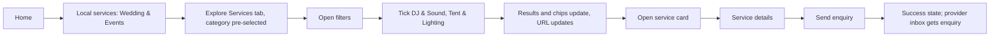
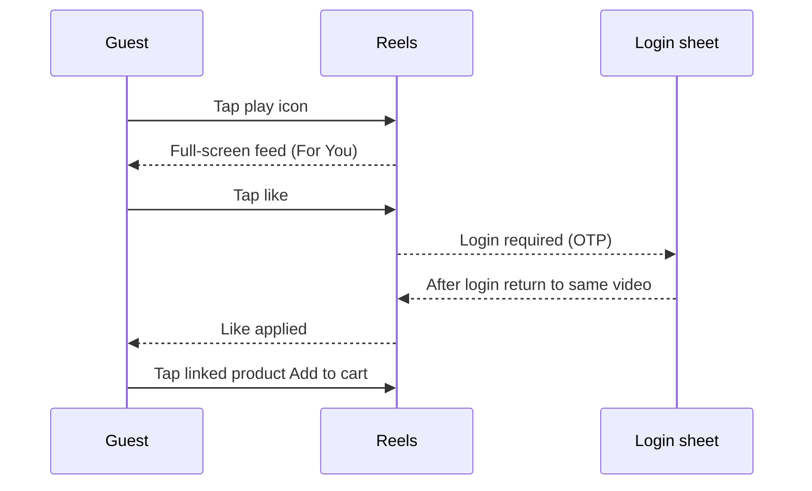

# 03 User flows

- **Purpose:** Every clickable flow, step by step, with Mermaid diagrams and the feature/screen IDs used.
- **Audience:** Copilot agents and developers
- **Related:** 01-feature-inventory.md, 02-screen-inventory.md
- **Last updated:** 2026-11-10

Source flows are runnable in the prototype (`reference/apnatown-prototype.html` -> Account -> Design system -> "Patterns & flows" and the Round 2 flows tab). J15 is the product-owner-requested provider billing flow and has no prototype screen.

## J1 Browse -> category -> Explore -> product -> cart -> split checkout -> track -> OTP delivery -> review
Features: F-HM-003, F-EX-001..002, F-PD-001..003, F-CK-001..008, F-OR-001..003, F-RV-001..003

```mermaid
flowchart LR
A[Home] --> B[Tap category tile]
B --> C[Explore Products with category pill]
C --> D[Product details]
D --> E[Add to cart]
E --> F[Cart grouped by shop]
F --> G[Checkout: choose delivery or pickup per shop]
G --> H[Pay online or COD]
H --> I[Order per shop created]
I --> J[Track: timeline, rider, OTP]
J --> K[Delivered with OTP]
K --> L[Review eligible]
```

Steps: 1 customer taps a category tile; 2 Explore opens on Products tab with that category pre-applied (also Shops and Services tabs); 3 open product; 4 Add to cart (login prompt if guest, then return); 5 cart shows lines grouped by business and notice "Your order will be split into N shops"; 6 per shop choose delivery/pickup, select address, see fee, check minimum order and range; 7 pay; 8 N orders created with ids; 9 tracking page with timeline; 10 delivery OTP shown; rider enters it; 11 delivered; 12 review prompt (verified purchaser).
Failure paths: payment failed -> retry or pay on delivery; out of range -> message; below minimum -> disabled place order.

## J2 Home -> Wedding & Events -> Explore Services -> filters -> DJ & Sound + Tent & Lighting -> service card -> details -> enquiry
Features: F-HM-004, F-EX-001..012, F-SV-001..007

URL after step 5: `/explore?tab=services&category=wedding-events&subcategory=dj-sound,tent-lighting`.

## J3 Offer -> product / service / list
Features: F-HM-005, F-OF-001..004, F-PD-004
Rules: single product -> product page with offer banner; service offer -> service page; multi-product -> Explore Products filtered by offer ids with removable chip; shop-wide -> shop page. Expired offer shows "Offer expired" and regular price; out-of-stock shows "Out of stock" banner.

## J4 Play -> Reels -> follow/like/share -> linked product -> add to cart
Features: F-RL-001..009, F-EG-003..006

## J5 Search "AC" and "iPhone 15" -> grouped results -> service details
Features: F-SR-001..010. "AC": Products (Split AC, Window AC), Shops (electronics), Services (AC Installation, AC Repair, AC Gas Refill) with label "Related services for AC", Videos. On the Services tab the user ticks AC Repair and AC Installation. "iPhone 15": products, mobile shops, services Mobile Repair/Screen Replacement.

## J6 Vendor uploads a video, links products, chooses Gallery option -> admin approves -> public Reels and Gallery
Features: F-VD-012..013, F-AD-010, F-RL-010, F-PF-009..010
Steps: vendor pastes YouTube/Instagram link (validated, preview) -> caption, hashtags, thumbnail -> link products/services -> toggles Show in Gallery / Show in Reels -> status pending -> admin Video moderation approves (or rejects with reason) -> vendor notified -> video appears in feed, Videos/Reels tab and Gallery.

## J7 Vendor onboarding -> approval -> first product -> first order -> accept -> ready -> rider -> OTP delivery -> earnings
Features: F-VD-001..008, F-AD-002, F-RD-001..006
## J8 Cancel / refund / dispute
Features: F-OR-005..008, F-AD-007, F-VD-008. Customer cancels or requests refund -> admin and vendor notified -> case opened -> admin resolves (approve refund, notes) -> refund tracker requested/approved/completed.
## J9 Subcategory suggestion -> admin approve/reject/merge -> notification
Features: F-VD-006, F-AD-006. Duplicate detection warns "Similar subcategory already exists". Merge maps to existing; suggester notified; approved subcategory appears in the Explore services filter.
## J10 Super admin operations
Features: F-SA-002..004, F-AD-008, F-AD-012. Deactivate admin (confirmation naming impact), edit/delete role (reassign rule), draw a zone on city detail, communications with scope and review-before-send step, live map city filter.
## J11 Rider onboarding -> approval -> online -> request -> deliver
Features: F-RD-001..006.
## J12 Guest -> login by OTP -> profile completion -> return to origin
Features: F-AU-003..006.
## J13 Language switch and dark mode anywhere
Features: F-X-001..002.
## J14 Customer enquiry -> provider inbox -> contacted -> converted -> review eligibility
Features: F-SV-005, F-PV-004, F-RV-002. Statuses: new -> contacted -> converted -> closed. An enquirer becomes review-eligible for that provider.

## J15 Provider Premium purchase, expiry and renewal
Features: F-PV-003, F-PV-005, F-PV-008, F-NT-001.
Provider views own plan status/expiry at S-PROV-18; a configured plan is purchased or manually renewed and entitlement changes only after verified payment. Cancellation records end-at-paid-expiry without a refund or immediate featuring change. At expiry, retained product/service selections become ineffective, owner and scoped admin notices are queued once, and public caches are invalidated. A later verified renewal restores effective featuring for still-selected eligible listings.
