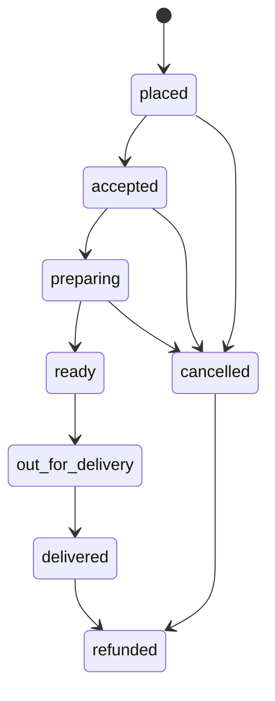

# 07 State machines and business rules

- **Purpose:** Authoritative lifecycle models and rules. Backend enforces them; frontend only reflects them.
- **Audience:** Backend/frontend developers and Copilot agents
- **Related:** 01-feature-inventory.md, 05, 08-permissions-matrix.md, 10-sample-data.json
- **Last updated:** 2026-11-10

## 1. State machines (ST-*)
### ST-order-delivery

### ST-order-pickup
`placed -> accepted -> ready -> picked_up`; `placed|accepted -> cancelled`; `picked_up|cancelled -> refunded` (when a refund completes). Pickup code verified at handover.
### Other models
| ID | States and transitions |
|---|---|
| ST-delivery-job | requested -> accepted -> reached_shop -> picked_up -> reached_drop -> delivered; failed (reasons: customer unreachable, wrong address, customer cancelled, vehicle problem); request expires after 60 s countdown or is rejected |
| ST-approval | pending -> approved / rejected / changes_requested; approved <-> suspended; approved <-> inactive; rejected, changes_requested -> pending (re-submit). Capabilities: pending = edit profile only; approved = full; rejected = see reason + resubmit; suspended = no selling or edits; inactive = can reactivate |
| ST-payment | pending -> paid / failed (retry); COD or pay-at-pickup: pending -> collected; paid/collected -> refunded |
| ST-refund | requested -> approved -> completed; requested -> declined -> escalated |
| ST-review | pending -> published; published -> reported -> hidden or published; deleted |
| ST-offer | pending (awaiting admin) -> active <-> paused -> ended; rejected -> ended |
| ST-video | pending -> approved / rejected(reason); approved -> removed; reported -> removed or dismissed |
| ST-enquiry | new -> contacted -> converted / closed |
| ST-subcategory-suggestion | pending -> approved / rejected(reason) / merged(into existing) |
| ST-comment | pending -> published / removed |
| ST-campaign | scheduled -> sent |
| ST-case | open -> in_review -> resolved |
| ST-city | enabled / disabled / coming_soon |
| ST-admin | active / inactive |

## 2. Business rules (BR-*)
| ID | Rule |
|---|---|
| BR-01 | Money is stored as integer paise; INR; Indian grouping in UI; server computes prices, fees, discounts and totals |
| BR-02 | Timestamps stored in UTC, shown in IST 12-hour |
| BR-03 | One checkout creates one order per shop, each with its own status, mode, payment, OTP/pickup code |
| BR-04 | Order status changes only through the state machine; stock never oversells |
| BR-05 | Delivery OTP and pickup code verified server-side only with attempt limits; never returned to rider/vendor APIs |
| BR-06 | Only approved vendors/providers/riders sell, accept orders or go online |
| BR-07 | Main categories only by super admin; subcategory suggestions need admin approval and duplicate detection |
| BR-08 | Each service has exactly one subcategory; a provider may be expert in several |
| BR-09 | Reviews only from verified purchasers or enquirers; unsafe content goes to moderation |
| BR-10 | Videos public only when approved; reports go to moderation; removed content shows "unavailable" |
| BR-11 | Location optional; WhatsApp/marketing only with recorded consent; opt-outs honoured; consent-aware counts |
| BR-12 | Admins act only within assigned cities/areas and module permissions; sensitive actions audit-logged with before/after |
| BR-13 | A role cannot be deleted while admins use it; system roles cannot be deleted |
| BR-14 | DPDP: minimise, consent, export/delete on request; KYC documents visible only to authorised admins |
| BR-15 | Explore filter state lives in a shareable URL; Explore and Search keep separate filter state |
| BR-16 | Media added to a product/service appears in business Gallery/Reels only if vendor allows (per-item toggle with default) |
| BR-17 | An offer applies only while active and not expired; expired/out-of-stock offers show clear states |
| BR-18 | A service's subcategory drives Explore/Search filters and counts |
| BR-19 | Coupon discount is distributed proportionally across shop orders |
| BR-20 | Customer cancellation or refund request notifies both admin and vendor |
| BR-21 | Guest actions needing login prompt login and return to the same place |
| BR-22 | UI never relies on colour alone for status (icon + text + colour) |

## 3. Formulas and defaults (sample from prototype settings; confirm before launch)
| Item | Value |
|---|---|
| Delivery fee (ApnaTown rider) by distance | up to 2 km Rs 20; up to 4 km Rs 35; up to 7 km Rs 50 (beyond radius = not deliverable) |
| Rider earning per ride | base Rs 20 + Rs 7 per km, rounded to nearest rupee |
| Platform fee | Rs 5 per order |
| Commission | default 6%; plans: Basic Rs 0/month 6%; Growth Rs 499/month 4%; Pro Rs 999/month 3% |
| Promotions | Featured listing (7 days) Rs 199; Homepage banner (7 days) Rs 699 |
| Coupons (sample) | APNA50 flat Rs 50 above Rs 299; WELCOME10 10% off up to Rs 100 |
| Refund request window | 24 hours after delivery |
| Codes and timers | Login OTP 6 digits, resend 30 s; delivery OTP 4 digits; pickup code 4 digits; rider request countdown 60 s |
| Search radius | default 6 km (1-12 slider) |
| Feature flags | reviews on, guestBrowse on, whatsapp on, booking OFF, donations OFF; payments online on, COD on |
| GST | prices include GST; invoice is a printable tax invoice |

## 4. Validation rules
Phone: 10 digits (+91), OTP numeric, 6 digits. PIN: 6 digits. Names 2-60 chars. Price >= 0 integer paise; MRP >= price. Stock >= 0. Embed links: only youtube.com, youtu.be, instagram.com (`/reel/`, `/p/`, `/tv/`) with strict ID extraction. Service price types: from, fixed, range, enquiry (enquiry has no amount). Reviews: 1-5 stars, text <= 1000 chars; links/abusive words held pending. Enquiry message required, preferred date optional and not in the past. Subcategory suggestion: name required, duplicate detection by normalised name.
