# 05 — Domain Model

**Purpose:** Conceptual entities, their relationships, and every status/lifecycle model — **not** a database schema.
**Audience:** Backend engineers, `architect`, `spec-writer`.
**Related files:** [docs/PROJECT.md](../PROJECT.md) (index) · [04-business-rules.md](./04-business-rules.md) · [`docs/architecture.md`](../architecture.md) (module map) · [`database.instructions.md`](../../.github/instructions/database.instructions.md)
**Last updated:** 2026-11-09
**Owner:** Architecture

> This is a **conceptual** model for product understanding. Actual
> table/column design happens later and is owned by
> `database.instructions.md` + per-feature specs in `specs/`.

## 1. Entities (key attributes)

| Entity | Key attributes |
|---|---|
| User | id, phone (E.164), name, email?, roles, status, language, consents |
| Customer profile | linked User, saved addresses |
| Address | label, line, landmark, PIN, area, lat/lng, default |
| Owner (Business or Provider) | id, slug, name (EN/HI), category, status, verified, rating, hours, location, delivery config, followers, media default, pill config, "expert in" subcategories |
| Category | main, product or service, fixed (BR-07) |
| Subcategory | category, name (EN/HI), slug, status |
| ServiceType | subcategory-level service type |
| SubcategorySuggestion | suggested name, category, submitter, status (ST-subcategory-suggestion) |
| Product | owner, category, subcategory, brand, price, MRP, unit, stock, variants, tags, media[], inGallery, featured, status |
| Service | owner, category, **subcategory (one, BR-08)**, price type, amount, unit, inclusions, exclusions, area, media[], active, inGallery, FAQ |
| Offer | owner, type (percent/flat/free delivery), value, validity, products[], services[], status (ST-offer), terms, featured |
| Coupon | code, type, value, minimum, cap |
| Cart / CartLine | customer, lines grouped by owner |
| Order | **per shop** (BR-03): customer, owner, mode, items, amounts in paise, payment, status (ST-order-delivery/-pickup), OTP/pickup code, address, rider, case, refund |
| OrderItem | product/service, quantity, price, availability at fulfilment |
| Payment | order, method, status (ST-payment) |
| Refund | order, reason, status (ST-refund) |
| DeliveryJob | order, rider, status (ST-delivery-job), distance, earning, countdown |
| Rider | profile, vehicle, documents, status (ST-approval), online |
| Review | target (product/shop/service/rider), author, rating, text, tags, status (ST-review), reply |
| Enquiry | service/owner, name, phone, message, preferred date, status (ST-enquiry) |
| Video | owner, source (YouTube/Instagram/upload), id/url, title, caption, hashtags, linked items[], visibility toggles, status (ST-video), counters |
| VideoComment | video, author, text, status (ST-comment) |
| Follow / Like / Heart | User <-> Owner/Video/Photo |
| Notification / NotificationPreference | user, channel, event, read state |
| Consent | type, granted, timestamp |
| Campaign | scope, audience, channels, template, schedule, report, status (ST-campaign) |
| Keyword | key, synonyms[], mapped categories/subcategories/tags |
| City | status, waitlist |
| Area | within a City |
| Zone | polygon, fee slabs, status |
| Admin | assigned cities/areas, role |
| Role | name, system flag, permission matrix |
| AuditLog | actor, action, before, after, time |
| Setting / FeatureFlag | key, value |
| Plan / Promotion / Invoice | commission/billing |

## 2. Entity relationships

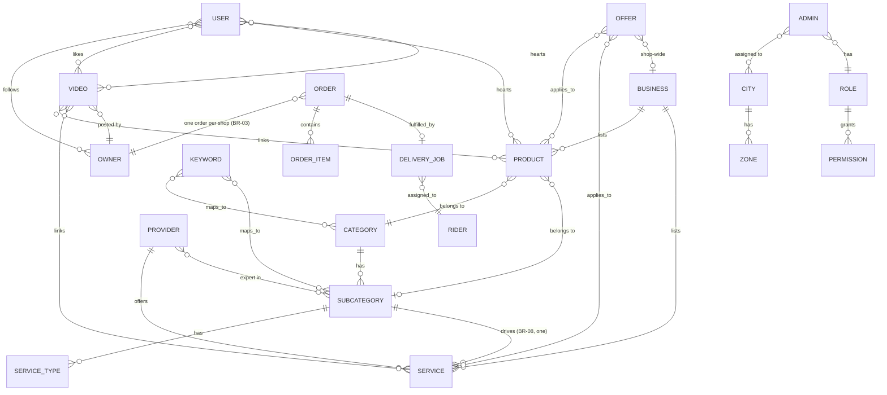

### How Explore, Search, Reels, Offers and Notifications read these relationships

- **Explore/Search** read `Category -< Subcategory -< ServiceType` and
  `Service >- Subcategory` to build the services filter (EX6); they
  read `Keyword -< Category/Subcategory/Tag` for keyword-driven results
  (SR2).
- **Reels** reads `Video >- Owner` and `Video -< linked Product/Service`
  to render the overlay and the linked-items strip (RL5, RL6); `User -<
  Like/Heart/Follow >- Video/Owner` drives engagement counts.
- **Offers** reads `Offer >-< Product/Service/Shop` to resolve where an
  offer card links (OF2).
- **Notifications/Communications** read `User -< Consent` and
  `Admin >-< City/Area` to compute consent-aware, scope-aware recipient
  counts (BR-11, BR-12, AD12).

## 3. Status and lifecycle models

Each model below has a Mermaid `stateDiagram-v2` plus a transition
table. Canonical enum values live in `packages/shared`
(`database.instructions.md`).

### ST-order-delivery

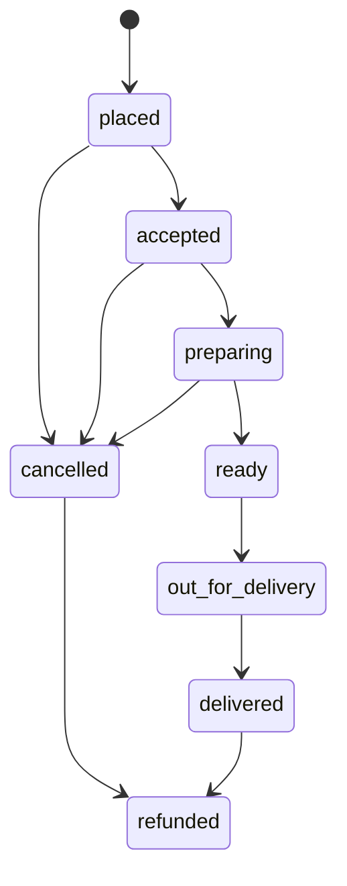

| From | Event | To |
|---|---|---|
| placed | vendor accepts | accepted |
| accepted | vendor marks preparing | preparing |
| preparing | vendor marks ready | ready |
| ready | rider picks up | out_for_delivery |
| out_for_delivery | delivery OTP verified (BR-05) | delivered |
| placed / accepted / preparing | customer or vendor cancels | cancelled |
| cancelled / delivered | refund completes | refunded |

### ST-order-pickup

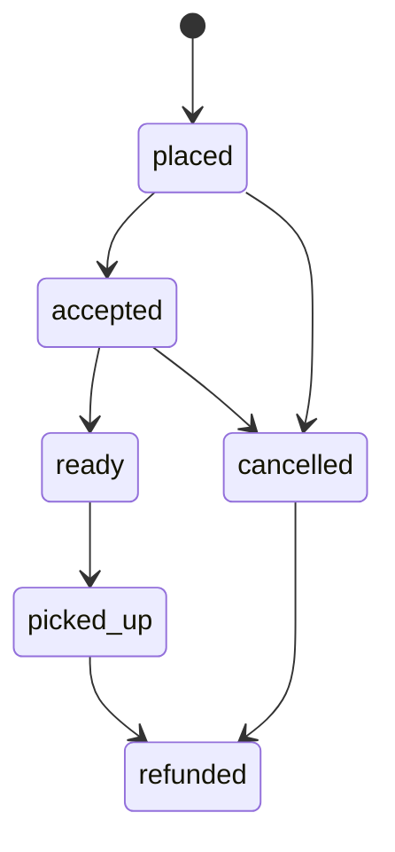

| From | Event | To |
|---|---|---|
| placed | vendor accepts | accepted |
| accepted | vendor marks ready | ready |
| ready | pickup code verified (BR-05) | picked_up |
| placed / accepted | customer or vendor cancels | cancelled |

### ST-delivery-job

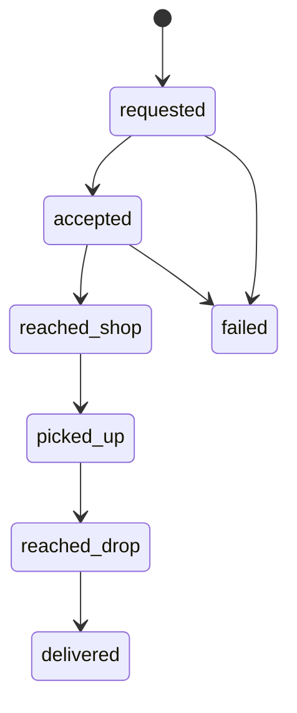

Requests expire after the 60-second countdown or are rejected (-> back
to `requested` for reassignment, or `failed` if no rider available).

### ST-approval

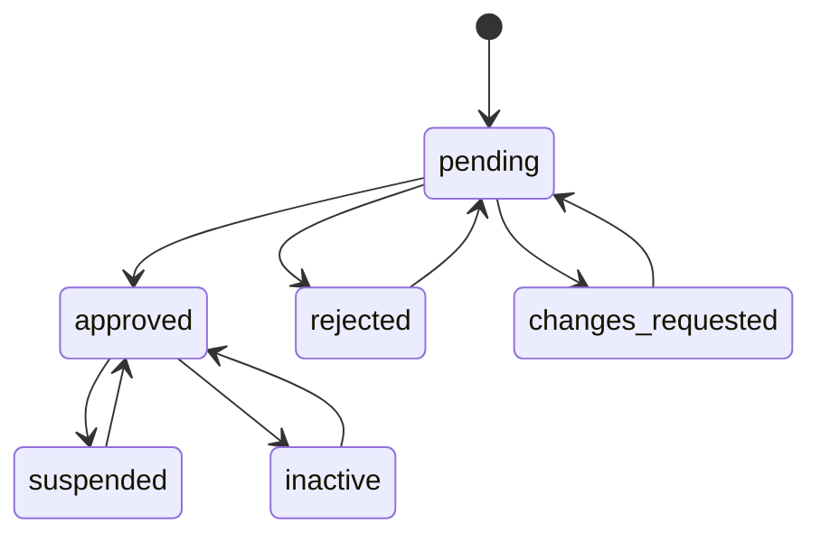

### ST-payment

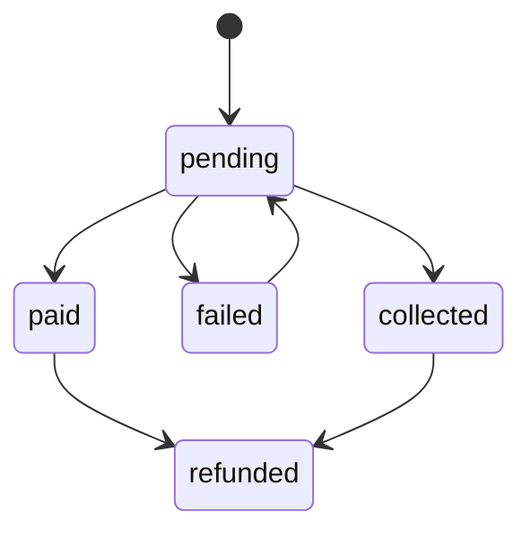

`collected` is the COD/pay-at-pickup path (equivalent to `paid`).

### ST-refund

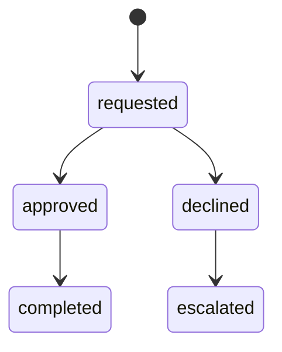

### ST-review

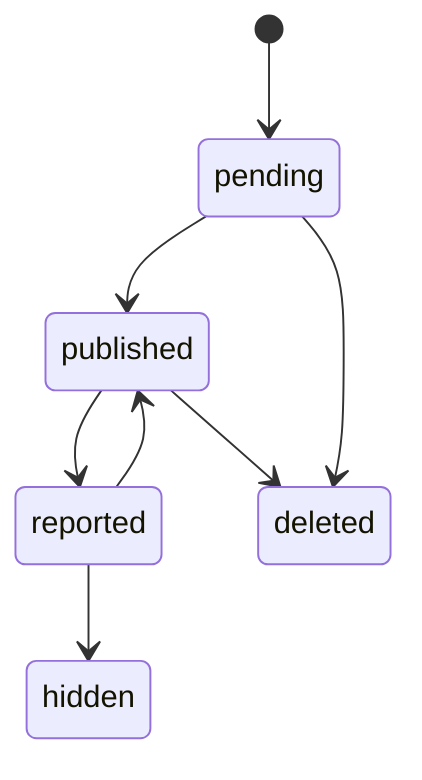

### ST-offer

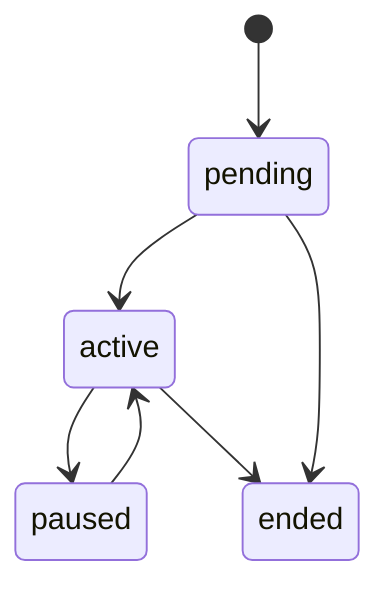

`pending -> ended` is the admin-rejection path.

### ST-video

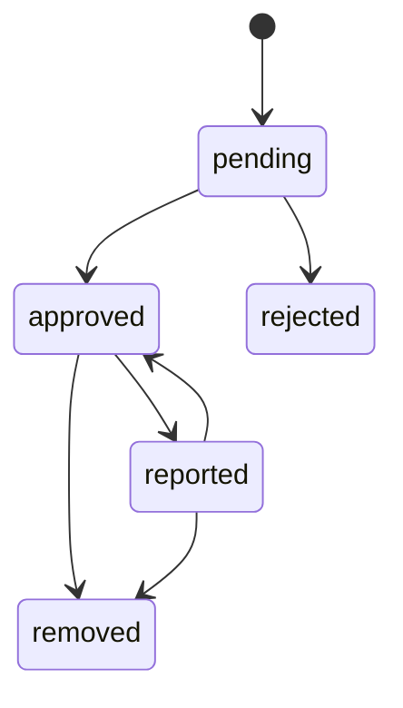

`reported --> approved` is the dismissed-report path.

### ST-enquiry

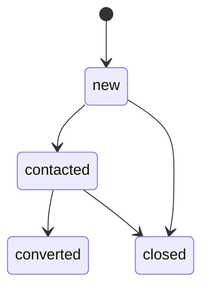

### ST-subcategory-suggestion

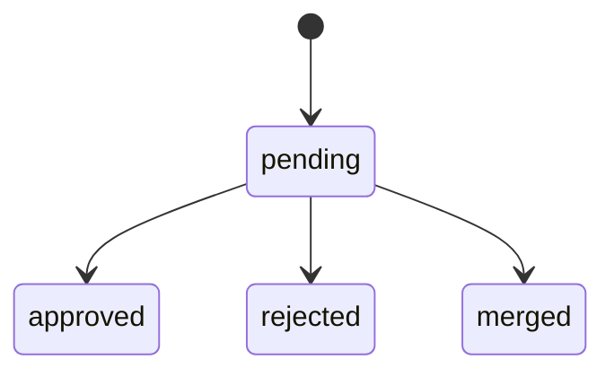

### ST-comment

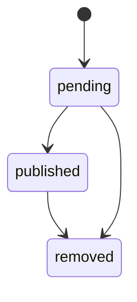

### ST-campaign

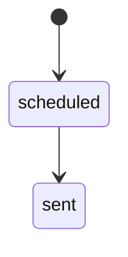

### ST-case (dispute)

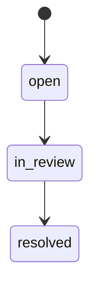
