# Product overview and scope

## Contents

- [Vision and scope](#vision-and-scope)
- [Personas and roles](#personas-and-roles)
- [PRD decisions](#prd-decisions)
- [Phases and boundaries](#phases-and-boundaries)
- [Technology assumptions](#technology-assumptions)
- [Glossary](#glossary)
- [Journey coverage and sequences](#journey-coverage-and-sequences)
- [Feature traceability](#feature-traceability)

## Vision and scope

ApnaTown.in is a mobile-first hyperlocal marketplace and local business discovery platform launching in Padrauna, Kushinagar, Uttar Pradesh. Local businesses list products and services; customers discover nearby businesses, order by delivery/self-pickup, enquire, watch videos/reels, follow and review. The design serves first-time shoppers and non-technical shopkeepers on mid-range Android and slow 3G/4G; English/Hindi, light/dark mode and WCAG 2.2 AA accessibility are required.

- **Brand:** ApnaTown — “Apna Shehar, Apni Dukaan”.
- **Fixed stack:** Next.js App Router + TypeScript + Tailwind + TanStack React Query (`@tanstack/react-query`) for frontend API integration, NestJS + TypeScript, PostgreSQL. Server/client boundaries follow the [shared API contract](../../../specs/_foundation/frontend-shared.md#api-integration-with-react-query).
- **Canonical source:** [Design Context Pack](../../design-context/README.md); prototype HTML and stylesheet control visual/behaviour conflicts, which must be appended to [open issues](../../design-context/11-open-issues-and-assumptions.md).
- **Coverage size:** 206 feature IDs/22 areas; 105 screens; 14 journeys; 16 state models; 22 BRs; 927 EN/HI string pairs.

**Implementation precedence:** the user's 2026-11-12
[media/map decision](../../../specs/_foundation/media-and-maps.md) selects
Cloudinary public-purpose images, link-only YouTube/Instagram videos and
Leaflet/OSM/Geoman Free. It overrides historical upload/provider proposals
throughout P01; source-requirement quotations remain historical evidence,
not permission to implement direct video uploads or choose other providers.

## Personas and roles

| Role | Goals and capabilities | Boundaries |
|---|---|---|
| **Customer (R-01)** | Browse as guest or signed-in user; discover shops/products/services, order, review, follow, like, heart, enquire and save. Login is required only for gated actions. | Server-side authorization; UI visibility is not authorization. |
| **Vendor (R-02)** | Manage own shop, products, services, offers, orders, inventory, media, followers, earnings and account. Approval is required to sell; sees own data only. | Server-side authorization; UI visibility is not authorization. |
| **Service Provider (R-03)** | Manage own provider profile, services, enquiries, media and analytics; may also list products and handle orders. Services are enquiry-only; approval gating applies. | Server-side authorization; UI visibility is not authorization. |
| **Rider (R-04)** | Mobile-first PWA for online/offline, requests, active deliveries, history and earnings. Must be approved; customer data is minimized and calls are masked. | Server-side authorization; UI visibility is not authorization. |
| **Admin (R-05)** | Granted modules only within assigned cities/areas; cannot change main categories, cities/zones, roles or global settings. | Server-side authorization; UI visibility is not authorization. |
| **Super Admin (R-06)** | Platform-wide administration plus admins, roles, cities/zones, settings and main categories; sensitive actions are audited. | Server-side authorization; UI visibility is not authorization. |

## PRD decisions

1. **Account:** Account required to order (mobile OTP); guests may browse. Login-gated actions prompt login and return to origin.
2. **Payments:** Online UPI/cards/net banking/wallets and COD/pay-at-pickup; gateway not chosen.
3. **Order splitting:** One checkout creates one order per shop, each with its own status, mode, payment record and delivery/pickup code.
4. **Delivery:** Vendor delivery or ApnaTown rider per shop/order; self-pickup; distance-based fees.
5. **Services:** Enquiry-only now; booking/quotation/online payment remain feature-flagged off.
6. **Revenue:** Subscriptions, commission and promotion fees; sample values require confirmation.
7. **Rider pay:** Per ride: admin-configurable base plus per-kilometre amount.
8. **Launch geography:** Padrauna first; Kasia coming soon; Deoria/Gorakhpur planned.
9. **Refunds/cancellations:** Notify admin and vendor; admin resolves disputes.
10. **Taxonomy:** Main categories Super Admin-managed; subcategories suggested and admin-approved with duplicate detection/merge.
11. **Service taxonomy:** Exactly one subcategory per service; provider may be expert in several.
12. **Videos:** YouTube/Instagram links only; public only after admin approval; direct video upload disabled.
13. **Media consent:** Product/service media enters business Gallery/Reels only if vendor allows per item.
14. **Location/messaging:** Location optional; WhatsApp/marketing requires recorded opt-in consent.

## Phases and boundaries

| Phase | Scope |
|---|---|
| P0 launch | Discovery (Home, Explore, Search, profiles, product/service details), cart/checkout/orders/tracking, vendor/provider dashboards, rider app, admin/super-admin, notifications, reels/moderation, EN/HI and SEO foundation. |
| P1 | Richer analytics, advanced promotions, vendor staff roles, saved payment methods. |
| P2 | Service booking/quotation/payment, wallet, loyalty, more cities. |
| Off by default / undecided | Donations OFF; service booking OFF; direct video hosting/transcoding disabled by the link-only launch decision. No partial UI may imply enablement. |

## Technology assumptions

The fixed stack and explicit foundation/provider decisions are binding.
Remaining P01 proposals do not authorize production integration; current
owning specs and unresolved operational gates remain authoritative.

| Concern | P01 proposal | Alternative and switch condition |
|---|---|---|
| ORM/repositories | Prisma + PostgreSQL; repository ports and parameterized SQL for PostGIS/query gaps. | TypeORM/Kysely; switch if complex queries/migrations need a SQL-first layer. |
| Cache | No Redis at launch; PostgreSQL remains authoritative and public read fragments use the approved Next.js ISR/tag boundary. No current use is selected because no workload measurement justifies another service. | Reconsider Redis only when production-like metrics show a named hot-read workload misses existing p95 budgets after indexing/query/cache review; an ADR must specify ownership, key/scope, TTL, invalidation, memory bounds, stampede protection, observability and outage behavior. |
| Queue | PostgreSQL `pg-boss` plus transactional outbox is the binding launch choice; do not adopt BullMQ/Redis for these jobs. | A separate broker requires measured throughput/isolation need and an approved architecture decision; Redis adoption alone does not select BullMQ. |
| Search | PostgreSQL FTS + pg_trgm with explicit Hindi/Hinglish keyword map. | OpenSearch if measured quality/volume cannot meet p95. |
| Storage | Selected Cloudinary public-purpose images behind Media/StoragePort; private documents/exports remain separate. | Change only by approved decision for cost/residency/capability; private-storage vendor remains open. |
| Realtime | SSE for server-to-client status; polling fallback on weak network. No high-frequency bidirectional location contract assumed. | WebSockets only if confirmed rider live-location needs demand bidirectional updates. |
| Payments | Evaluate Razorpay first behind provider port; Cashfree alternative; no provider live before Q-01 decision. | Re-evaluate against settlement, method coverage, pricing, uptime and compliance. |
| OTP/SMS | Provider-neutral port; MSG91 candidate only after DLT, delivery and failover review. | Provider/failover remains open Q-15. |
| WhatsApp | Template-approved BSP adapter; consent/STOP handling mandatory; BSP/sender open Q-04. | Select after template approval, deliverability and cost comparison. |
| Maps | Selected Leaflet/OSM with Geoman Free; no geocoding/routing provider selected. | Approved tile provider/self-hosting for capacity/SLA; MapLibre only for justified vector requirements. |
| Video | Typed YouTube/Instagram link embeds and safe Open fallback; direct uploads disabled. | New explicit scope/processing/cost/retention approval required before hosted video. |
| Hosting | Managed application/database hosting in India region is provisional; provider/topology/backups pending residency approval. | Provider-specific deployment after residency, restore and cost requirements. |

## Glossary

| Term | Meaning |
|---|---|
| Shop | Local store that lists products and fulfils shop orders. |
| Service provider | Business/person that lists enquiry-only services and may also list products. |
| Enquiry | Customer request for provider contact; not a booking/payment. |
| Self-pickup | Customer collects from shop; pickup code verified at handover. |
| Offer | Admin-approved promotion subject to active period and stock. |
| Explore state | Shareable URL query state; Search state is independent (BR-15). |
| INR/paise | Store money as integer paise; display Indian grouping (BR-01). |
| IST/UTC | Store timestamps UTC; display IST 12-hour (BR-02). |

## Journey coverage and sequences

All J1-J14 source journey details, diagrams, feature IDs and failure paths are reproduced below. Each journey includes a sequence view and numbered source steps. Any details absent from the source remain open for the owning later prompt; no product rule is inferred here.

### J1 — Browse -> category -> Explore -> product -> cart -> split checkout -> track -> OTP delivery -> review

Features: F-HM-003, F-EX-001..002, F-PD-001..003, F-CK-001..008, F-OR-001..003, F-RV-001..003
```mermaid
flowchart LR
A[Home] --> B[Tap category tile]
B --> C[Explore Products with category pill]
C --> D[Product details]
D --> E[Add to cart]
E --> F[Cart grouped by shop]
F --> G[Checkout: choose delivery or pickup per shop]
G --> H[Pay online or COD]
H --> I[Order per shop created]
I --> J[Track: timeline, rider, OTP]
J --> K[Delivered with OTP]
K --> L[Review eligible]
```
Steps: 1 customer taps a category tile; 2 Explore opens on Products tab with that category pre-applied (also Shops and Services tabs); 3 open product; 4 Add to cart (login prompt if guest, then return); 5 cart shows lines grouped by business and notice "Your order will be split into N shops"; 6 per shop choose delivery/pickup, select address, see fee, check minimum order and range; 7 pay; 8 N orders created with ids; 9 tracking page with timeline; 10 delivery OTP shown; rider enters it; 11 delivered; 12 review prompt (verified purchaser).
Failure paths: payment failed -> retry or pay on delivery; out of range -> message; below minimum -> disabled place order.

**Sequence view (source-bounded):**

```mermaid
sequenceDiagram
  participant C as Customer
  participant H as Home
  participant E as Explore
  participant P as Product
  participant K as Cart/Checkout
  participant Pay as Payment
  participant O as Orders
  participant R as Rider
  C->>H: Select category
  H->>E: Open Products with category applied
  E->>P: Open product
  P->>K: Add item (login gate if guest)
  K->>Pay: Choose per-shop mode/address and pay or COD
  Pay->>O: Create one order per shop
  O-->>C: Tracking timeline and OTP
  R->>O: Verify OTP
  O-->>C: Delivered; review eligible
```

**Steps:**
1. Tap a category tile; Explore opens with that category applied across Products, Shops and Services.
2. Open a product.
3. Add it to the cart; a guest is prompted to log in and returns to the product.
4. Review the cart grouped by business and the split-order notice.
5. For each shop, choose delivery or pickup, select an address, review the fee and check minimum-order and delivery-range rules.
6. Pay online or choose COD.
7. Create one order per shop and show each order ID.
8. Open tracking and view the order timeline.
9. Show the delivery OTP; the rider enters and verifies it server-side.
10. Mark the order delivered and offer a review to the verified purchaser.

### J2 — Home -> Wedding & Events -> Explore Services -> filters -> DJ & Sound + Tent & Lighting -> service card -> details -> enquiry

Features: F-HM-004, F-EX-001..012, F-SV-001..007
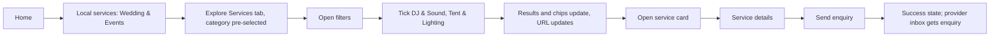
URL after step 5: `/explore?tab=services&category=wedding-events&subcategory=dj-sound,tent-lighting`.

**Sequence view (source-bounded):**

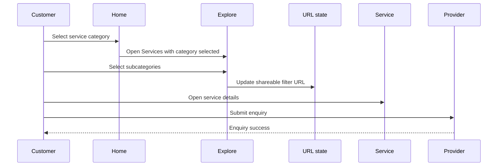

**Steps:**
1. Select Wedding & Events on Home.
2. Open Explore Services with the category pre-selected.
3. Open filters.
4. Select DJ & Sound and Tent & Lighting.
5. Update results, chips and the shareable URL.
6. Open a service card and view its details.
7. Submit an enquiry.
8. Show success and add the enquiry to the provider inbox.

### J3 — Offer -> product / service / list

Features: F-HM-005, F-OF-001..004, F-PD-004
Rules: single product -> product page with offer banner; service offer -> service page; multi-product -> Explore Products filtered by offer ids with removable chip; shop-wide -> shop page. Expired offer shows "Offer expired" and regular price; out-of-stock shows "Out of stock" banner.

**Sequence view (source-bounded):**

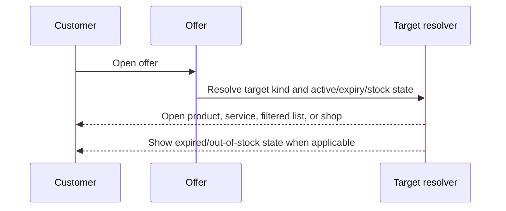

**Steps:**
1. Open an offer.
2. Resolve its target type and active, expiry and stock state.
3. Open the product, service, filtered product list or shop according to the target.
4. For expired or out-of-stock offers, show the specified state and regular price where applicable.

### J4 — Play -> Reels -> follow/like/share -> linked product -> add to cart

Features: F-RL-001..009, F-EG-003..006
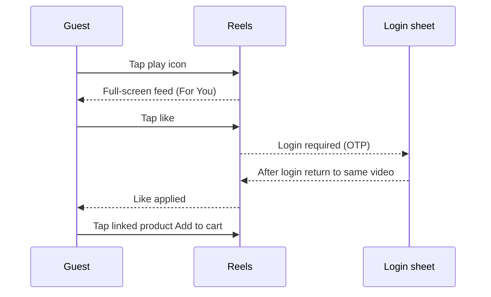

**Sequence view (source-bounded):**

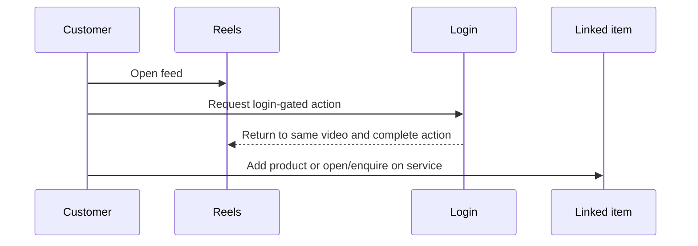

**Steps:**
1. Open the full-screen Reels feed.
2. Follow, like or share a video; prompt a guest to log in for gated actions.
3. After login, return to the same video and complete the action.
4. Open a linked product and add it to the cart.

### J5 — Search "AC" and "iPhone 15" -> grouped results -> service details

Features: F-SR-001..010. "AC": Products (Split AC, Window AC), Shops (electronics), Services (AC Installation, AC Repair, AC Gas Refill) with label "Related services for AC", Videos. On the Services tab the user ticks AC Repair and AC Installation. "iPhone 15": products, mobile shops, services Mobile Repair/Screen Replacement.

**Sequence view (source-bounded):**

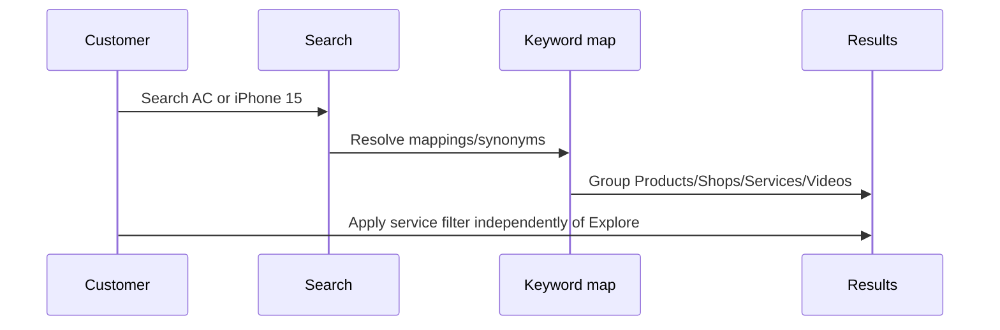

**Steps:**
1. Search for “AC” or “iPhone 15”.
2. Show grouped Products, Shops, Services and Videos results with the stated related-services label.
3. On Services, select AC Repair and AC Installation for “AC”; open service details.

### J6 — Vendor uploads a video, links products, chooses Gallery option -> admin approves -> public Reels and Gallery

Features: F-VD-012..013, F-AD-010, F-RL-010, F-PF-009..010
Steps: vendor pastes YouTube/Instagram link (validated, preview) -> caption, hashtags, thumbnail -> link products/services -> toggles Show in Gallery / Show in Reels -> status pending -> admin Video moderation approves (or rejects with reason) -> vendor notified -> video appears in feed, Videos/Reels tab and Gallery.

**Sequence view (source-bounded):**

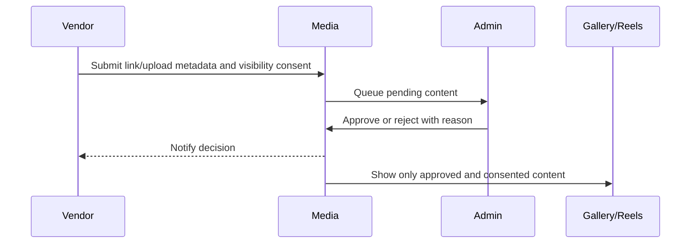

**Steps:**
1. Paste a YouTube or Instagram link and validate/preview it.
2. Add caption, hashtags and thumbnail.
3. Link products or services.
4. Set the per-item Gallery and Reels visibility choices.
5. Submit into pending moderation.
6. Admin approves or rejects with a reason.
7. Notify the vendor; show approved, consented content in the feed, Videos/Reels and Gallery.

### J7 — Vendor onboarding -> approval -> first product -> first order -> accept -> ready -> rider -> OTP delivery -> earnings

Features: F-VD-001..008, F-AD-002, F-RD-001..006

**Sequence view (source-bounded):**

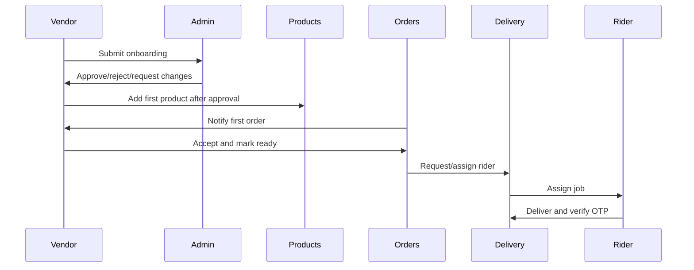

**Steps:**
1. Submit vendor onboarding.
2. Admin approves, rejects or requests changes.
3. After approval, add the first product.
4. Receive the first order.
5. Accept the order and mark it ready.
6. Request and assign a rider.
7. Rider delivers and verifies the OTP.
8. Record the resulting earnings.

### J8 — Cancel / refund / dispute

Features: F-OR-005..008, F-AD-007, F-VD-008. Customer cancels or requests refund -> admin and vendor notified -> case opened -> admin resolves (approve refund, notes) -> refund tracker requested/approved/completed.

**Sequence view (source-bounded):**

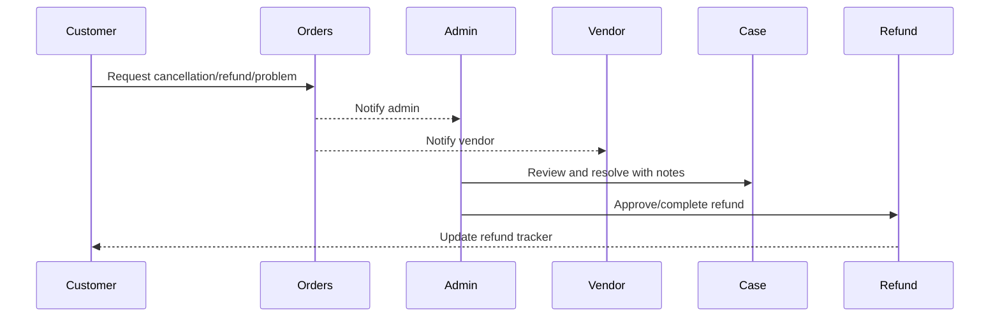

**Steps:**
1. Customer cancels or requests a refund.
2. Notify the admin and vendor.
3. Open a case.
4. Admin resolves it with a decision and notes.
5. Track the refund through requested, approved and completed states when approved.

### J9 — Subcategory suggestion -> admin approve/reject/merge -> notification

Features: F-VD-006, F-AD-006. Duplicate detection warns "Similar subcategory already exists". Merge maps to existing; suggester notified; approved subcategory appears in the Explore services filter.

**Sequence view (source-bounded):**

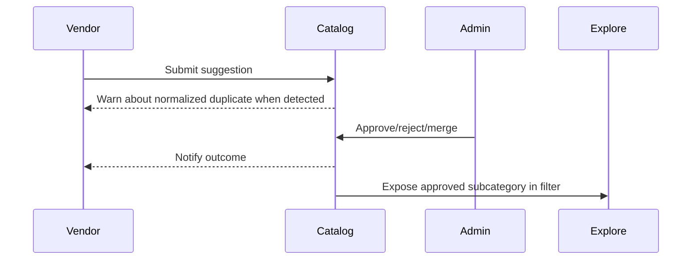

**Steps:**
1. Vendor suggests a subcategory; show similar-name duplicate warnings.
2. Admin approves, rejects or merges the suggestion.
3. Notify the suggester.
4. Make an approved subcategory available in the Explore Services filter.

### J10 — Super admin operations

Features: F-SA-002..004, F-AD-008, F-AD-012. Deactivate admin (confirmation naming impact), edit/delete role (reassign rule), draw a zone on city detail, communications with scope and review-before-send step, live map city filter.

**Sequence view (source-bounded):**

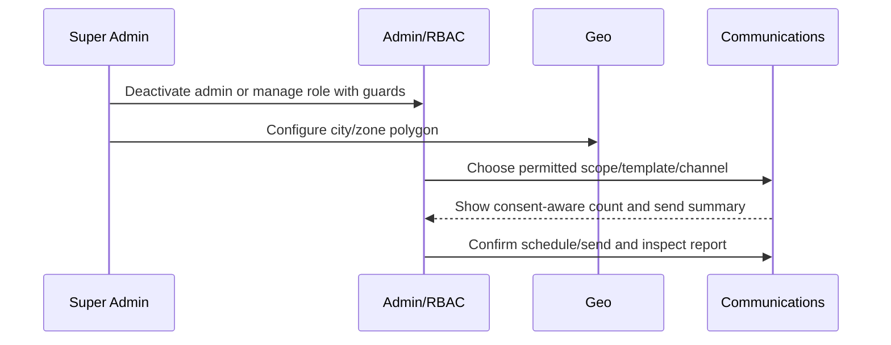

**Steps:**
**Operations (independent):**
- Deactivate an admin and confirm the named impact.
- Edit or delete a role, enforcing reassignment before deletion.
- Draw a zone on a city detail.
- Prepare communications with a scope and review-before-send step.
- Filter the live map by city.

### J11 — Rider onboarding -> approval -> online -> request -> deliver

Features: F-RD-001..006.

**Sequence view (source-bounded):**

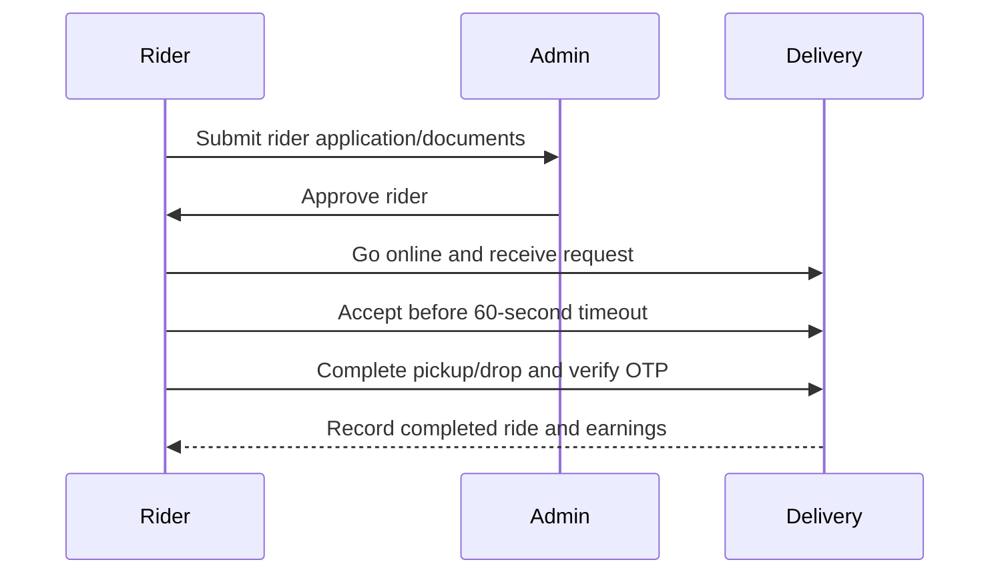

**Steps:**
1. Complete rider onboarding.
2. Obtain admin approval.
3. Go online.
4. Receive and accept a delivery request.
5. Complete delivery.

### J12 — Guest -> login by OTP -> profile completion -> return to origin

Features: F-AU-003..006.

**Sequence view (source-bounded):**

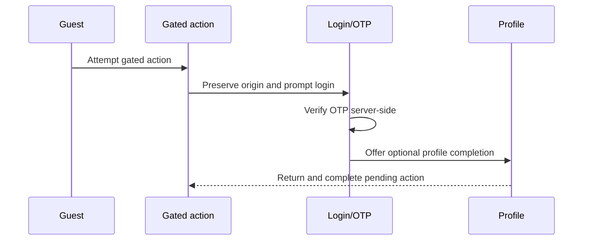

**Steps:**
1. Browse as a guest.
2. Start a login-gated action.
3. Complete mobile OTP login and optional profile completion.
4. Return to the original page/video and complete the action.

### J13 — Language switch and dark mode anywhere

Features: F-X-001..002.

**Sequence view (source-bounded):**

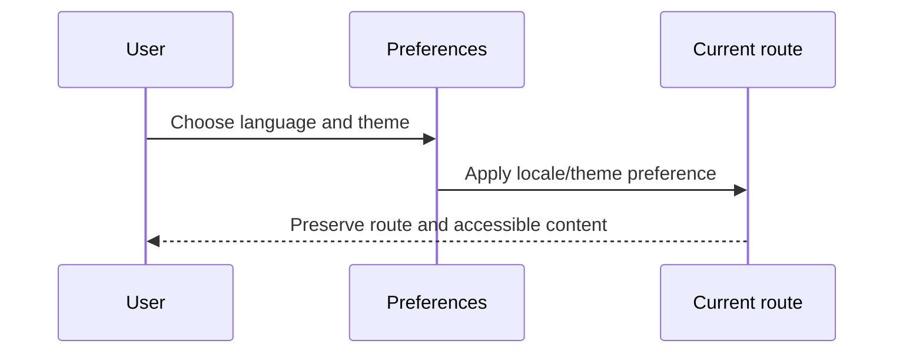

**Steps:**
**Independent settings:**
1. Switch the language between English and Hindi.
2. Set the theme to light, dark or automatic.

### J14 — Customer enquiry -> provider inbox -> contacted -> converted -> review eligibility

Features: F-SV-005, F-PV-004, F-RV-002. Statuses: new -> contacted -> converted -> closed. An enquirer becomes review-eligible for that provider.

**Sequence view (source-bounded):**

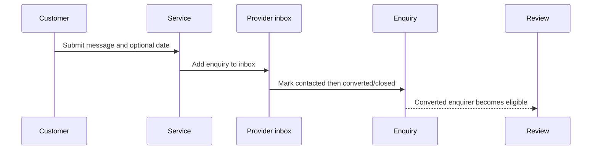

**Steps:**
1. Customer submits an enquiry.
2. Provider receives it in the inbox.
3. Provider marks it contacted.
4. Provider converts or closes the enquiry.
5. A converted enquirer becomes eligible to review that provider.

## Feature traceability

Verification handles below identify manual acceptance scenarios under the
[verification policy](../../../.github/instructions/testing.instructions.md),
not automated test-file deliverables. Preserve these IDs when recording evidence.

| Feature ID | Screen IDs | Journey IDs | API/module handle | Logical data concepts | Shared component refs | Verification handles |
|---|---|---|---|---|---|---|
| F-X-001 | S-CUST-01, S-CUST-38 | J13 | packages/shared, packages/ui | UserPreference | Button, IconButton, AppShell, DashboardShell, EmptyState, OfflineBanner, StatusBadge | F-X-001-HAPPY, F-X-001-NEGATIVE, F-X-001-AUTHZ, F-X-001-EMPTY-ERROR, F-X-001-I18N-HI-LONG |
| F-X-002 | S-CUST-01, S-CUST-38 | J13 | packages/shared, packages/ui | None (presentation preference) | Button, IconButton, AppShell, DashboardShell, EmptyState, OfflineBanner, StatusBadge | F-X-002-HAPPY, F-X-002-NEGATIVE, F-X-002-AUTHZ, F-X-002-EMPTY-ERROR, F-X-002-I18N-HI-LONG |
| F-X-003 | S-CUST-01, S-CUST-38 | None specified | packages/ui | None (presentation-only) | Button, IconButton, AppShell, DashboardShell, EmptyState, OfflineBanner, StatusBadge | F-X-003-HAPPY, F-X-003-NEGATIVE, F-X-003-AUTHZ, F-X-003-EMPTY-ERROR, F-X-003-I18N-HI-LONG |
| F-X-004 | S-CUST-38 | None specified | packages/ui | None (presentation-only) | Button, IconButton, AppShell, DashboardShell, EmptyState, OfflineBanner, StatusBadge | F-X-004-HAPPY, F-X-004-NEGATIVE, F-X-004-AUTHZ, F-X-004-EMPTY-ERROR, F-X-004-I18N-HI-LONG |
| F-X-005 | S-CUST-36 | None specified | packages/ui | None (presentation-only) | Button, IconButton, AppShell, DashboardShell, EmptyState, OfflineBanner, StatusBadge | F-X-005-HAPPY, F-X-005-NEGATIVE, F-X-005-AUTHZ, F-X-005-EMPTY-ERROR, F-X-005-I18N-HI-LONG |
| F-X-006 | S-CUST-21 | None specified | packages/shared, packages/ui | None (transient preference) | Button, IconButton, AppShell, DashboardShell, EmptyState, OfflineBanner, StatusBadge | F-X-006-HAPPY, F-X-006-NEGATIVE, F-X-006-AUTHZ, F-X-006-EMPTY-ERROR, F-X-006-I18N-HI-LONG |
| F-X-007 | S-CUST-01 | None specified | packages/ui | None (presentation-only) | Button, IconButton, AppShell, DashboardShell, EmptyState, OfflineBanner, StatusBadge | F-X-007-HAPPY, F-X-007-NEGATIVE, F-X-007-AUTHZ, F-X-007-EMPTY-ERROR, F-X-007-I18N-HI-LONG |
| F-X-008 | S-CUST-23 | None specified | users, communications | Consent | Button, IconButton, AppShell, DashboardShell, EmptyState, OfflineBanner, StatusBadge | F-X-008-HAPPY, F-X-008-NEGATIVE, F-X-008-AUTHZ, F-X-008-EMPTY-ERROR, F-X-008-I18N-HI-LONG |
| F-X-009 | S-CUST-28, S-CUST-29, S-CUST-34, S-CUST-35, S-CUST-36, S-CUST-37 | None specified | auth, users, packages/ui | Session, User | Button, IconButton, AppShell, DashboardShell, EmptyState, OfflineBanner, StatusBadge | F-X-009-HAPPY, F-X-009-NEGATIVE, F-X-009-AUTHZ, F-X-009-EMPTY-ERROR, F-X-009-I18N-HI-LONG |
| F-X-010 | S-CUST-05, S-CUST-06, S-CUST-07, S-CUST-08, S-CUST-09 | None specified | businesses, products, services, catalog | Business, Product, Service, Category | Button, IconButton, AppShell, DashboardShell, EmptyState, OfflineBanner, StatusBadge | F-X-010-HAPPY, F-X-010-NEGATIVE, F-X-010-AUTHZ, F-X-010-EMPTY-ERROR, F-X-010-I18N-HI-LONG |
| F-X-011 | S-CUST-16, S-VEND-10 | None specified | businesses, products, services, orders | Business, Product, Service, Order | Button, IconButton, AppShell, DashboardShell, EmptyState, OfflineBanner, StatusBadge | F-X-011-HAPPY, F-X-011-NEGATIVE, F-X-011-AUTHZ, F-X-011-EMPTY-ERROR, F-X-011-I18N-HI-LONG |
| F-X-012 | S-CUST-22 | None specified | notifications, communications | NotificationTemplate, Notification, NotificationPreference, Consent | Button, IconButton, AppShell, DashboardShell, EmptyState, OfflineBanner, StatusBadge | F-X-012-HAPPY, F-X-012-NEGATIVE, F-X-012-AUTHZ, F-X-012-EMPTY-ERROR, F-X-012-I18N-HI-LONG |
| F-X-013 | S-CUST-08 | None specified | packages/shared | None (formatting utilities) | Button, IconButton, AppShell, DashboardShell, EmptyState, OfflineBanner, StatusBadge | F-X-013-HAPPY, F-X-013-NEGATIVE, F-X-013-AUTHZ, F-X-013-EMPTY-ERROR, F-X-013-I18N-HI-LONG |
| F-X-014 | S-ADMN-16, S-SUPR-08 | None specified | audit, admin | AuditLog, Admin | Button, IconButton, AppShell, DashboardShell, EmptyState, OfflineBanner, StatusBadge | F-X-014-HAPPY, F-X-014-NEGATIVE, F-X-014-AUTHZ, F-X-014-EMPTY-ERROR, F-X-014-I18N-HI-LONG |
| F-X-015 | S-RIDE-02 | None specified | delivery | Rider, DeliveryJob | Button, IconButton, AppShell, DashboardShell, EmptyState, OfflineBanner, StatusBadge | F-X-015-HAPPY, F-X-015-NEGATIVE, F-X-015-AUTHZ, F-X-015-EMPTY-ERROR, F-X-015-I18N-HI-LONG |
| F-AU-001 | S-CUST-01 | None specified | auth, users | User, Consent | PhoneInput, OtpInput, Input, Sheet, Button, NotificationCard, Toggle | F-AU-001-HAPPY, F-AU-001-NEGATIVE, F-AU-001-AUTHZ, F-AU-001-EMPTY-ERROR, F-AU-001-I18N-HI-LONG |
| F-AU-002 | S-CUST-01 | None specified | auth, users | User, Consent | PhoneInput, OtpInput, Input, Sheet, Button, MapView, AddressForm | F-AU-002-HAPPY, F-AU-002-NEGATIVE, F-AU-002-AUTHZ, F-AU-002-EMPTY-ERROR, F-AU-002-I18N-HI-LONG |
| F-AU-003 | S-CUST-01 | J12 | auth, users | User, Consent | PhoneInput, OtpInput, Input, Sheet, Button, ReviewForm, RatingBreakdown | F-AU-003-HAPPY, F-AU-003-NEGATIVE, F-AU-003-AUTHZ, F-AU-003-EMPTY-ERROR, F-AU-003-I18N-HI-LONG |
| F-AU-004 | S-CUST-27 | J12 | auth, users | User, Consent | PhoneInput, OtpInput, Input, Sheet, Button | F-AU-004-HAPPY, F-AU-004-NEGATIVE, F-AU-004-AUTHZ, F-AU-004-EMPTY-ERROR, F-AU-004-I18N-HI-LONG |
| F-AU-005 | S-CUST-25 | J12 | auth, users | User, Consent | PhoneInput, OtpInput, Input, Sheet, Button | F-AU-005-HAPPY, F-AU-005-NEGATIVE, F-AU-005-AUTHZ, F-AU-005-EMPTY-ERROR, F-AU-005-I18N-HI-LONG |
| F-AU-006 | S-CUST-11 | J12 | auth, users | User, Consent | PhoneInput, OtpInput, Input, Sheet, Button, MediaCarousel, GalleryGrid | F-AU-006-HAPPY, F-AU-006-NEGATIVE, F-AU-006-AUTHZ, F-AU-006-EMPTY-ERROR, F-AU-006-I18N-HI-LONG |
| F-AU-007 | S-CUST-28 | None specified | auth, users | User, Consent | PhoneInput, OtpInput, Input, Sheet, Button | F-AU-007-HAPPY, F-AU-007-NEGATIVE, F-AU-007-AUTHZ, F-AU-007-EMPTY-ERROR, F-AU-007-I18N-HI-LONG |
| F-AU-008 | S-CUST-29 | None specified | auth, users | User, Consent | PhoneInput, OtpInput, Input, Sheet, Button, ServiceCard, EnquiryForm | F-AU-008-HAPPY, F-AU-008-NEGATIVE, F-AU-008-AUTHZ, F-AU-008-EMPTY-ERROR, F-AU-008-I18N-HI-LONG |
| F-HM-001 | S-CUST-01 | None specified | catalog, businesses, products, services, offers, engagement | Product, Service, Offer, Owner | TopBar, CategoryTile, ShopCard, ProductCard, ServiceCard, OfferCard, FilterPanel | F-HM-001-HAPPY, F-HM-001-NEGATIVE, F-HM-001-AUTHZ, F-HM-001-EMPTY-ERROR, F-HM-001-I18N-HI-LONG |
| F-HM-002 | S-CUST-01 | None specified | catalog, businesses, products, services, offers, engagement | Product, Service, Offer, Owner | TopBar, CategoryTile, ShopCard, ProductCard, ServiceCard, OfferCard, DataTable | F-HM-002-HAPPY, F-HM-002-NEGATIVE, F-HM-002-AUTHZ, F-HM-002-EMPTY-ERROR, F-HM-002-I18N-HI-LONG |
| F-HM-003 | S-CUST-01, S-CUST-05 | J1 | catalog, businesses, products, services, offers, engagement | Product, Service, Offer, Owner | TopBar, CategoryTile, ShopCard, ProductCard, ServiceCard, OfferCard, FilterPanel | F-HM-003-HAPPY, F-HM-003-NEGATIVE, F-HM-003-AUTHZ, F-HM-003-EMPTY-ERROR, F-HM-003-I18N-HI-LONG |
| F-HM-004 | S-CUST-01, S-CUST-04, S-CUST-05 | J2 | catalog, businesses, products, services, offers, engagement | Product, Service, Offer, Owner | TopBar, CategoryTile, ShopCard, ProductCard, ServiceCard, OfferCard, FilterPanel | F-HM-004-HAPPY, F-HM-004-NEGATIVE, F-HM-004-AUTHZ, F-HM-004-EMPTY-ERROR, F-HM-004-I18N-HI-LONG |
| F-HM-005 | S-CUST-01 | J3 | catalog, businesses, products, services, offers, engagement | Product, Service, Offer, Owner | TopBar, CategoryTile, ShopCard, ProductCard, ServiceCard, OfferCard, FilterPanel | F-HM-005-HAPPY, F-HM-005-NEGATIVE, F-HM-005-AUTHZ, F-HM-005-EMPTY-ERROR, F-HM-005-I18N-HI-LONG |
| F-HM-006 | S-CUST-01 | None specified | catalog, businesses, products, services, offers, engagement | Product, Service, Offer, Owner | TopBar, CategoryTile, ShopCard, ProductCard, ServiceCard, OfferCard, FilterPanel | F-HM-006-HAPPY, F-HM-006-NEGATIVE, F-HM-006-AUTHZ, F-HM-006-EMPTY-ERROR, F-HM-006-I18N-HI-LONG |
| F-HM-007 | S-CUST-01 | None specified | catalog, businesses, products, services, offers, engagement | Product, Service, Offer, Owner | TopBar, CategoryTile, ShopCard, ProductCard, ServiceCard, OfferCard, FilterPanel | F-HM-007-HAPPY, F-HM-007-NEGATIVE, F-HM-007-AUTHZ, F-HM-007-EMPTY-ERROR, F-HM-007-I18N-HI-LONG |
| F-HM-008 | S-CUST-01 | None specified | catalog, businesses, products, services, offers, engagement | Product, Service, Offer, Owner | TopBar, CategoryTile, ShopCard, ProductCard, ServiceCard, OfferCard | F-HM-008-HAPPY, F-HM-008-NEGATIVE, F-HM-008-AUTHZ, F-HM-008-EMPTY-ERROR, F-HM-008-I18N-HI-LONG |
| F-HM-009 | S-CUST-01 | None specified | catalog, businesses, products, services, offers, engagement | Product, Service, Offer, Owner | TopBar, CategoryTile, ShopCard, ProductCard, ServiceCard, OfferCard, FilterPanel | F-HM-009-HAPPY, F-HM-009-NEGATIVE, F-HM-009-AUTHZ, F-HM-009-EMPTY-ERROR, F-HM-009-I18N-HI-LONG |
| F-HM-010 | S-CUST-01 | None specified | catalog, businesses, products, services, offers, engagement | Product, Service, Offer, Owner | TopBar, CategoryTile, ShopCard, ProductCard, ServiceCard, OfferCard, EnquiryForm | F-HM-010-HAPPY, F-HM-010-NEGATIVE, F-HM-010-AUTHZ, F-HM-010-EMPTY-ERROR, F-HM-010-I18N-HI-LONG |
| F-HM-011 | S-CUST-01 | None specified | catalog, businesses, products, services, offers, engagement | Product, Service, Offer, Owner | TopBar, CategoryTile, ShopCard, ProductCard, ServiceCard, OfferCard, OfferBanner | F-HM-011-HAPPY, F-HM-011-NEGATIVE, F-HM-011-AUTHZ, F-HM-011-EMPTY-ERROR, F-HM-011-I18N-HI-LONG |
| F-HM-012 | S-CUST-01 | None specified | catalog, businesses, products, services, offers, engagement | Product, Service, Offer, Owner | TopBar, CategoryTile, ShopCard, ProductCard, ServiceCard, OfferCard, EnquiryForm | F-HM-012-HAPPY, F-HM-012-NEGATIVE, F-HM-012-AUTHZ, F-HM-012-EMPTY-ERROR, F-HM-012-I18N-HI-LONG |
| F-HM-013 | S-CUST-01 | None specified | catalog, businesses, products, services, offers, engagement | Product, Service, Offer, Owner | TopBar, CategoryTile, ShopCard, ProductCard, ServiceCard, OfferCard | F-HM-013-HAPPY, F-HM-013-NEGATIVE, F-HM-013-AUTHZ, F-HM-013-EMPTY-ERROR, F-HM-013-I18N-HI-LONG |
| F-HM-014 | S-CUST-01 | None specified | catalog, businesses, products, services, offers, engagement | Product, Service, Offer, Owner | TopBar, CategoryTile, ShopCard, ProductCard, ServiceCard, OfferCard, NotificationCard | F-HM-014-HAPPY, F-HM-014-NEGATIVE, F-HM-014-AUTHZ, F-HM-014-EMPTY-ERROR, F-HM-014-I18N-HI-LONG |
| F-LC-001 | S-CUST-01 | None specified | geo | Address, Zone, City | MapView, AddressForm, Select, Sheet, PhoneInput, OtpInput | F-LC-001-HAPPY, F-LC-001-NEGATIVE, F-LC-001-AUTHZ, F-LC-001-EMPTY-ERROR, F-LC-001-I18N-HI-LONG |
| F-LC-002 | S-CUST-02 | None specified | geo | Address, Zone, City | MapView, AddressForm, Select, Sheet | F-LC-002-HAPPY, F-LC-002-NEGATIVE, F-LC-002-AUTHZ, F-LC-002-EMPTY-ERROR, F-LC-002-I18N-HI-LONG |
| F-LC-003 | S-CUST-06, S-CUST-07, S-CUST-09 | None specified | geo | Address, Zone, City | MapView, AddressForm, Select, Sheet | F-LC-003-HAPPY, F-LC-003-NEGATIVE, F-LC-003-AUTHZ, F-LC-003-EMPTY-ERROR, F-LC-003-I18N-HI-LONG |
| F-LC-004 | S-CUST-02 | None specified | geo | Address, Zone, City | MapView, AddressForm, Select, Sheet | F-LC-004-HAPPY, F-LC-004-NEGATIVE, F-LC-004-AUTHZ, F-LC-004-EMPTY-ERROR, F-LC-004-I18N-HI-LONG |
| F-LC-005 | S-CUST-01 | None specified | geo | Address, Zone, City | MapView, AddressForm, Select, Sheet, ServiceCard, EnquiryForm, DataTable | F-LC-005-HAPPY, F-LC-005-NEGATIVE, F-LC-005-AUTHZ, F-LC-005-EMPTY-ERROR, F-LC-005-I18N-HI-LONG |
| F-EX-001 | S-CUST-02 | J1, J2 | search, catalog | Category, Subcategory, Product, Service, Owner | FilterPanel, SubcategoryMultiSelect, CategoryMultiSelect, ActiveFilterChips, MapView, Tabs, ServiceCard | F-EX-001-HAPPY, F-EX-001-NEGATIVE, F-EX-001-AUTHZ, F-EX-001-EMPTY-ERROR, F-EX-001-I18N-HI-LONG |
| F-EX-002 | S-CUST-02 | J1, J2 | search, catalog | Category, Subcategory, Product, Service, Owner | FilterPanel, SubcategoryMultiSelect, CategoryMultiSelect, ActiveFilterChips, MapView, Tabs, ServiceCard | F-EX-002-HAPPY, F-EX-002-NEGATIVE, F-EX-002-AUTHZ, F-EX-002-EMPTY-ERROR, F-EX-002-I18N-HI-LONG |
| F-EX-003 | S-CUST-02 | J2 | search, catalog | Category, Subcategory, Product, Service, Owner | FilterPanel, SubcategoryMultiSelect, CategoryMultiSelect, ActiveFilterChips, MapView, Tabs | F-EX-003-HAPPY, F-EX-003-NEGATIVE, F-EX-003-AUTHZ, F-EX-003-EMPTY-ERROR, F-EX-003-I18N-HI-LONG |
| F-EX-004 | S-CUST-02 | J2 | search, catalog | Category, Subcategory, Product, Service, Owner | FilterPanel, SubcategoryMultiSelect, CategoryMultiSelect, ActiveFilterChips, MapView, Tabs, AddressForm | F-EX-004-HAPPY, F-EX-004-NEGATIVE, F-EX-004-AUTHZ, F-EX-004-EMPTY-ERROR, F-EX-004-I18N-HI-LONG |
| F-EX-005 | S-CUST-02 | J2 | search, catalog | Category, Subcategory, Product, Service, Owner | FilterPanel, SubcategoryMultiSelect, CategoryMultiSelect, ActiveFilterChips, MapView, Tabs, AddressForm | F-EX-005-HAPPY, F-EX-005-NEGATIVE, F-EX-005-AUTHZ, F-EX-005-EMPTY-ERROR, F-EX-005-I18N-HI-LONG |
| F-EX-006 | S-CUST-02 | J2 | search, catalog | Category, Subcategory, Product, Service, Owner | FilterPanel, SubcategoryMultiSelect, CategoryMultiSelect, ActiveFilterChips, MapView, Tabs, AddressForm | F-EX-006-HAPPY, F-EX-006-NEGATIVE, F-EX-006-AUTHZ, F-EX-006-EMPTY-ERROR, F-EX-006-I18N-HI-LONG |
| F-EX-007 | S-CUST-02 | J2 | search, catalog | Category, Subcategory, Product, Service, Owner | FilterPanel, SubcategoryMultiSelect, CategoryMultiSelect, ActiveFilterChips, MapView, Tabs | F-EX-007-HAPPY, F-EX-007-NEGATIVE, F-EX-007-AUTHZ, F-EX-007-EMPTY-ERROR, F-EX-007-I18N-HI-LONG |
| F-EX-008 | S-CUST-02 | J2 | search, catalog | Category, Subcategory, Product, Service, Owner | FilterPanel, SubcategoryMultiSelect, CategoryMultiSelect, ActiveFilterChips, MapView, Tabs, MediaCarousel | F-EX-008-HAPPY, F-EX-008-NEGATIVE, F-EX-008-AUTHZ, F-EX-008-EMPTY-ERROR, F-EX-008-I18N-HI-LONG |
| F-EX-009 | S-CUST-02 | J2 | search, catalog | Category, Subcategory, Product, Service, Owner | FilterPanel, SubcategoryMultiSelect, CategoryMultiSelect, ActiveFilterChips, MapView, Tabs | F-EX-009-HAPPY, F-EX-009-NEGATIVE, F-EX-009-AUTHZ, F-EX-009-EMPTY-ERROR, F-EX-009-I18N-HI-LONG |
| F-EX-010 | S-CUST-02 | J2 | search, catalog | Category, Subcategory, Product, Service, Owner | FilterPanel, SubcategoryMultiSelect, CategoryMultiSelect, ActiveFilterChips, MapView, Tabs | F-EX-010-HAPPY, F-EX-010-NEGATIVE, F-EX-010-AUTHZ, F-EX-010-EMPTY-ERROR, F-EX-010-I18N-HI-LONG |
| F-EX-011 | S-CUST-02 | J2 | search, catalog | Category, Subcategory, Product, Service, Owner | FilterPanel, SubcategoryMultiSelect, CategoryMultiSelect, ActiveFilterChips, MapView, Tabs, AddressForm | F-EX-011-HAPPY, F-EX-011-NEGATIVE, F-EX-011-AUTHZ, F-EX-011-EMPTY-ERROR, F-EX-011-I18N-HI-LONG |
| F-EX-012 | S-CUST-02, S-CUST-03, S-CUST-05 | J2 | search, catalog | Category, Subcategory, Product, Service, Owner | FilterPanel, SubcategoryMultiSelect, CategoryMultiSelect, ActiveFilterChips, MapView, Tabs, ServiceCard | F-EX-012-HAPPY, F-EX-012-NEGATIVE, F-EX-012-AUTHZ, F-EX-012-EMPTY-ERROR, F-EX-012-I18N-HI-LONG |
| F-SR-001 | S-CUST-03 | J5 | search, catalog | Keyword, Product, Service, Owner, Video | SearchBar, SearchResultGroup, FilterPanel, SubcategoryMultiSelect, ActiveFilterChips, MediaCarousel, GalleryGrid | F-SR-001-HAPPY, F-SR-001-NEGATIVE, F-SR-001-AUTHZ, F-SR-001-EMPTY-ERROR, F-SR-001-I18N-HI-LONG |
| F-SR-002 | S-CUST-03 | J5 | search, catalog | Keyword, Product, Service, Owner, Video | SearchBar, SearchResultGroup, FilterPanel, SubcategoryMultiSelect, ActiveFilterChips, MapView, AddressForm | F-SR-002-HAPPY, F-SR-002-NEGATIVE, F-SR-002-AUTHZ, F-SR-002-EMPTY-ERROR, F-SR-002-I18N-HI-LONG |
| F-SR-003 | S-CUST-03 | J5 | search, catalog | Keyword, Product, Service, Owner, Video | SearchBar, SearchResultGroup, FilterPanel, SubcategoryMultiSelect | F-SR-003-HAPPY, F-SR-003-NEGATIVE, F-SR-003-AUTHZ, F-SR-003-EMPTY-ERROR, F-SR-003-I18N-HI-LONG |
| F-SR-004 | S-CUST-03 | J5 | search, catalog | Keyword, Product, Service, Owner, Video | SearchBar, SearchResultGroup, FilterPanel, SubcategoryMultiSelect, ActiveFilterChips, ServiceCard, EnquiryForm | F-SR-004-HAPPY, F-SR-004-NEGATIVE, F-SR-004-AUTHZ, F-SR-004-EMPTY-ERROR, F-SR-004-I18N-HI-LONG |
| F-SR-005 | S-CUST-03 | J5 | search, catalog | Keyword, Product, Service, Owner, Video | SearchBar, SearchResultGroup, FilterPanel, SubcategoryMultiSelect, ActiveFilterChips | F-SR-005-HAPPY, F-SR-005-NEGATIVE, F-SR-005-AUTHZ, F-SR-005-EMPTY-ERROR, F-SR-005-I18N-HI-LONG |
| F-SR-006 | S-CUST-03 | J5 | search, catalog | Keyword, Product, Service, Owner, Video | SearchBar, SearchResultGroup, FilterPanel, SubcategoryMultiSelect, ServiceCard, EnquiryForm | F-SR-006-HAPPY, F-SR-006-NEGATIVE, F-SR-006-AUTHZ, F-SR-006-EMPTY-ERROR, F-SR-006-I18N-HI-LONG |
| F-SR-007 | S-CUST-03 | J5 | search, catalog | Keyword, Product, Service, Owner, Video | SearchBar, SearchResultGroup, FilterPanel, SubcategoryMultiSelect, ActiveFilterChips, ServiceCard, EnquiryForm | F-SR-007-HAPPY, F-SR-007-NEGATIVE, F-SR-007-AUTHZ, F-SR-007-EMPTY-ERROR, F-SR-007-I18N-HI-LONG |
| F-SR-008 | S-CUST-03 | J5 | search, catalog | Keyword, Product, Service, Owner, Video | SearchBar, SearchResultGroup, FilterPanel, SubcategoryMultiSelect, ActiveFilterChips, MapView, AddressForm | F-SR-008-HAPPY, F-SR-008-NEGATIVE, F-SR-008-AUTHZ, F-SR-008-EMPTY-ERROR, F-SR-008-I18N-HI-LONG |
| F-SR-009 | S-CUST-03 | J5 | search, catalog | Keyword, Product, Service, Owner, Video | SearchBar, SearchResultGroup, FilterPanel, SubcategoryMultiSelect, ActiveFilterChips | F-SR-009-HAPPY, F-SR-009-NEGATIVE, F-SR-009-AUTHZ, F-SR-009-EMPTY-ERROR, F-SR-009-I18N-HI-LONG |
| F-SR-010 | S-CUST-03 | J5 | search, catalog | Keyword, Product, Service, Owner, Video | SearchBar, SearchResultGroup, FilterPanel, SubcategoryMultiSelect, ActiveFilterChips | F-SR-010-HAPPY, F-SR-010-NEGATIVE, F-SR-010-AUTHZ, F-SR-010-EMPTY-ERROR, F-SR-010-I18N-HI-LONG |
| F-PF-001 | S-CUST-06, S-CUST-07 | None specified | businesses, products, services, offers, engagement, media-videos | Owner, Product, Service, Video | ShopCard, ServiceCard, Tabs, CategoryPillRow, SubcategoryPillRow, FollowButton, GalleryGrid | F-PF-001-HAPPY, F-PF-001-NEGATIVE, F-PF-001-AUTHZ, F-PF-001-EMPTY-ERROR, F-PF-001-I18N-HI-LONG |
| F-PF-002 | S-CUST-06, S-CUST-07 | None specified | businesses, products, services, offers, engagement, media-videos | Owner, Product, Service, Video | ShopCard, ServiceCard, Tabs, CategoryPillRow, SubcategoryPillRow, FollowButton, GalleryGrid | F-PF-002-HAPPY, F-PF-002-NEGATIVE, F-PF-002-AUTHZ, F-PF-002-EMPTY-ERROR, F-PF-002-I18N-HI-LONG |
| F-PF-003 | S-CUST-06, S-CUST-07 | None specified | businesses, products, services, offers, engagement, media-videos | Owner, Product, Service, Video | ShopCard, ServiceCard, Tabs, CategoryPillRow, SubcategoryPillRow, FollowButton, GalleryGrid | F-PF-003-HAPPY, F-PF-003-NEGATIVE, F-PF-003-AUTHZ, F-PF-003-EMPTY-ERROR, F-PF-003-I18N-HI-LONG |
| F-PF-004 | S-CUST-06, S-CUST-07 | None specified | businesses, products, services, offers, engagement, media-videos | Owner, Product, Service, Video | ShopCard, ServiceCard, Tabs, CategoryPillRow, SubcategoryPillRow, FollowButton, GalleryGrid | F-PF-004-HAPPY, F-PF-004-NEGATIVE, F-PF-004-AUTHZ, F-PF-004-EMPTY-ERROR, F-PF-004-I18N-HI-LONG |
| F-PF-005 | S-CUST-06, S-CUST-07 | None specified | businesses, products, services, offers, engagement, media-videos | Owner, Product, Service, Video | ShopCard, ServiceCard, Tabs, CategoryPillRow, SubcategoryPillRow, FollowButton, GalleryGrid | F-PF-005-HAPPY, F-PF-005-NEGATIVE, F-PF-005-AUTHZ, F-PF-005-EMPTY-ERROR, F-PF-005-I18N-HI-LONG |
| F-PF-006 | S-CUST-06, S-CUST-07 | None specified | businesses, products, services, offers, engagement, media-videos | Owner, Product, Service, Video | ShopCard, ServiceCard, Tabs, CategoryPillRow, SubcategoryPillRow, FollowButton, GalleryGrid | F-PF-006-HAPPY, F-PF-006-NEGATIVE, F-PF-006-AUTHZ, F-PF-006-EMPTY-ERROR, F-PF-006-I18N-HI-LONG |
| F-PF-007 | S-CUST-06, S-CUST-07 | None specified | businesses, products, services, offers, engagement, media-videos | Owner, Product, Service, Video | ShopCard, ServiceCard, Tabs, CategoryPillRow, SubcategoryPillRow, FollowButton, GalleryGrid | F-PF-007-HAPPY, F-PF-007-NEGATIVE, F-PF-007-AUTHZ, F-PF-007-EMPTY-ERROR, F-PF-007-I18N-HI-LONG |
| F-PF-008 | S-CUST-06, S-CUST-07 | None specified | businesses, products, services, offers, engagement, media-videos | Owner, Product, Service, Video | ShopCard, ServiceCard, Tabs, CategoryPillRow, SubcategoryPillRow, FollowButton, GalleryGrid | F-PF-008-HAPPY, F-PF-008-NEGATIVE, F-PF-008-AUTHZ, F-PF-008-EMPTY-ERROR, F-PF-008-I18N-HI-LONG |
| F-PF-009 | S-CUST-06, S-CUST-07 | J6 | businesses, products, services, offers, engagement, media-videos | Owner, Product, Service, Video | ShopCard, ServiceCard, Tabs, CategoryPillRow, SubcategoryPillRow, FollowButton, GalleryGrid | F-PF-009-HAPPY, F-PF-009-NEGATIVE, F-PF-009-AUTHZ, F-PF-009-EMPTY-ERROR, F-PF-009-I18N-HI-LONG |
| F-PF-010 | S-CUST-06, S-CUST-07 | J6 | businesses, products, services, offers, engagement, media-videos | Owner, Product, Service, Video | ShopCard, ServiceCard, Tabs, CategoryPillRow, SubcategoryPillRow, FollowButton, GalleryGrid | F-PF-010-HAPPY, F-PF-010-NEGATIVE, F-PF-010-AUTHZ, F-PF-010-EMPTY-ERROR, F-PF-010-I18N-HI-LONG |
| F-PF-011 | S-CUST-06, S-CUST-07 | None specified | businesses, products, services, offers, engagement, media-videos | Owner, Product, Service, Video | ShopCard, ServiceCard, Tabs, CategoryPillRow, SubcategoryPillRow, FollowButton, GalleryGrid | F-PF-011-HAPPY, F-PF-011-NEGATIVE, F-PF-011-AUTHZ, F-PF-011-EMPTY-ERROR, F-PF-011-I18N-HI-LONG |
| F-PF-012 | S-CUST-06, S-CUST-07 | None specified | businesses, products, services, offers, engagement, media-videos | Owner, Product, Service, Video | ShopCard, ServiceCard, Tabs, CategoryPillRow, SubcategoryPillRow, FollowButton, GalleryGrid | F-PF-012-HAPPY, F-PF-012-NEGATIVE, F-PF-012-AUTHZ, F-PF-012-EMPTY-ERROR, F-PF-012-I18N-HI-LONG |
| F-PF-013 | S-CUST-06, S-CUST-07 | None specified | businesses, products, services, offers, engagement, media-videos | Owner, Product, Service, Video | ShopCard, ServiceCard, Tabs, CategoryPillRow, SubcategoryPillRow, FollowButton, GalleryGrid | F-PF-013-HAPPY, F-PF-013-NEGATIVE, F-PF-013-AUTHZ, F-PF-013-EMPTY-ERROR, F-PF-013-I18N-HI-LONG |
| F-PD-001 | S-CUST-08 | J1 | products, offers, reviews, media-videos, engagement | Product, Offer, Review | Breadcrumbs, MediaCarousel, FullScreenViewer, OfferBanner, LinkedItemsStrip, ReviewForm, FilterPanel | F-PD-001-HAPPY, F-PD-001-NEGATIVE, F-PD-001-AUTHZ, F-PD-001-EMPTY-ERROR, F-PD-001-I18N-HI-LONG |
| F-PD-002 | S-CUST-08 | J1 | products, offers, reviews, media-videos, engagement | Product, Offer, Review | Breadcrumbs, MediaCarousel, FullScreenViewer, OfferBanner, LinkedItemsStrip, ReviewForm, GalleryGrid | F-PD-002-HAPPY, F-PD-002-NEGATIVE, F-PD-002-AUTHZ, F-PD-002-EMPTY-ERROR, F-PD-002-I18N-HI-LONG |
| F-PD-003 | S-CUST-08 | J1 | products, offers, reviews, media-videos, engagement | Product, Offer, Review | Breadcrumbs, MediaCarousel, FullScreenViewer, OfferBanner, LinkedItemsStrip, ReviewForm, ProductCard | F-PD-003-HAPPY, F-PD-003-NEGATIVE, F-PD-003-AUTHZ, F-PD-003-EMPTY-ERROR, F-PD-003-I18N-HI-LONG |
| F-PD-004 | S-CUST-08 | J3 | products, offers, reviews, media-videos, engagement | Product, Offer, Review | Breadcrumbs, MediaCarousel, FullScreenViewer, OfferBanner, LinkedItemsStrip, ReviewForm, OfferCard | F-PD-004-HAPPY, F-PD-004-NEGATIVE, F-PD-004-AUTHZ, F-PD-004-EMPTY-ERROR, F-PD-004-I18N-HI-LONG |
| F-PD-005 | S-CUST-08 | None specified | products, offers, reviews, media-videos, engagement | Product, Offer, Review | Breadcrumbs, MediaCarousel, FullScreenViewer, OfferBanner, LinkedItemsStrip, ReviewForm, GalleryGrid | F-PD-005-HAPPY, F-PD-005-NEGATIVE, F-PD-005-AUTHZ, F-PD-005-EMPTY-ERROR, F-PD-005-I18N-HI-LONG |
| F-PD-006 | S-CUST-06, S-CUST-08 | None specified | products, offers, reviews, media-videos, engagement | Product, Offer, Review | Breadcrumbs, MediaCarousel, FullScreenViewer, OfferBanner, LinkedItemsStrip, ReviewForm, OrderCard | F-PD-006-HAPPY, F-PD-006-NEGATIVE, F-PD-006-AUTHZ, F-PD-006-EMPTY-ERROR, F-PD-006-I18N-HI-LONG |
| F-PD-007 | S-CUST-08 | None specified | products, offers, reviews, media-videos, engagement | Product, Offer, Review | Breadcrumbs, MediaCarousel, FullScreenViewer, OfferBanner, LinkedItemsStrip, ReviewForm, RatingBreakdown | F-PD-007-HAPPY, F-PD-007-NEGATIVE, F-PD-007-AUTHZ, F-PD-007-EMPTY-ERROR, F-PD-007-I18N-HI-LONG |
| F-PD-008 | S-CUST-08 | None specified | products, offers, reviews, media-videos, engagement | Product, Offer, Review | Breadcrumbs, MediaCarousel, FullScreenViewer, OfferBanner, LinkedItemsStrip, ReviewForm, FilterPanel | F-PD-008-HAPPY, F-PD-008-NEGATIVE, F-PD-008-AUTHZ, F-PD-008-EMPTY-ERROR, F-PD-008-I18N-HI-LONG |
| F-PD-009 | S-CUST-08 | None specified | products, offers, reviews, media-videos, engagement | Product, Offer, Review | Breadcrumbs, MediaCarousel, FullScreenViewer, OfferBanner, LinkedItemsStrip, ReviewForm, GalleryGrid | F-PD-009-HAPPY, F-PD-009-NEGATIVE, F-PD-009-AUTHZ, F-PD-009-EMPTY-ERROR, F-PD-009-I18N-HI-LONG |
| F-SV-001 | S-CUST-04, S-CUST-09 | J2 | services, businesses, offers, reviews, media-videos, engagement | Service, Owner, Enquiry | ServiceCard, MediaCarousel, EnquiryForm, FollowButton, ReviewForm, FilterPanel, SubcategoryMultiSelect | F-SV-001-HAPPY, F-SV-001-NEGATIVE, F-SV-001-AUTHZ, F-SV-001-EMPTY-ERROR, F-SV-001-I18N-HI-LONG |
| F-SV-002 | S-CUST-09 | J2 | services, businesses, offers, reviews, media-videos, engagement | Service, Owner, Enquiry | ServiceCard, MediaCarousel, EnquiryForm, FollowButton, ReviewForm, FilterPanel, SubcategoryMultiSelect | F-SV-002-HAPPY, F-SV-002-NEGATIVE, F-SV-002-AUTHZ, F-SV-002-EMPTY-ERROR, F-SV-002-I18N-HI-LONG |
| F-SV-003 | S-CUST-09 | J2 | services, businesses, offers, reviews, media-videos, engagement | Service, Owner, Enquiry | ServiceCard, MediaCarousel, EnquiryForm, FollowButton, ReviewForm, MapView, AddressForm | F-SV-003-HAPPY, F-SV-003-NEGATIVE, F-SV-003-AUTHZ, F-SV-003-EMPTY-ERROR, F-SV-003-I18N-HI-LONG |
| F-SV-004 | S-CUST-09 | J2 | services, businesses, offers, reviews, media-videos, engagement | Service, Owner, Enquiry | ServiceCard, MediaCarousel, EnquiryForm, FollowButton, ReviewForm, GalleryGrid, ReelsPlayer | F-SV-004-HAPPY, F-SV-004-NEGATIVE, F-SV-004-AUTHZ, F-SV-004-EMPTY-ERROR, F-SV-004-I18N-HI-LONG |
| F-SV-005 | S-CUST-09 | J2, J14 | services, businesses, offers, reviews, media-videos, engagement | Service, Owner, Enquiry | ServiceCard, MediaCarousel, EnquiryForm, FollowButton, ReviewForm, ProductCard, QuantityStepper | F-SV-005-HAPPY, F-SV-005-NEGATIVE, F-SV-005-AUTHZ, F-SV-005-EMPTY-ERROR, F-SV-005-I18N-HI-LONG |
| F-SV-006 | S-CUST-09 | J2 | services, businesses, offers, reviews, media-videos, engagement | Service, Owner, Enquiry | ServiceCard, MediaCarousel, EnquiryForm, FollowButton, ReviewForm, RatingBreakdown, ReviewCard | F-SV-006-HAPPY, F-SV-006-NEGATIVE, F-SV-006-AUTHZ, F-SV-006-EMPTY-ERROR, F-SV-006-I18N-HI-LONG |
| F-SV-007 | S-CUST-09 | J2 | services, businesses, offers, reviews, media-videos, engagement | Service, Owner, Enquiry | ServiceCard, MediaCarousel, EnquiryForm, FollowButton, ReviewForm, FilterPanel, SubcategoryMultiSelect | F-SV-007-HAPPY, F-SV-007-NEGATIVE, F-SV-007-AUTHZ, F-SV-007-EMPTY-ERROR, F-SV-007-I18N-HI-LONG |
| F-SV-008 | S-CUST-07, S-CUST-09, S-VEND-13 | None specified | services, businesses, offers, reviews, media-videos, engagement | Service, Owner, Enquiry | ServiceCard, MediaCarousel, EnquiryForm, FollowButton, ReviewForm, FilterPanel, SubcategoryMultiSelect | F-SV-008-HAPPY, F-SV-008-NEGATIVE, F-SV-008-AUTHZ, F-SV-008-EMPTY-ERROR, F-SV-008-I18N-HI-LONG |
| F-OF-001 | S-CUST-20 | J3 | offers, products, services | Offer, Product, Service | OfferCard, OfferBanner, FilterPanel, SubcategoryMultiSelect, ActiveFilterChips | F-OF-001-HAPPY, F-OF-001-NEGATIVE, F-OF-001-AUTHZ, F-OF-001-EMPTY-ERROR, F-OF-001-I18N-HI-LONG |
| F-OF-002 | S-CUST-08, S-CUST-20 | J3 | offers, products, services | Offer, Product, Service | OfferCard, OfferBanner, FilterPanel, SubcategoryMultiSelect, ActiveFilterChips, ServiceCard, EnquiryForm | F-OF-002-HAPPY, F-OF-002-NEGATIVE, F-OF-002-AUTHZ, F-OF-002-EMPTY-ERROR, F-OF-002-I18N-HI-LONG |
| F-OF-003 | S-CUST-08, S-CUST-20 | J3 | offers, products, services | Offer, Product, Service | OfferCard, OfferBanner, FilterPanel, ProductCard, QuantityStepper, PaymentMethodPicker, DataTable | F-OF-003-HAPPY, F-OF-003-NEGATIVE, F-OF-003-AUTHZ, F-OF-003-EMPTY-ERROR, F-OF-003-I18N-HI-LONG |
| F-OF-004 | S-CUST-20 | J3 | offers, products, services | Offer, Product, Service | OfferCard, OfferBanner, FilterPanel | F-OF-004-HAPPY, F-OF-004-NEGATIVE, F-OF-004-AUTHZ, F-OF-004-EMPTY-ERROR, F-OF-004-I18N-HI-LONG |
| F-OF-005 | S-VEND-07 | None specified | offers, products, services | Offer, Product, Service | OfferCard, OfferBanner, FilterPanel, DataTable, PermissionMatrix, AuditDiff | F-OF-005-HAPPY, F-OF-005-NEGATIVE, F-OF-005-AUTHZ, F-OF-005-EMPTY-ERROR, F-OF-005-I18N-HI-LONG |
| F-CK-001 | S-CUST-10 | J1 | cart-checkout, products, businesses, payments, orders | Cart, CartLine, Address, Coupon | QuantityStepper, AddressForm, PaymentMethodPicker, CouponField, Button, OfferCard, OfferBanner | F-CK-001-HAPPY, F-CK-001-NEGATIVE, F-CK-001-AUTHZ, F-CK-001-EMPTY-ERROR, F-CK-001-I18N-HI-LONG |
| F-CK-002 | S-CUST-10, S-CUST-11 | J1 | cart-checkout, products, businesses, payments, orders | Cart, CartLine, Address, Coupon | QuantityStepper, AddressForm, PaymentMethodPicker, CouponField, Button, PhoneInput, OtpInput | F-CK-002-HAPPY, F-CK-002-NEGATIVE, F-CK-002-AUTHZ, F-CK-002-EMPTY-ERROR, F-CK-002-I18N-HI-LONG |
| F-CK-003 | S-CUST-10, S-CUST-11 | J1 | cart-checkout, products, businesses, payments, orders | Cart, CartLine, Address, Coupon | QuantityStepper, AddressForm, PaymentMethodPicker, CouponField, Button, OrderCard, Timeline | F-CK-003-HAPPY, F-CK-003-NEGATIVE, F-CK-003-AUTHZ, F-CK-003-EMPTY-ERROR, F-CK-003-I18N-HI-LONG |
| F-CK-004 | S-CUST-11, S-CUST-26 | J1 | cart-checkout, products, businesses, payments, orders | Cart, CartLine, Address, Coupon | QuantityStepper, AddressForm, PaymentMethodPicker, CouponField, Button, MapView | F-CK-004-HAPPY, F-CK-004-NEGATIVE, F-CK-004-AUTHZ, F-CK-004-EMPTY-ERROR, F-CK-004-I18N-HI-LONG |
| F-CK-005 | S-CUST-10, S-CUST-11 | J1 | cart-checkout, products, businesses, payments, orders | Cart, CartLine, Address, Coupon | QuantityStepper, AddressForm, PaymentMethodPicker, CouponField, Button, OrderCard, Timeline | F-CK-005-HAPPY, F-CK-005-NEGATIVE, F-CK-005-AUTHZ, F-CK-005-EMPTY-ERROR, F-CK-005-I18N-HI-LONG |
| F-CK-006 | S-CUST-11 | J1 | cart-checkout, products, businesses, payments, orders | Cart, CartLine, Address, Coupon | QuantityStepper, AddressForm, PaymentMethodPicker, CouponField, Button, ProductCard | F-CK-006-HAPPY, F-CK-006-NEGATIVE, F-CK-006-AUTHZ, F-CK-006-EMPTY-ERROR, F-CK-006-I18N-HI-LONG |
| F-CK-007 | S-CUST-11 | J1 | cart-checkout, products, businesses, payments, orders | Cart, CartLine, Address, Coupon | QuantityStepper, AddressForm, PaymentMethodPicker, CouponField, Button, OrderCard, Timeline | F-CK-007-HAPPY, F-CK-007-NEGATIVE, F-CK-007-AUTHZ, F-CK-007-EMPTY-ERROR, F-CK-007-I18N-HI-LONG |
| F-CK-008 | S-CUST-11, S-CUST-12 | J1 | cart-checkout, products, businesses, payments, orders | Cart, CartLine, Address, Coupon | QuantityStepper, AddressForm, PaymentMethodPicker, CouponField, Button, OrderCard, Timeline | F-CK-008-HAPPY, F-CK-008-NEGATIVE, F-CK-008-AUTHZ, F-CK-008-EMPTY-ERROR, F-CK-008-I18N-HI-LONG |
| F-CK-009 | S-CUST-10 | None specified | cart-checkout, products, businesses, payments, orders | Cart, CartLine, Address, Coupon | QuantityStepper, AddressForm, PaymentMethodPicker, CouponField, Button, OfferCard, OfferBanner | F-CK-009-HAPPY, F-CK-009-NEGATIVE, F-CK-009-AUTHZ, F-CK-009-EMPTY-ERROR, F-CK-009-I18N-HI-LONG |
| F-OR-001 | S-CUST-13, S-CUST-14 | J1 | orders, delivery, payments, notifications | Order, OrderItem, Payment, DeliveryJob, Refund | OrderCard, Timeline, DeliveryCard, Button, FilterPanel, SubcategoryMultiSelect, ActiveFilterChips | F-OR-001-HAPPY, F-OR-001-NEGATIVE, F-OR-001-AUTHZ, F-OR-001-EMPTY-ERROR, F-OR-001-I18N-HI-LONG |
| F-OR-002 | S-CUST-14 | J1 | orders, delivery, payments, notifications | Order, OrderItem, Payment, DeliveryJob, Refund | OrderCard, Timeline, DeliveryCard, Button | F-OR-002-HAPPY, F-OR-002-NEGATIVE, F-OR-002-AUTHZ, F-OR-002-EMPTY-ERROR, F-OR-002-I18N-HI-LONG |
| F-OR-003 | S-CUST-14 | J1 | orders, delivery, payments, notifications | Order, OrderItem, Payment, DeliveryJob, Refund | OrderCard, Timeline, DeliveryCard, Button, PhoneInput, OtpInput, Sheet | F-OR-003-HAPPY, F-OR-003-NEGATIVE, F-OR-003-AUTHZ, F-OR-003-EMPTY-ERROR, F-OR-003-I18N-HI-LONG |
| F-OR-004 | S-CUST-14 | None specified | orders, delivery, payments, notifications | Order, OrderItem, Payment, DeliveryJob, Refund | OrderCard, Timeline, DeliveryCard, Button, MapView, AddressForm | F-OR-004-HAPPY, F-OR-004-NEGATIVE, F-OR-004-AUTHZ, F-OR-004-EMPTY-ERROR, F-OR-004-I18N-HI-LONG |
| F-OR-005 | S-CUST-14, S-CUST-16 | J8 | orders, delivery, payments, notifications | Order, OrderItem, Payment, DeliveryJob, Refund | OrderCard, Timeline, DeliveryCard, Button, DataTable, PermissionMatrix, AuditDiff | F-OR-005-HAPPY, F-OR-005-NEGATIVE, F-OR-005-AUTHZ, F-OR-005-EMPTY-ERROR, F-OR-005-I18N-HI-LONG |
| F-OR-006 | S-CUST-14, S-CUST-15 | J8 | orders, delivery, payments, notifications | Order, OrderItem, Payment, DeliveryJob, Refund | OrderCard, Timeline, DeliveryCard, Button, DataTable, PermissionMatrix, AuditDiff | F-OR-006-HAPPY, F-OR-006-NEGATIVE, F-OR-006-AUTHZ, F-OR-006-EMPTY-ERROR, F-OR-006-I18N-HI-LONG |
| F-OR-007 | S-CUST-14, S-VEND-04 | J8 | orders, delivery, payments, notifications | Order, OrderItem, Payment, DeliveryJob, Refund | OrderCard, Timeline, DeliveryCard, Button | F-OR-007-HAPPY, F-OR-007-NEGATIVE, F-OR-007-AUTHZ, F-OR-007-EMPTY-ERROR, F-OR-007-I18N-HI-LONG |
| F-OR-008 | S-CUST-14 | J8 | orders, delivery, payments, notifications | Order, OrderItem, Payment, DeliveryJob, Refund | OrderCard, Timeline, DeliveryCard, Button | F-OR-008-HAPPY, F-OR-008-NEGATIVE, F-OR-008-AUTHZ, F-OR-008-EMPTY-ERROR, F-OR-008-I18N-HI-LONG |
| F-RV-001 | S-CUST-18 | J1 | reviews, media-videos | Review | ReviewForm, RatingBreakdown, ReviewCard, Button, OrderCard, Timeline, DeliveryCard | F-RV-001-HAPPY, F-RV-001-NEGATIVE, F-RV-001-AUTHZ, F-RV-001-EMPTY-ERROR, F-RV-001-I18N-HI-LONG |
| F-RV-002 | S-CUST-18 | J1, J14 | reviews, media-videos | Review | ReviewForm, RatingBreakdown, ReviewCard, Button, ServiceCard, EnquiryForm | F-RV-002-HAPPY, F-RV-002-NEGATIVE, F-RV-002-AUTHZ, F-RV-002-EMPTY-ERROR, F-RV-002-I18N-HI-LONG |
| F-RV-003 | S-CUST-18 | J1 | reviews, media-videos | Review | ReviewForm, RatingBreakdown, ReviewCard, Button, MediaCarousel, GalleryGrid, ReelsPlayer | F-RV-003-HAPPY, F-RV-003-NEGATIVE, F-RV-003-AUTHZ, F-RV-003-EMPTY-ERROR, F-RV-003-I18N-HI-LONG |
| F-RV-004 | S-CUST-17 | None specified | reviews, media-videos | Review | ReviewForm, RatingBreakdown, ReviewCard, Button | F-RV-004-HAPPY, F-RV-004-NEGATIVE, F-RV-004-AUTHZ, F-RV-004-EMPTY-ERROR, F-RV-004-I18N-HI-LONG |
| F-RV-005 | S-CUST-06, S-CUST-08, S-CUST-09 | None specified | reviews, media-videos | Review | ReviewForm, RatingBreakdown, ReviewCard, Button, DataTable, PermissionMatrix, AuditDiff | F-RV-005-HAPPY, F-RV-005-NEGATIVE, F-RV-005-AUTHZ, F-RV-005-EMPTY-ERROR, F-RV-005-I18N-HI-LONG |
| F-RV-006 | S-ADMN-10 | None specified | reviews, media-videos | Review | ReviewForm, RatingBreakdown, ReviewCard, Button | F-RV-006-HAPPY, F-RV-006-NEGATIVE, F-RV-006-AUTHZ, F-RV-006-EMPTY-ERROR, F-RV-006-I18N-HI-LONG |
| F-RV-007 | S-VEND-09 | None specified | reviews, media-videos | Review | ReviewForm, RatingBreakdown, ReviewCard, Button, DataTable, PermissionMatrix, AuditDiff | F-RV-007-HAPPY, F-RV-007-NEGATIVE, F-RV-007-AUTHZ, F-RV-007-EMPTY-ERROR, F-RV-007-I18N-HI-LONG |
| F-EG-001 | S-CUST-19 | None specified | engagement, media-videos | Follow, Like, Heart | BookmarkCard, HeartButton, FollowButton, LikeButton, ShareSheet, FilterPanel, SubcategoryMultiSelect | F-EG-001-HAPPY, F-EG-001-NEGATIVE, F-EG-001-AUTHZ, F-EG-001-EMPTY-ERROR, F-EG-001-I18N-HI-LONG |
| F-EG-002 | S-CUST-19 | None specified | engagement, media-videos | Follow, Like, Heart | BookmarkCard, HeartButton, FollowButton, LikeButton, ShareSheet, PhoneInput, OtpInput | F-EG-002-HAPPY, F-EG-002-NEGATIVE, F-EG-002-AUTHZ, F-EG-002-EMPTY-ERROR, F-EG-002-I18N-HI-LONG |
| F-EG-003 | S-CUST-06, S-CUST-21 | J4 | engagement, media-videos | Follow, Like, Heart | BookmarkCard, HeartButton, FollowButton, LikeButton, ShareSheet, NotificationCard, Toggle | F-EG-003-HAPPY, F-EG-003-NEGATIVE, F-EG-003-AUTHZ, F-EG-003-EMPTY-ERROR, F-EG-003-I18N-HI-LONG |
| F-EG-004 | S-CUST-21 | J4 | engagement, media-videos | Follow, Like, Heart | BookmarkCard, HeartButton, FollowButton, LikeButton, ShareSheet, MediaCarousel, GalleryGrid | F-EG-004-HAPPY, F-EG-004-NEGATIVE, F-EG-004-AUTHZ, F-EG-004-EMPTY-ERROR, F-EG-004-I18N-HI-LONG |
| F-EG-005 | S-CUST-21 | J4 | engagement, media-videos | Follow, Like, Heart | BookmarkCard, HeartButton, FollowButton, LikeButton, ShareSheet | F-EG-005-HAPPY, F-EG-005-NEGATIVE, F-EG-005-AUTHZ, F-EG-005-EMPTY-ERROR, F-EG-005-I18N-HI-LONG |
| F-EG-006 | S-CUST-21 | J4 | engagement, media-videos | Follow, Like, Heart | BookmarkCard, HeartButton, FollowButton, LikeButton, ShareSheet, MediaCarousel, GalleryGrid | F-EG-006-HAPPY, F-EG-006-NEGATIVE, F-EG-006-AUTHZ, F-EG-006-EMPTY-ERROR, F-EG-006-I18N-HI-LONG |
| F-EG-007 | S-CUST-19 | None specified | engagement, media-videos | Follow, Like, Heart | BookmarkCard, HeartButton, FollowButton, LikeButton, ShareSheet, ServiceCard, EnquiryForm | F-EG-007-HAPPY, F-EG-007-NEGATIVE, F-EG-007-AUTHZ, F-EG-007-EMPTY-ERROR, F-EG-007-I18N-HI-LONG |
| F-RL-001 | S-CUST-21 | J4 | media-videos, engagement, products, services | Video, VideoComment, Follow, Like | ReelsPlayer, VideoCard, LinkedItemsStrip, FollowButton, ShareSheet | F-RL-001-HAPPY, F-RL-001-NEGATIVE, F-RL-001-AUTHZ, F-RL-001-EMPTY-ERROR, F-RL-001-I18N-HI-LONG |
| F-RL-002 | S-CUST-21 | J4 | media-videos, engagement, products, services | Video, VideoComment, Follow, Like | ReelsPlayer, VideoCard, LinkedItemsStrip, FollowButton, ShareSheet, FilterPanel, SubcategoryMultiSelect | F-RL-002-HAPPY, F-RL-002-NEGATIVE, F-RL-002-AUTHZ, F-RL-002-EMPTY-ERROR, F-RL-002-I18N-HI-LONG |
| F-RL-003 | S-CUST-21 | J4 | media-videos, engagement, products, services | Video, VideoComment, Follow, Like | ReelsPlayer, VideoCard, LinkedItemsStrip, FollowButton, ShareSheet | F-RL-003-HAPPY, F-RL-003-NEGATIVE, F-RL-003-AUTHZ, F-RL-003-EMPTY-ERROR, F-RL-003-I18N-HI-LONG |
| F-RL-004 | S-CUST-21 | J4 | media-videos, engagement, products, services | Video, VideoComment, Follow, Like | ReelsPlayer, VideoCard, LinkedItemsStrip, FollowButton, ShareSheet, ProductCard, QuantityStepper | F-RL-004-HAPPY, F-RL-004-NEGATIVE, F-RL-004-AUTHZ, F-RL-004-EMPTY-ERROR, F-RL-004-I18N-HI-LONG |
| F-RL-005 | S-CUST-21 | J4 | media-videos, engagement, products, services | Video, VideoComment, Follow, Like | ReelsPlayer, VideoCard, LinkedItemsStrip, FollowButton, ShareSheet, MapView, AddressForm | F-RL-005-HAPPY, F-RL-005-NEGATIVE, F-RL-005-AUTHZ, F-RL-005-EMPTY-ERROR, F-RL-005-I18N-HI-LONG |
| F-RL-006 | S-CUST-21 | J4 | media-videos, engagement, products, services | Video, VideoComment, Follow, Like | ReelsPlayer, VideoCard, LinkedItemsStrip, FollowButton, ShareSheet, MediaCarousel, GalleryGrid | F-RL-006-HAPPY, F-RL-006-NEGATIVE, F-RL-006-AUTHZ, F-RL-006-EMPTY-ERROR, F-RL-006-I18N-HI-LONG |
| F-RL-007 | S-CUST-21 | J4 | media-videos, engagement, products, services | Video, VideoComment, Follow, Like | ReelsPlayer, VideoCard, LinkedItemsStrip, FollowButton, ShareSheet, PhoneInput, OtpInput | F-RL-007-HAPPY, F-RL-007-NEGATIVE, F-RL-007-AUTHZ, F-RL-007-EMPTY-ERROR, F-RL-007-I18N-HI-LONG |
| F-RL-008 | S-CUST-21 | J4 | media-videos, engagement, products, services | Video, VideoComment, Follow, Like | ReelsPlayer, VideoCard, LinkedItemsStrip, FollowButton, ShareSheet, MediaCarousel, GalleryGrid | F-RL-008-HAPPY, F-RL-008-NEGATIVE, F-RL-008-AUTHZ, F-RL-008-EMPTY-ERROR, F-RL-008-I18N-HI-LONG |
| F-RL-009 | S-CUST-21 | J4 | media-videos, engagement, products, services | Video, VideoComment, Follow, Like | ReelsPlayer, VideoCard, LinkedItemsStrip, FollowButton, ShareSheet, PhoneInput, OtpInput | F-RL-009-HAPPY, F-RL-009-NEGATIVE, F-RL-009-AUTHZ, F-RL-009-EMPTY-ERROR, F-RL-009-I18N-HI-LONG |
| F-RL-010 | S-CUST-08, S-CUST-21, S-VEND-11 | J6 | media-videos, engagement, products, services | Video, VideoComment, Follow, Like | ReelsPlayer, VideoCard, LinkedItemsStrip, FollowButton, ShareSheet, MediaCarousel, GalleryGrid | F-RL-010-HAPPY, F-RL-010-NEGATIVE, F-RL-010-AUTHZ, F-RL-010-EMPTY-ERROR, F-RL-010-I18N-HI-LONG |
| F-NT-001 | S-CUST-22, S-VEND-17, S-PROV-15 | None specified | notifications, communications | Notification, NotificationPreference | NotificationCard, Toggle, Badge, ReviewForm, RatingBreakdown, ReviewCard, OfferCard | F-NT-001-HAPPY, F-NT-001-NEGATIVE, F-NT-001-AUTHZ, F-NT-001-EMPTY-ERROR, F-NT-001-I18N-HI-LONG |
| F-NT-002 | S-CUST-23 | None specified | notifications, communications | Notification, NotificationPreference | NotificationCard, Toggle, Badge, OfferCard, OfferBanner, OrderCard, Timeline | F-NT-002-HAPPY, F-NT-002-NEGATIVE, F-NT-002-AUTHZ, F-NT-002-EMPTY-ERROR, F-NT-002-I18N-HI-LONG |
| F-NT-003 | S-VEND-15 | None specified | notifications, communications | Notification, NotificationPreference | NotificationCard, Toggle, Badge, OfferCard, OfferBanner, MediaCarousel, GalleryGrid | F-NT-003-HAPPY, F-NT-003-NEGATIVE, F-NT-003-AUTHZ, F-NT-003-EMPTY-ERROR, F-NT-003-I18N-HI-LONG |
| F-AC-001 | S-CUST-24, S-CUST-25, S-CUST-26 | None specified | users, auth, geo | User, Address, Consent | Input, AddressForm, Toggle, Button, MapView | F-AC-001-HAPPY, F-AC-001-NEGATIVE, F-AC-001-AUTHZ, F-AC-001-EMPTY-ERROR, F-AC-001-I18N-HI-LONG |
| F-AC-002 | S-CUST-24 | None specified | users, auth, geo | User, Address, Consent | Input, AddressForm, Toggle, Button, ProductCard, QuantityStepper, PaymentMethodPicker | F-AC-002-HAPPY, F-AC-002-NEGATIVE, F-AC-002-AUTHZ, F-AC-002-EMPTY-ERROR, F-AC-002-I18N-HI-LONG |
| F-AC-003 | S-CUST-24 | None specified | users, auth, geo | User, Address, Consent | Input, AddressForm, Toggle, Button, NotificationCard | F-AC-003-HAPPY, F-AC-003-NEGATIVE, F-AC-003-AUTHZ, F-AC-003-EMPTY-ERROR, F-AC-003-I18N-HI-LONG |
| F-AC-004 | S-CUST-24, S-CUST-33 | None specified | users, auth, geo | User, Address, Consent | Input, AddressForm, Toggle, Button, NotificationCard | F-AC-004-HAPPY, F-AC-004-NEGATIVE, F-AC-004-AUTHZ, F-AC-004-EMPTY-ERROR, F-AC-004-I18N-HI-LONG |
| F-AC-005 | S-CUST-24, S-CUST-30 | None specified | users, auth, geo | User, Address, Consent | Input, AddressForm, Toggle, Button | F-AC-005-HAPPY, F-AC-005-NEGATIVE, F-AC-005-AUTHZ, F-AC-005-EMPTY-ERROR, F-AC-005-I18N-HI-LONG |
| F-AC-006 | S-CUST-24, S-CUST-31, S-CUST-32, S-CUST-33 | None specified | users, auth, geo | User, Address, Consent | Input, AddressForm, Toggle, Button, OrderCard, Timeline, DeliveryCard | F-AC-006-HAPPY, F-AC-006-NEGATIVE, F-AC-006-AUTHZ, F-AC-006-EMPTY-ERROR, F-AC-006-I18N-HI-LONG |
| F-VD-001 | S-VEND-01 | J7 | users, businesses, products, services, offers, orders, reviews, media-videos, engagement | Owner, Product, Service, Offer, Order, Video | DashboardShell, DataTable, Input, MediaSorter, MediaConsentToggle, EnquiryForm, PhoneInput | F-VD-001-HAPPY, F-VD-001-NEGATIVE, F-VD-001-AUTHZ, F-VD-001-EMPTY-ERROR, F-VD-001-I18N-HI-LONG |
| F-VD-002 | S-VEND-02 | J7 | users, businesses, products, services, offers, orders, reviews, media-videos, engagement | Owner, Product, Service, Offer, Order, Video | DashboardShell, DataTable, Input, MediaSorter, MediaConsentToggle, EnquiryForm, ProductCard | F-VD-002-HAPPY, F-VD-002-NEGATIVE, F-VD-002-AUTHZ, F-VD-002-EMPTY-ERROR, F-VD-002-I18N-HI-LONG |
| F-VD-003 | S-VEND-12 | J7 | users, businesses, products, services, offers, orders, reviews, media-videos, engagement | Owner, Product, Service, Offer, Order, Video | DashboardShell, DataTable, Input, MediaSorter, MediaConsentToggle, EnquiryForm, MapView | F-VD-003-HAPPY, F-VD-003-NEGATIVE, F-VD-003-AUTHZ, F-VD-003-EMPTY-ERROR, F-VD-003-I18N-HI-LONG |
| F-VD-004 | S-VEND-05, S-VEND-06 | J7 | users, businesses, products, services, offers, orders, reviews, media-videos, engagement | Owner, Product, Service, Offer, Order, Video | DashboardShell, DataTable, Input, MediaSorter, MediaConsentToggle, EnquiryForm, FilterPanel | F-VD-004-HAPPY, F-VD-004-NEGATIVE, F-VD-004-AUTHZ, F-VD-004-EMPTY-ERROR, F-VD-004-I18N-HI-LONG |
| F-VD-005 | S-VEND-05 | J7 | users, businesses, products, services, offers, orders, reviews, media-videos, engagement | Owner, Product, Service, Offer, Order, Video | DashboardShell, DataTable, Input, MediaSorter, MediaConsentToggle, EnquiryForm, FilterPanel | F-VD-005-HAPPY, F-VD-005-NEGATIVE, F-VD-005-AUTHZ, F-VD-005-EMPTY-ERROR, F-VD-005-I18N-HI-LONG |
| F-VD-006 | S-VEND-05 | J7, J9 | users, businesses, products, services, offers, orders, reviews, media-videos, engagement | Owner, Product, Service, Offer, Order, Video | DashboardShell, DataTable, Input, MediaSorter, MediaConsentToggle, EnquiryForm, FilterPanel | F-VD-006-HAPPY, F-VD-006-NEGATIVE, F-VD-006-AUTHZ, F-VD-006-EMPTY-ERROR, F-VD-006-I18N-HI-LONG |
| F-VD-007 | S-VEND-07 | J7 | users, businesses, products, services, offers, orders, reviews, media-videos, engagement | Owner, Product, Service, Offer, Order, Video | DashboardShell, DataTable, Input, MediaSorter, MediaConsentToggle, EnquiryForm, OfferCard | F-VD-007-HAPPY, F-VD-007-NEGATIVE, F-VD-007-AUTHZ, F-VD-007-EMPTY-ERROR, F-VD-007-I18N-HI-LONG |
| F-VD-008 | S-VEND-03, S-VEND-04 | J7, J8 | users, businesses, products, services, offers, orders, reviews, media-videos, engagement | Owner, Product, Service, Offer, Order, Video | DashboardShell, DataTable, Input, MediaSorter, MediaConsentToggle, EnquiryForm, PhoneInput | F-VD-008-HAPPY, F-VD-008-NEGATIVE, F-VD-008-AUTHZ, F-VD-008-EMPTY-ERROR, F-VD-008-I18N-HI-LONG |
| F-VD-009 | S-VEND-08 | None specified | users, businesses, products, services, offers, orders, reviews, media-videos, engagement | Owner, Product, Service, Offer, Order, Video | DashboardShell, DataTable, Input, MediaSorter, MediaConsentToggle, EnquiryForm, ProductCard | F-VD-009-HAPPY, F-VD-009-NEGATIVE, F-VD-009-AUTHZ, F-VD-009-EMPTY-ERROR, F-VD-009-I18N-HI-LONG |
| F-VD-010 | S-VEND-09 | None specified | users, businesses, products, services, offers, orders, reviews, media-videos, engagement | Owner, Product, Service, Offer, Order, Video | DashboardShell, DataTable, Input, MediaSorter, MediaConsentToggle, EnquiryForm, FilterPanel | F-VD-010-HAPPY, F-VD-010-NEGATIVE, F-VD-010-AUTHZ, F-VD-010-EMPTY-ERROR, F-VD-010-I18N-HI-LONG |
| F-VD-011 | S-VEND-10 | None specified | users, businesses, products, services, offers, orders, reviews, media-videos, engagement | Owner, Product, Service, Offer, Order, Video | DashboardShell, DataTable, Input, MediaSorter, MediaConsentToggle, EnquiryForm, MediaCarousel | F-VD-011-HAPPY, F-VD-011-NEGATIVE, F-VD-011-AUTHZ, F-VD-011-EMPTY-ERROR, F-VD-011-I18N-HI-LONG |
| F-VD-012 | S-VEND-11 | J6 | users, businesses, products, services, offers, orders, reviews, media-videos, engagement | Owner, Product, Service, Offer, Order, Video | DashboardShell, DataTable, Input, MediaSorter, MediaConsentToggle, EnquiryForm, NotificationCard | F-VD-012-HAPPY, F-VD-012-NEGATIVE, F-VD-012-AUTHZ, F-VD-012-EMPTY-ERROR, F-VD-012-I18N-HI-LONG |
| F-VD-013 | S-VEND-06, S-VEND-11 | J6 | users, businesses, products, services, offers, orders, reviews, media-videos, engagement | Owner, Product, Service, Offer, Order, Video | DashboardShell, DataTable, Input, MediaSorter, MediaConsentToggle, EnquiryForm, NotificationCard | F-VD-013-HAPPY, F-VD-013-NEGATIVE, F-VD-013-AUTHZ, F-VD-013-EMPTY-ERROR, F-VD-013-I18N-HI-LONG |
| F-VD-014 | S-VEND-13 | None specified | users, businesses, products, services, offers, orders, reviews, media-videos, engagement | Owner, Product, Service, Offer, Order, Video | DashboardShell, DataTable, Input, MediaSorter, MediaConsentToggle, EnquiryForm, FilterPanel | F-VD-014-HAPPY, F-VD-014-NEGATIVE, F-VD-014-AUTHZ, F-VD-014-EMPTY-ERROR, F-VD-014-I18N-HI-LONG |
| F-VD-015 | S-VEND-15 | None specified | users, businesses, products, services, offers, orders, reviews, media-videos, engagement | Owner, Product, Service, Offer, Order, Video | DashboardShell, DataTable, Input, MediaSorter, MediaConsentToggle, EnquiryForm | F-VD-015-HAPPY, F-VD-015-NEGATIVE, F-VD-015-AUTHZ, F-VD-015-EMPTY-ERROR, F-VD-015-I18N-HI-LONG |
| F-VD-016 | S-VEND-14 | None specified | users, businesses, products, services, offers, orders, reviews, media-videos, engagement | Owner, Product, Service, Offer, Order, Video | DashboardShell, DataTable, Input, MediaSorter, MediaConsentToggle, EnquiryForm, ServiceCard | F-VD-016-HAPPY, F-VD-016-NEGATIVE, F-VD-016-AUTHZ, F-VD-016-EMPTY-ERROR, F-VD-016-I18N-HI-LONG |
| F-VD-017 | S-VEND-16 | None specified | users, businesses, products, services, offers, orders, reviews, media-videos, engagement | Owner, Product, Service, Offer, Order, Video | DashboardShell, DataTable, Input, MediaSorter, MediaConsentToggle, EnquiryForm, OfferCard | F-VD-017-HAPPY, F-VD-017-NEGATIVE, F-VD-017-AUTHZ, F-VD-017-EMPTY-ERROR, F-VD-017-I18N-HI-LONG |
| F-VD-018 | S-VEND-18 | None specified | users, businesses, products, services, offers, orders, reviews, media-videos, engagement | Owner, Product, Service, Offer, Order, Video | DashboardShell, DataTable, Input, MediaSorter, MediaConsentToggle, EnquiryForm, NotificationCard | F-VD-018-HAPPY, F-VD-018-NEGATIVE, F-VD-018-AUTHZ, F-VD-018-EMPTY-ERROR, F-VD-018-I18N-HI-LONG |
| F-PV-001 | S-PROV-01 | None specified | users, businesses, services, orders, reviews, media-videos, engagement | Owner, Service, Enquiry, Video | DashboardShell, DataTable, Input, ServiceCard, EnquiryForm, MediaConsentToggle | F-PV-001-HAPPY, F-PV-001-NEGATIVE, F-PV-001-AUTHZ, F-PV-001-EMPTY-ERROR, F-PV-001-I18N-HI-LONG |
| F-PV-002 | S-PROV-09 | None specified | users, businesses, services, orders, reviews, media-videos, engagement | Owner, Service, Enquiry, Video | DashboardShell, DataTable, Input, ServiceCard, EnquiryForm, MediaConsentToggle, FilterPanel | F-PV-002-HAPPY, F-PV-002-NEGATIVE, F-PV-002-AUTHZ, F-PV-002-EMPTY-ERROR, F-PV-002-I18N-HI-LONG |
| F-PV-003 | S-PROV-08 | None specified | users, businesses, services, orders, reviews, media-videos, engagement | Owner, Service, Enquiry, Video | DashboardShell, DataTable, Input, ServiceCard, EnquiryForm, MediaConsentToggle | F-PV-003-HAPPY, F-PV-003-NEGATIVE, F-PV-003-AUTHZ, F-PV-003-EMPTY-ERROR, F-PV-003-I18N-HI-LONG |
| F-PV-004 | S-PROV-03 | J14 | users, businesses, services, orders, reviews, media-videos, engagement | Owner, Service, Enquiry, Video | DashboardShell, DataTable, Input, ServiceCard, EnquiryForm, MediaConsentToggle, FilterPanel | F-PV-004-HAPPY, F-PV-004-NEGATIVE, F-PV-004-AUTHZ, F-PV-004-EMPTY-ERROR, F-PV-004-I18N-HI-LONG |
| F-PV-005 | S-PROV-04, S-PROV-05, S-PROV-06, S-PROV-07 | None specified | users, businesses, services, orders, reviews, media-videos, engagement | Owner, Service, Enquiry, Video | DashboardShell, DataTable, Input, ServiceCard, EnquiryForm, MediaConsentToggle, OrderCard | F-PV-005-HAPPY, F-PV-005-NEGATIVE, F-PV-005-AUTHZ, F-PV-005-EMPTY-ERROR, F-PV-005-I18N-HI-LONG |
| F-PV-006 | S-PROV-02, S-PROV-10, S-PROV-11, S-PROV-12, S-PROV-13, S-PROV-14, S-PROV-16 | None specified | users, businesses, services, orders, reviews, media-videos, engagement | Owner, Service, Enquiry, Video | DashboardShell, DataTable, Input, ServiceCard, EnquiryForm, MediaConsentToggle, ReviewForm | F-PV-006-HAPPY, F-PV-006-NEGATIVE, F-PV-006-AUTHZ, F-PV-006-EMPTY-ERROR, F-PV-006-I18N-HI-LONG |
| F-PV-007 | S-PROV-08 | None specified | users, businesses, services, orders, reviews, media-videos, engagement | Owner, Service, Enquiry, Video | DashboardShell, DataTable, Input, ServiceCard, EnquiryForm, MediaConsentToggle, ProductCard | F-PV-007-HAPPY, F-PV-007-NEGATIVE, F-PV-007-AUTHZ, F-PV-007-EMPTY-ERROR, F-PV-007-I18N-HI-LONG |
| F-RD-001 | S-RIDE-01 | J7, J11 | delivery, users, orders, geo | Rider, DeliveryJob | DashboardShell, DeliveryCard, Timeline, MapView, StatusBadge, OrderCard, DataTable | F-RD-001-HAPPY, F-RD-001-NEGATIVE, F-RD-001-AUTHZ, F-RD-001-EMPTY-ERROR, F-RD-001-I18N-HI-LONG |
| F-RD-002 | S-RIDE-02 | J7, J11 | delivery, users, orders, geo | Rider, DeliveryJob | DashboardShell, DeliveryCard, Timeline, MapView, StatusBadge, OrderCard | F-RD-002-HAPPY, F-RD-002-NEGATIVE, F-RD-002-AUTHZ, F-RD-002-EMPTY-ERROR, F-RD-002-I18N-HI-LONG |
| F-RD-003 | S-RIDE-03 | J7, J11 | delivery, users, orders, geo | Rider, DeliveryJob | DashboardShell, DeliveryCard, Timeline, MapView, StatusBadge, AddressForm, OrderCard | F-RD-003-HAPPY, F-RD-003-NEGATIVE, F-RD-003-AUTHZ, F-RD-003-EMPTY-ERROR, F-RD-003-I18N-HI-LONG |
| F-RD-004 | S-RIDE-04 | J7, J11 | delivery, users, orders, geo | Rider, DeliveryJob | DashboardShell, DeliveryCard, Timeline, MapView, StatusBadge, PhoneInput, OtpInput | F-RD-004-HAPPY, F-RD-004-NEGATIVE, F-RD-004-AUTHZ, F-RD-004-EMPTY-ERROR, F-RD-004-I18N-HI-LONG |
| F-RD-005 | S-RIDE-05 | J7, J11 | delivery, users, orders, geo | Rider, DeliveryJob | DashboardShell, DeliveryCard, Timeline, MapView, StatusBadge, FilterPanel, SubcategoryMultiSelect | F-RD-005-HAPPY, F-RD-005-NEGATIVE, F-RD-005-AUTHZ, F-RD-005-EMPTY-ERROR, F-RD-005-I18N-HI-LONG |
| F-RD-006 | S-RIDE-06 | J7, J11 | delivery, users, orders, geo | Rider, DeliveryJob | DashboardShell, DeliveryCard, Timeline, MapView, StatusBadge, OrderCard | F-RD-006-HAPPY, F-RD-006-NEGATIVE, F-RD-006-AUTHZ, F-RD-006-EMPTY-ERROR, F-RD-006-I18N-HI-LONG |
| F-RD-007 | S-RIDE-07 | None specified | delivery, users, orders, geo | Rider, DeliveryJob | DashboardShell, DeliveryCard, Timeline, MapView, StatusBadge, ReviewForm, RatingBreakdown | F-RD-007-HAPPY, F-RD-007-NEGATIVE, F-RD-007-AUTHZ, F-RD-007-EMPTY-ERROR, F-RD-007-I18N-HI-LONG |
| F-RD-008 | S-RIDE-08 | None specified | delivery, users, orders, geo | Rider, DeliveryJob | DashboardShell, DeliveryCard, Timeline, MapView, StatusBadge, NotificationCard, Toggle | F-RD-008-HAPPY, F-RD-008-NEGATIVE, F-RD-008-AUTHZ, F-RD-008-EMPTY-ERROR, F-RD-008-I18N-HI-LONG |
| F-AD-001 | S-ADMN-01 | None specified | admin, users, catalog, orders, delivery, reviews, media-videos, communications, audit, search | Admin, AuditLog, SubcategorySuggestion, Review, Video, Campaign | DashboardShell, DataTable, PermissionMatrix, ConfirmImpactDialog, ApprovalDocumentViewer, AuditDiff, OrderCard | F-AD-001-HAPPY, F-AD-001-NEGATIVE, F-AD-001-AUTHZ, F-AD-001-EMPTY-ERROR, F-AD-001-I18N-HI-LONG |
| F-AD-002 | S-ADMN-02 | J7 | admin, users, catalog, orders, delivery, reviews, media-videos, communications, audit, search | Admin, AuditLog, SubcategorySuggestion, Review, Video, Campaign | DashboardShell, DataTable, PermissionMatrix, ConfirmImpactDialog, ApprovalDocumentViewer, AuditDiff, NotificationCard | F-AD-002-HAPPY, F-AD-002-NEGATIVE, F-AD-002-AUTHZ, F-AD-002-EMPTY-ERROR, F-AD-002-I18N-HI-LONG |
| F-AD-003 | S-ADMN-03 | None specified | admin, users, catalog, orders, delivery, reviews, media-videos, communications, audit, search | Admin, AuditLog, SubcategorySuggestion, Review, Video, Campaign | DashboardShell, DataTable, PermissionMatrix, ConfirmImpactDialog, ApprovalDocumentViewer, AuditDiff, ProductCard | F-AD-003-HAPPY, F-AD-003-NEGATIVE, F-AD-003-AUTHZ, F-AD-003-EMPTY-ERROR, F-AD-003-I18N-HI-LONG |
| F-AD-004 | S-ADMN-04 | None specified | admin, users, catalog, orders, delivery, reviews, media-videos, communications, audit, search | Admin, AuditLog, SubcategorySuggestion, Review, Video, Campaign | DashboardShell, DataTable, PermissionMatrix, ConfirmImpactDialog, ApprovalDocumentViewer, AuditDiff, FilterPanel | F-AD-004-HAPPY, F-AD-004-NEGATIVE, F-AD-004-AUTHZ, F-AD-004-EMPTY-ERROR, F-AD-004-I18N-HI-LONG |
| F-AD-005 | S-ADMN-05 | None specified | admin, users, catalog, orders, delivery, reviews, media-videos, communications, audit, search | Admin, AuditLog, SubcategorySuggestion, Review, Video, Campaign | DashboardShell, DataTable, PermissionMatrix, ConfirmImpactDialog, ApprovalDocumentViewer, AuditDiff, FilterPanel | F-AD-005-HAPPY, F-AD-005-NEGATIVE, F-AD-005-AUTHZ, F-AD-005-EMPTY-ERROR, F-AD-005-I18N-HI-LONG |
| F-AD-006 | S-ADMN-06 | J9 | admin, users, catalog, orders, delivery, reviews, media-videos, communications, audit, search | Admin, AuditLog, SubcategorySuggestion, Review, Video, Campaign | DashboardShell, DataTable, PermissionMatrix, ConfirmImpactDialog, ApprovalDocumentViewer, AuditDiff, FilterPanel | F-AD-006-HAPPY, F-AD-006-NEGATIVE, F-AD-006-AUTHZ, F-AD-006-EMPTY-ERROR, F-AD-006-I18N-HI-LONG |
| F-AD-007 | S-ADMN-07, S-ADMN-08 | J8 | admin, users, catalog, orders, delivery, reviews, media-videos, communications, audit, search | Admin, AuditLog, SubcategorySuggestion, Review, Video, Campaign | DashboardShell, DataTable, PermissionMatrix, ConfirmImpactDialog, ApprovalDocumentViewer, AuditDiff, ReviewForm | F-AD-007-HAPPY, F-AD-007-NEGATIVE, F-AD-007-AUTHZ, F-AD-007-EMPTY-ERROR, F-AD-007-I18N-HI-LONG |
| F-AD-008 | S-ADMN-09 | J10 | admin, users, catalog, orders, delivery, reviews, media-videos, communications, audit, search | Admin, AuditLog, SubcategorySuggestion, Review, Video, Campaign | DashboardShell, DataTable, PermissionMatrix, ConfirmImpactDialog, ApprovalDocumentViewer, AuditDiff, FilterPanel | F-AD-008-HAPPY, F-AD-008-NEGATIVE, F-AD-008-AUTHZ, F-AD-008-EMPTY-ERROR, F-AD-008-I18N-HI-LONG |
| F-AD-009 | S-ADMN-10 | None specified | admin, users, catalog, orders, delivery, reviews, media-videos, communications, audit, search | Admin, AuditLog, SubcategorySuggestion, Review, Video, Campaign | DashboardShell, DataTable, PermissionMatrix, ConfirmImpactDialog, ApprovalDocumentViewer, AuditDiff, ReviewForm | F-AD-009-HAPPY, F-AD-009-NEGATIVE, F-AD-009-AUTHZ, F-AD-009-EMPTY-ERROR, F-AD-009-I18N-HI-LONG |
| F-AD-010 | S-ADMN-11 | J6 | admin, users, catalog, orders, delivery, reviews, media-videos, communications, audit, search | Admin, AuditLog, SubcategorySuggestion, Review, Video, Campaign | DashboardShell, DataTable, PermissionMatrix, ConfirmImpactDialog, ApprovalDocumentViewer, AuditDiff, MediaCarousel | F-AD-010-HAPPY, F-AD-010-NEGATIVE, F-AD-010-AUTHZ, F-AD-010-EMPTY-ERROR, F-AD-010-I18N-HI-LONG |
| F-AD-011 | S-ADMN-12 | None specified | admin, users, catalog, orders, delivery, reviews, media-videos, communications, audit, search | Admin, AuditLog, SubcategorySuggestion, Review, Video, Campaign | DashboardShell, DataTable, PermissionMatrix, ConfirmImpactDialog, ApprovalDocumentViewer, AuditDiff, OfferCard | F-AD-011-HAPPY, F-AD-011-NEGATIVE, F-AD-011-AUTHZ, F-AD-011-EMPTY-ERROR, F-AD-011-I18N-HI-LONG |
| F-AD-012 | S-ADMN-13 | J10 | admin, users, catalog, orders, delivery, reviews, media-videos, communications, audit, search | Admin, AuditLog, SubcategorySuggestion, Review, Video, Campaign | DashboardShell, DataTable, PermissionMatrix, ConfirmImpactDialog, ApprovalDocumentViewer, AuditDiff, FilterPanel | F-AD-012-HAPPY, F-AD-012-NEGATIVE, F-AD-012-AUTHZ, F-AD-012-EMPTY-ERROR, F-AD-012-I18N-HI-LONG |
| F-AD-013 | S-ADMN-14 | None specified | admin, users, catalog, orders, delivery, reviews, media-videos, communications, audit, search | Admin, AuditLog, SubcategorySuggestion, Review, Video, Campaign | DashboardShell, DataTable, PermissionMatrix, ConfirmImpactDialog, ApprovalDocumentViewer, AuditDiff, OrderCard | F-AD-013-HAPPY, F-AD-013-NEGATIVE, F-AD-013-AUTHZ, F-AD-013-EMPTY-ERROR, F-AD-013-I18N-HI-LONG |
| F-AD-014 | S-ADMN-16 | None specified | admin, users, catalog, orders, delivery, reviews, media-videos, communications, audit, search | Admin, AuditLog, SubcategorySuggestion, Review, Video, Campaign | DashboardShell, DataTable, PermissionMatrix, ConfirmImpactDialog, ApprovalDocumentViewer, AuditDiff, FilterPanel | F-AD-014-HAPPY, F-AD-014-NEGATIVE, F-AD-014-AUTHZ, F-AD-014-EMPTY-ERROR, F-AD-014-I18N-HI-LONG |
| F-AD-015 | S-ADMN-15 | None specified | admin, users, catalog, orders, delivery, reviews, media-videos, communications, audit, search | Admin, AuditLog, SubcategorySuggestion, Review, Video, Campaign | DashboardShell, DataTable, PermissionMatrix, ConfirmImpactDialog, ApprovalDocumentViewer, AuditDiff, FilterPanel | F-AD-015-HAPPY, F-AD-015-NEGATIVE, F-AD-015-AUTHZ, F-AD-015-EMPTY-ERROR, F-AD-015-I18N-HI-LONG |
| F-AD-016 | S-ADMN-01, S-ADMN-17 | None specified | admin, users, catalog, orders, delivery, reviews, media-videos, communications, audit, search | Admin, AuditLog, SubcategorySuggestion, Review, Video, Campaign | DashboardShell, DataTable, PermissionMatrix, ConfirmImpactDialog, ApprovalDocumentViewer, AuditDiff | F-AD-016-HAPPY, F-AD-016-NEGATIVE, F-AD-016-AUTHZ, F-AD-016-EMPTY-ERROR, F-AD-016-I18N-HI-LONG |
| F-SA-001 | S-SUPR-01 | None specified | admin, settings, geo, audit, catalog | Admin, Role, City, Zone, Setting, Category | DashboardShell, DataTable, PermissionMatrix, ChartCard, CityCard, ZoneEditor, MapView | F-SA-001-HAPPY, F-SA-001-NEGATIVE, F-SA-001-AUTHZ, F-SA-001-EMPTY-ERROR, F-SA-001-I18N-HI-LONG |
| F-SA-002 | S-SUPR-02 | J10 | admin, settings, geo, audit, catalog | Admin, Role, City, Zone, Setting, Category | DashboardShell, DataTable, PermissionMatrix, ChartCard, CityCard, ZoneEditor, FilterPanel | F-SA-002-HAPPY, F-SA-002-NEGATIVE, F-SA-002-AUTHZ, F-SA-002-EMPTY-ERROR, F-SA-002-I18N-HI-LONG |
| F-SA-003 | S-SUPR-03 | J10 | admin, settings, geo, audit, catalog | Admin, Role, City, Zone, Setting, Category | DashboardShell, DataTable, PermissionMatrix, ChartCard, CityCard, ZoneEditor, AuditDiff | F-SA-003-HAPPY, F-SA-003-NEGATIVE, F-SA-003-AUTHZ, F-SA-003-EMPTY-ERROR, F-SA-003-I18N-HI-LONG |
| F-SA-004 | S-SUPR-04, S-SUPR-05 | J10 | admin, settings, geo, audit, catalog | Admin, Role, City, Zone, Setting, Category | DashboardShell, DataTable, PermissionMatrix, ChartCard, CityCard, ZoneEditor, MapView | F-SA-004-HAPPY, F-SA-004-NEGATIVE, F-SA-004-AUTHZ, F-SA-004-EMPTY-ERROR, F-SA-004-I18N-HI-LONG |
| F-SA-005 | S-SUPR-06 | None specified | admin, settings, geo, audit, catalog | Admin, Role, City, Zone, Setting, Category | DashboardShell, DataTable, PermissionMatrix, ChartCard, CityCard, ZoneEditor, ReviewForm | F-SA-005-HAPPY, F-SA-005-NEGATIVE, F-SA-005-AUTHZ, F-SA-005-EMPTY-ERROR, F-SA-005-I18N-HI-LONG |
| F-SA-006 | S-SUPR-07 | None specified | admin, settings, geo, audit, catalog | Admin, Role, City, Zone, Setting, Category | DashboardShell, DataTable, PermissionMatrix, ChartCard, CityCard, ZoneEditor, FilterPanel | F-SA-006-HAPPY, F-SA-006-NEGATIVE, F-SA-006-AUTHZ, F-SA-006-EMPTY-ERROR, F-SA-006-I18N-HI-LONG |
| F-SA-007 | S-SUPR-08 | None specified | admin, settings, geo, audit, catalog | Admin, Role, City, Zone, Setting, Category | DashboardShell, DataTable, PermissionMatrix, ChartCard, CityCard, ZoneEditor, FilterPanel | F-SA-007-HAPPY, F-SA-007-NEGATIVE, F-SA-007-AUTHZ, F-SA-007-EMPTY-ERROR, F-SA-007-I18N-HI-LONG |
| F-SA-008 | S-ADMN-05 | None specified | admin, settings, geo, audit, catalog | Admin, Role, City, Zone, Setting, Category | DashboardShell, DataTable, PermissionMatrix, ChartCard, CityCard, ZoneEditor, FilterPanel | F-SA-008-HAPPY, F-SA-008-NEGATIVE, F-SA-008-AUTHZ, F-SA-008-EMPTY-ERROR, F-SA-008-I18N-HI-LONG |
