# State machines and transition contracts

## Contents

- [ST-order-delivery](#st-order-delivery)
- [ST-order-pickup](#st-order-pickup)
- [ST-delivery-job](#st-delivery-job)
- [ST-approval](#st-approval)
- [ST-payment](#st-payment)
- [ST-refund](#st-refund)
- [ST-review](#st-review)
- [ST-offer](#st-offer)
- [ST-video](#st-video)
- [ST-enquiry](#st-enquiry)
- [ST-subcategory-suggestion](#st-subcategory-suggestion)
- [ST-comment](#st-comment)
- [ST-campaign](#st-campaign)
- [ST-case](#st-case)
- [ST-city](#st-city)
- [ST-admin](#st-admin)
- [Transition contract](#transition-contract)

Backend is authoritative. Mermaid edges reproduce pack transitions; status-only models do not invent edges. Actor/guard/side effects not specified in the pack are identified as pending confirmation for the owning prompt.

## ST-order-delivery

BR-04; delivered/cancelled refund paths as source.

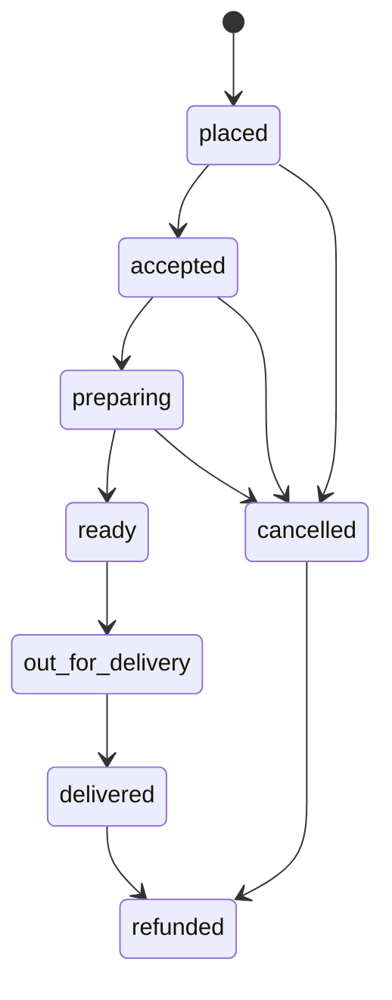

| From | To | Actor | Guard | Side effect | Domain event | Notification |
|---|---|---|---|---|---|
| [*] | placed | Customer through checkout service | Checkout succeeds for this shop; create one order per shop (BR-03). | Create the placed order. | None specified by source. | None specified by source. |
| placed | accepted | Actor not specified in source; owning service enforces authorization | Source state, authorization and applicable BR; remaining guard details are not specified. | No additional side effect specified by source. | None specified by source. | None specified by source. |
| placed | cancelled | Actor not specified in source; owning service enforces authorization | Source state, authorization and applicable BR; remaining guard details are not specified. | Notify admin and vendor (BR-20). | None specified by source. | Only source-named bilingual notification. |
| accepted | preparing | Actor not specified in source; owning service enforces authorization | Source state, authorization and applicable BR; remaining guard details are not specified. | No additional side effect specified by source. | None specified by source. | None specified by source. |
| accepted | cancelled | Actor not specified in source; owning service enforces authorization | Source state, authorization and applicable BR; remaining guard details are not specified. | Notify admin and vendor (BR-20). | None specified by source. | Only source-named bilingual notification. |
| preparing | ready | Actor not specified in source; owning service enforces authorization | Source state, authorization and applicable BR; remaining guard details are not specified. | No additional side effect specified by source. | None specified by source. | None specified by source. |
| preparing | cancelled | Actor not specified in source; owning service enforces authorization | Source state, authorization and applicable BR; remaining guard details are not specified. | Notify admin and vendor (BR-20). | None specified by source. | Only source-named bilingual notification. |
| ready | out_for_delivery | Actor not specified in source; owning service enforces authorization | Source state, authorization and applicable BR; remaining guard details are not specified. | No additional side effect specified by source. | None specified by source. | None specified by source. |
| out_for_delivery | delivered | Actor not specified in source; owning service enforces authorization | Source state, authorization and applicable BR; remaining guard details are not specified. | No additional side effect specified by source. | None specified by source. | None specified by source. |
| delivered | refunded | Actor not specified in source; owning service enforces authorization | Source state, authorization and applicable BR; remaining guard details are not specified. | No additional side effect specified by source. | None specified by source. | None specified by source. |
| cancelled | refunded | Actor not specified in source; owning service enforces authorization | Source state, authorization and applicable BR; remaining guard details are not specified. | No additional side effect specified by source. | None specified by source. | None specified by source. |

## ST-order-pickup

Pickup code verified at handover.

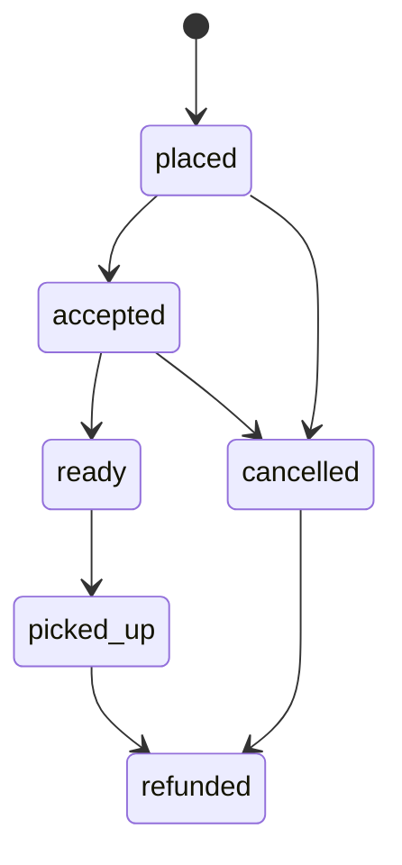

| From | To | Actor | Guard | Side effect | Domain event | Notification |
|---|---|---|---|---|---|
| [*] | placed | Customer through checkout service | Checkout succeeds for this shop; create one order per shop (BR-03). | Create the placed order. | None specified by source. | None specified by source. |
| placed | accepted | Actor not specified in source; owning service enforces authorization | Source state, authorization and applicable BR; remaining guard details are not specified. | No additional side effect specified by source. | None specified by source. | None specified by source. |
| accepted | ready | Actor not specified in source; owning service enforces authorization | Source state, authorization and applicable BR; remaining guard details are not specified. | No additional side effect specified by source. | None specified by source. | None specified by source. |
| ready | picked_up | Actor not specified in source; owning service enforces authorization | Source state, authorization and applicable BR; remaining guard details are not specified. | No additional side effect specified by source. | None specified by source. | None specified by source. |
| placed | cancelled | Actor not specified in source; owning service enforces authorization | Source state, authorization and applicable BR; remaining guard details are not specified. | No additional side effect specified by source. | None specified by source. | Only source-named bilingual notification. |
| accepted | cancelled | Actor not specified in source; owning service enforces authorization | Source state, authorization and applicable BR; remaining guard details are not specified. | No additional side effect specified by source. | None specified by source. | Only source-named bilingual notification. |
| picked_up | refunded | Actor not specified in source; owning service enforces authorization | Source state, authorization and applicable BR; remaining guard details are not specified. | No additional side effect specified by source. | None specified by source. | None specified by source. |
| cancelled | refunded | Actor not specified in source; owning service enforces authorization | Source state, authorization and applicable BR; remaining guard details are not specified. | No additional side effect specified by source. | None specified by source. | None specified by source. |

## ST-delivery-job

60-second request timer; fail reasons: customer unreachable, wrong address, customer cancelled, vehicle problem.

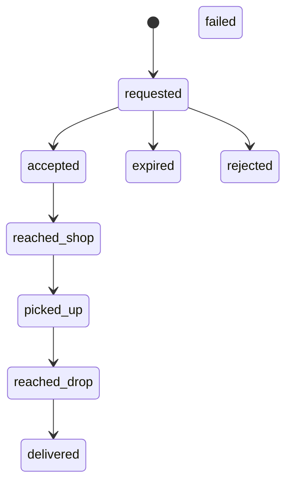

| From | To | Actor | Guard | Side effect | Domain event | Notification |
|---|---|---|---|---|---|
| [*] | requested | Requesting order/delivery service; exact initiator not specified | Source state, authorization and applicable BR; remaining guard details are not specified. | No additional side effect specified by source. | None specified by source. | None specified by source. |
| requested | accepted | Approved assigned Rider | Source state, authorization and applicable BR; remaining guard details are not specified. | No additional side effect specified by source. | None specified by source. | None specified by source. |
| accepted | reached_shop | Approved assigned Rider | Source state, authorization and applicable BR; remaining guard details are not specified. | No additional side effect specified by source. | None specified by source. | None specified by source. |
| reached_shop | picked_up | Approved assigned Rider | Source state, authorization and applicable BR; remaining guard details are not specified. | No additional side effect specified by source. | None specified by source. | None specified by source. |
| picked_up | reached_drop | Approved assigned Rider | Source state, authorization and applicable BR; remaining guard details are not specified. | No additional side effect specified by source. | None specified by source. | None specified by source. |
| reached_drop | delivered | Approved assigned Rider | Source state, authorization and applicable BR; remaining guard details are not specified. | Verify OTP server-side and record completion. | None specified by source. | None specified by source. |
| requested | expired | Approved assigned Rider | 60-second request timer elapsed. | No additional side effect specified by source. | None specified by source. | None specified by source. |
| requested | rejected | Approved assigned Rider | Source state, authorization and applicable BR; remaining guard details are not specified. | No additional side effect specified by source. | None specified by source. | Only source-named bilingual notification. |

## ST-approval

Pending: edit profile only; approved: full; rejected: view reason/resubmit; suspended: no sell/edit; inactive: reactivate.

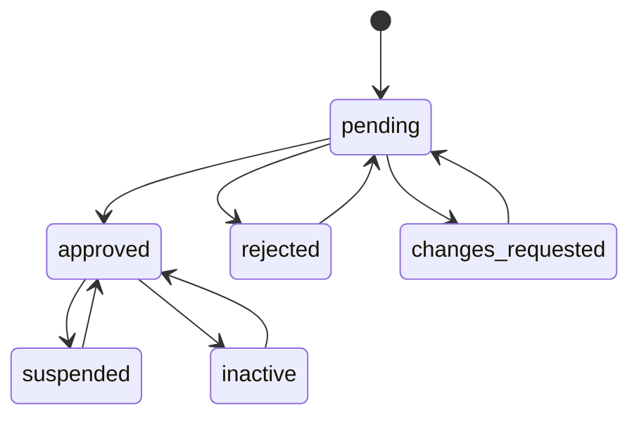

| From | To | Actor | Guard | Side effect | Domain event | Notification |
|---|---|---|---|---|---|
| [*] | pending | Vendor/Provider/Rider applicant | Initial application submitted. | Create pending application. | None specified by source. | None specified by source. |
| pending | approved | Admin with permission/scope | Source state, authorization and applicable BR; remaining guard details are not specified. | Record decision; notify applicant. | None specified by source. | Only source-named bilingual notification. |
| pending | rejected | Admin with permission/scope | Source state, authorization and applicable BR; remaining guard details are not specified. | Record decision; notify applicant. | None specified by source. | Only source-named bilingual notification. |
| pending | changes_requested | Admin with permission/scope | Source state, authorization and applicable BR; remaining guard details are not specified. | Record decision; notify applicant. | None specified by source. | None specified by source. |
| approved | suspended | Admin with permission/scope | Source state, authorization and applicable BR; remaining guard details are not specified. | Record decision; notify applicant. | None specified by source. | None specified by source. |
| suspended | approved | Admin with permission/scope | Source state, authorization and applicable BR; remaining guard details are not specified. | Record decision; notify applicant. | None specified by source. | Only source-named bilingual notification. |
| approved | inactive | Admin with permission/scope | Source state, authorization and applicable BR; remaining guard details are not specified. | Record decision; notify applicant. | None specified by source. | None specified by source. |
| inactive | approved | Admin with permission/scope | Source state, authorization and applicable BR; remaining guard details are not specified. | Record decision; notify applicant. | None specified by source. | Only source-named bilingual notification. |
| rejected | pending | Applicant (Vendor/Provider/Rider) | Rejected application resubmitted. | Record resubmission. | None specified by source. | None specified by source. |
| changes_requested | pending | Applicant (Vendor/Provider/Rider) | Changes-requested application resubmitted. | Record resubmission. | None specified by source. | None specified by source. |

## ST-payment

COD/pay-at-pickup uses pending>collected.

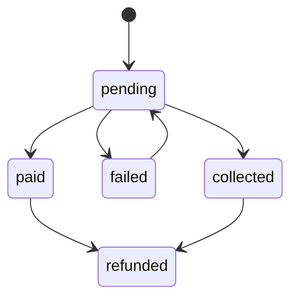

| From | To | Actor | Guard | Side effect | Domain event | Notification |
|---|---|---|---|---|---|
| [*] | pending | Checkout/payment service; exact initiator not specified | Checkout starts a payment attempt. | Create pending payment record. | None specified by source. | None specified by source. |
| pending | paid | Actor not specified in source; owning service enforces authorization | Source state, authorization and applicable BR; remaining guard details are not specified. | No additional side effect specified by source. | None specified by source. | None specified by source. |
| pending | failed | Actor not specified in source; owning service enforces authorization | Source state, authorization and applicable BR; remaining guard details are not specified. | No additional side effect specified by source. | None specified by source. | None specified by source. |
| failed | pending | Actor not specified in source; owning service enforces authorization | Source state, authorization and applicable BR; remaining guard details are not specified. | No additional side effect specified by source. | None specified by source. | None specified by source. |
| pending | collected | Actor not specified in source; owning service enforces authorization | COD/pay-at-pickup collection confirmed. | No additional side effect specified by source. | None specified by source. | None specified by source. |
| paid | refunded | Actor not specified in source; owning service enforces authorization | Source state, authorization and applicable BR; remaining guard details are not specified. | No additional side effect specified by source. | None specified by source. | None specified by source. |
| collected | refunded | Actor not specified in source; owning service enforces authorization | Source state, authorization and applicable BR; remaining guard details are not specified. | No additional side effect specified by source. | None specified by source. | None specified by source. |

## ST-refund

Customer refund window 24 hours after delivery.

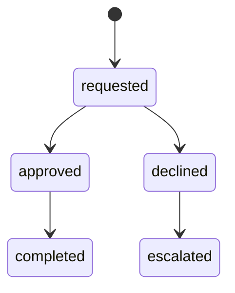

| From | To | Actor | Guard | Side effect | Domain event | Notification |
|---|---|---|---|---|---|
| [*] | requested | Customer | Refund requested within the 24-hour post-delivery window. | Record refund request and notify admin/vendor as required by BR-20. | None specified by source. | Only source-named bilingual notification (BR-20). |
| requested | approved | Actor not specified in source; owning service enforces authorization | Source state, authorization and applicable BR; remaining guard details are not specified. | No additional side effect specified by source. | None specified by source. | Only source-named bilingual notification. |
| approved | completed | Actor not specified in source; owning service enforces authorization | Source state, authorization and applicable BR; remaining guard details are not specified. | No additional side effect specified by source. | None specified by source. | None specified by source. |
| requested | declined | Actor not specified in source; owning service enforces authorization | Source state, authorization and applicable BR; remaining guard details are not specified. | No additional side effect specified by source. | None specified by source. | None specified by source. |
| declined | escalated | Actor not specified in source; owning service enforces authorization | Source state, authorization and applicable BR; remaining guard details are not specified. | No additional side effect specified by source. | None specified by source. | None specified by source. |

## ST-review

Risky links/abusive content is held pending. The `deleted` status has no transition edge specified in the source.

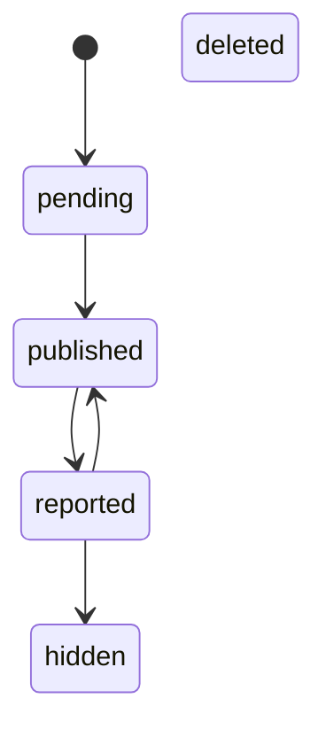

| From | To | Actor | Guard | Side effect | Domain event | Notification |
|---|---|---|---|---|---|
| [*] | pending | Customer (verified purchaser/enquirer) | Eligible customer submits a review; risky content is held pending. | Record review for eligibility/moderation. | None specified by source. | None specified by source. |
| pending | published | Actor not specified in source; owning service enforces authorization | Source state, authorization and applicable BR; remaining guard details are not specified. | No additional side effect specified by source. | None specified by source. | None specified by source. |
| published | reported | Actor not specified in source; owning service enforces authorization | Source state, authorization and applicable BR; remaining guard details are not specified. | No additional side effect specified by source. | None specified by source. | None specified by source. |
| reported | hidden | Actor not specified in source; owning service enforces authorization | Source state, authorization and applicable BR; remaining guard details are not specified. | No additional side effect specified by source. | None specified by source. | None specified by source. |
| reported | published | Actor not specified in source; owning service enforces authorization | Source state, authorization and applicable BR; remaining guard details are not specified. | No additional side effect specified by source. | None specified by source. | None specified by source. |

## ST-offer

Admin approval before active; active period/stock follows BR-17.

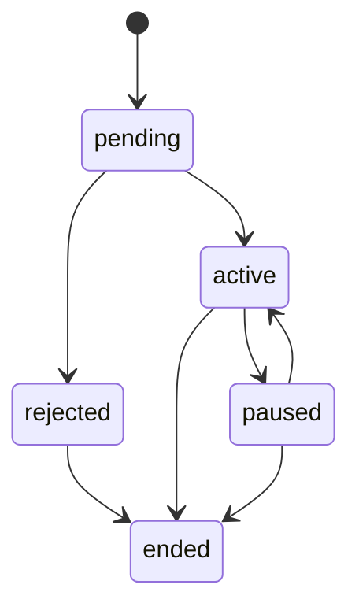

| From | To | Actor | Guard | Side effect | Domain event | Notification |
|---|---|---|---|---|---|
| [*] | pending | Vendor/Provider owner | Offer submitted for admin approval. | Create pending offer. | None specified by source. | None specified by source. |
| pending | active | Admin with permission/scope | Source state, authorization and applicable BR; remaining guard details are not specified. | No additional side effect specified by source. | None specified by source. | None specified by source. |
| pending | rejected | Admin with permission/scope | Source state, authorization and applicable BR; remaining guard details are not specified. | No additional side effect specified by source. | None specified by source. | Only source-named bilingual notification. |
| rejected | ended | Admin with permission/scope | Source state, authorization and applicable BR; remaining guard details are not specified. | No additional side effect specified by source. | None specified by source. | None specified by source. |
| active | paused | Admin with permission/scope | Source state, authorization and applicable BR; remaining guard details are not specified. | No additional side effect specified by source. | None specified by source. | None specified by source. |
| paused | active | Admin with permission/scope | Source state, authorization and applicable BR; remaining guard details are not specified. | No additional side effect specified by source. | None specified by source. | None specified by source. |
| active | ended | Admin with permission/scope | Source state, authorization and applicable BR; remaining guard details are not specified. | No additional side effect specified by source. | None specified by source. | None specified by source. |
| paused | ended | Admin with permission/scope | Source state, authorization and applicable BR; remaining guard details are not specified. | No additional side effect specified by source. | None specified by source. | None specified by source. |

## ST-video

Public only after approval; rejection has reason.

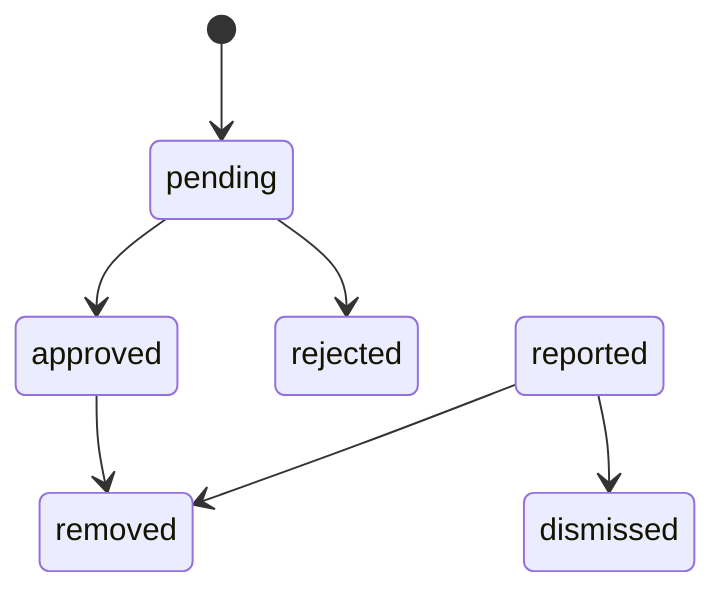

| From | To | Actor | Guard | Side effect | Domain event | Notification |
|---|---|---|---|---|---|
| [*] | pending | Vendor/Provider owner | Video submitted; apply the item-level Gallery/Reels consent choice. | Queue pending moderation. | None specified by source. | None specified by source. |
| pending | approved | Admin with permission/scope | Source state, authorization and applicable BR; remaining guard details are not specified. | No additional side effect specified by source. | None specified by source. | Only source-named bilingual notification. |
| pending | rejected | Admin with permission/scope | Source state, authorization and applicable BR; remaining guard details are not specified. | No additional side effect specified by source. | None specified by source. | Only source-named bilingual notification. |
| approved | removed | Admin with permission/scope | Source state, authorization and applicable BR; remaining guard details are not specified. | No additional side effect specified by source. | None specified by source. | None specified by source. |
| reported | removed | Admin with permission/scope | Source state, authorization and applicable BR; remaining guard details are not specified. | No additional side effect specified by source. | None specified by source. | None specified by source. |
| reported | dismissed | Admin with permission/scope | Source state, authorization and applicable BR; remaining guard details are not specified. | No additional side effect specified by source. | None specified by source. | None specified by source. |

## ST-enquiry

Converted enquirer is review-eligible.

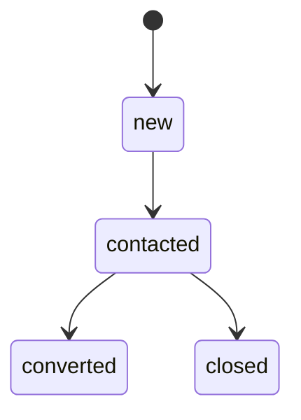

| From | To | Actor | Guard | Side effect | Domain event | Notification |
|---|---|---|---|---|---|
| [*] | new | Customer | Required enquiry message submitted. | Create enquiry and notify provider. | None specified by source. | Only source-named bilingual new-enquiry notification. |
| new | contacted | Provider owner | Source state, authorization and applicable BR; remaining guard details are not specified. | No additional side effect specified by source. | None specified by source. | None specified by source. |
| contacted | converted | Provider owner | Owner updates enquiry state. | Make enquirer review-eligible. | None specified by source. | Only source-named bilingual notification. |
| contacted | closed | Provider owner | Source state, authorization and applicable BR; remaining guard details are not specified. | No additional side effect specified by source. | None specified by source. | None specified by source. |

## ST-subcategory-suggestion

Duplicate detection; merge targets existing subcategory.

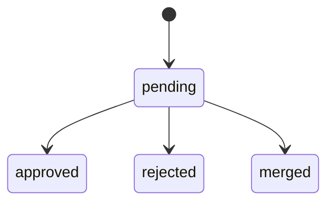

| From | To | Actor | Guard | Side effect | Domain event | Notification |
|---|---|---|---|---|---|
| [*] | pending | Vendor/Provider suggester | Suggestion submitted with required name and duplicate check. | Create pending suggestion. | None specified by source. | None specified by source. |
| pending | approved | Admin with permission/scope | Source state, authorization and applicable BR; remaining guard details are not specified. | Notify suggester; approved item becomes filterable. | None specified by source. | Only source-named bilingual notification. |
| pending | rejected | Admin with permission/scope | Source state, authorization and applicable BR; remaining guard details are not specified. | Notify suggester; approved item becomes filterable. | None specified by source. | Only source-named bilingual notification. |
| pending | merged | Admin with permission/scope | Source state, authorization and applicable BR; remaining guard details are not specified. | Notify suggester; approved item becomes filterable. | None specified by source. | None specified by source. |

## ST-comment

Moderation placeholder in source; detailed comment policy is open.

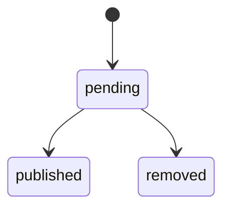

| From | To | Actor | Guard | Side effect | Domain event | Notification |
|---|---|---|---|---|---|
| [*] | pending | Actor not specified in source; owning service enforces authorization | Source state, authorization and applicable BR; remaining guard details are not specified. | No additional side effect specified by source. | None specified by source. | None specified by source. |
| pending | published | Actor not specified in source; owning service enforces authorization | Source state, authorization and applicable BR; remaining guard details are not specified. | No additional side effect specified by source. | None specified by source. | None specified by source. |
| pending | removed | Actor not specified in source; owning service enforces authorization | Source state, authorization and applicable BR; remaining guard details are not specified. | No additional side effect specified by source. | None specified by source. | None specified by source. |

## ST-campaign

Consent-aware counts and opt-out report.

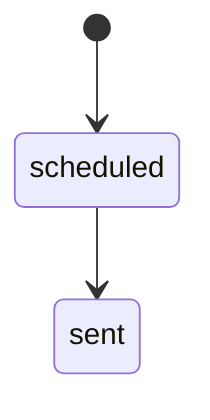

| From | To | Actor | Guard | Side effect | Domain event | Notification |
|---|---|---|---|---|---|
| [*] | scheduled | Actor not specified in source; owning service enforces authorization | Source state, authorization and applicable BR; remaining guard details are not specified. | No additional side effect specified by source. | None specified by source. | None specified by source. |
| scheduled | sent | Actor not specified in source; owning service enforces authorization | Source state, authorization and applicable BR; remaining guard details are not specified. | No additional side effect specified by source. | None specified by source. | Only source-named bilingual notification. |

## ST-case

Admin case workflow; role/area/module scope applies.

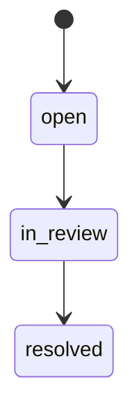

| From | To | Actor | Guard | Side effect | Domain event | Notification |
|---|---|---|---|---|---|
| [*] | open | Order/refund service; exact opener not specified | Case opened from the cancellation/refund flow (J8). | Create open case. | None specified by source. | None specified by source. |
| open | in_review | Admin with permission/scope | Source state, authorization and applicable BR; remaining guard details are not specified. | No additional side effect specified by source. | None specified by source. | None specified by source. |
| in_review | resolved | Admin with permission/scope | Source state, authorization and applicable BR; remaining guard details are not specified. | Persist resolution notes. | None specified by source. | None specified by source. |

## ST-city

Statuses only; allowed transition edges are unspecified.

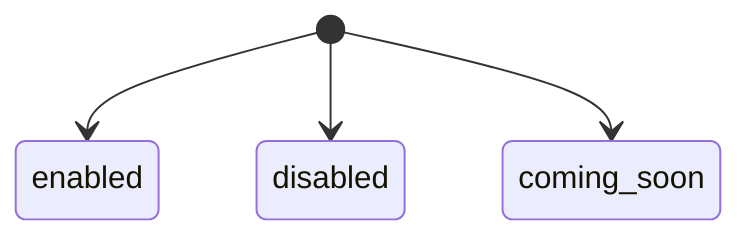

| From | To | Actor | Guard | Side effect | Domain event | Notification |
|---|---|---|---|---|---|
| [*] | enabled | Super Admin (candidate; confirm) | Source state, authorization and applicable BR; remaining guard details are not specified. | No additional side effect specified by source. | None specified by source. | None specified by source. |
| [*] | disabled | Super Admin (candidate; confirm) | Source state, authorization and applicable BR; remaining guard details are not specified. | No additional side effect specified by source. | None specified by source. | None specified by source. |
| [*] | coming_soon | Super Admin (candidate; confirm) | Source state, authorization and applicable BR; remaining guard details are not specified. | No additional side effect specified by source. | None specified by source. | None specified by source. |

## ST-admin

Statuses only; allowed transition edges are unspecified.

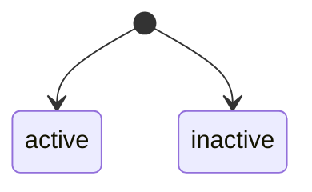

| From | To | Actor | Guard | Side effect | Domain event | Notification |
|---|---|---|---|---|---|
| [*] | active | Super Admin (candidate; confirm) | Source state, authorization and applicable BR; remaining guard details are not specified. | No additional side effect specified by source. | None specified by source. | None specified by source. |
| [*] | inactive | Super Admin (candidate; confirm) | Source state, authorization and applicable BR; remaining guard details are not specified. | No additional side effect specified by source. | None specified by source. | None specified by source. |

## Transition contract

- Reject any transition absent from the owning model; clients never set generic status fields. Candidate code `INVALID_TRANSITION` needs P04 approval.
- Timers: 60-second rider request; 30-second login OTP resend cooldown; 24-hour post-delivery refund request window. Server clock is authoritative.
- Delivery/pickup codes are server-generated and verified, attempt-limited, and excluded from rider/vendor API responses and logs (BR-05).
- Transaction, idempotency, locking, outbox/event payload and retry semantics belong to P03/P04; no transition may bypass them.
