# Data model foundation

## Contents

- [Conventions](#conventions)
- [Ownership and relationships](#ownership-and-relationships)
- [Hot-query indexes](#hot-query-indexes)

## Conventions

- PostgreSQL is the target; enable PostGIS, `pg_trgm`, `unaccent`, and full-text search as recorded in [architecture](./architecture.md).
- Tables and columns use `snake_case`; primary keys are application-generated UUIDv7. Foreign keys are explicit and indexed where they serve a query.
- Store instants as `timestamptz` in UTC; format IST only at the API/UI boundary.
- Store all money as `bigint` paise; never use floating point for amounts. Serialize through the shared `Money` value object.
- Use `created_at` and `updated_at` on mutable records. Soft-delete only user/content records that need reversible hiding; immutable audit records and financial facts are not soft-deleted.
- Use `version` for optimistic concurrency on mutable aggregates with competing writes (inventory, orders, approval records); transition writes include the expected version/current state.
- Localized names use `name_en` and `name_hi`; localize display copy through message keys, not duplicate free-text columns.
- Unique constraints encode identity (slugs, normalized suggestion names within category, role/user membership, user-target interactions). Check constraints enforce non-negative paise/stock and valid enum-like values where practical.
- A module owns every domain table listed below. `outbox_events` and `idempotency_keys` are shared runtime infrastructure, specified once by the shared persistence layer; pg-boss owns its internal queue tables.

## Ownership and relationships

This ERD is an ownership/relationship map, not a column specification. Each table's complete columns, constraints and access patterns belong in its owning module BE spec.

```mermaid
erDiagram
    %% auth
    users ||--o{ sessions : authenticates
    users ||--o{ otp_challenges : verifies

    %% users and geo
    users ||--o{ user_roles : has
    users ||--o{ addresses : saves
    users ||--o{ consents : records
    cities ||--o{ areas : contains
    cities ||--o{ zones : serves
    zones ||--o{ zone_fee_slabs : prices
    cities ||--o{ service_area_waitlist : receives
    areas ||--o{ businesses : locates
    users ||--o{ businesses : owns

    %% catalog and listings
    categories ||--o{ subcategories : groups
    keyword_mappings ||--o{ keyword_mapping_terms : matches
    keyword_mappings ||--o{ keyword_mapping_targets : targets
    categories ||--o{ products : classifies
    subcategories ||--o{ products : classifies
    products ||--o{ product_variants : offers
    products ||--|| inventory : tracks
    businesses ||--o{ product_category_pills : configures
    subcategories ||--o{ product_category_pills : labels
    subcategories ||--o{ services : classifies
    businesses ||--o{ products : lists
    businesses ||--o{ services : lists
    businesses ||--o{ provider_expertise : declares
    subcategories ||--o{ provider_expertise : expertise
    businesses ||--o{ business_hours : schedules
    businesses ||--o{ business_documents : owns
    subcategories ||--o{ subcategory_suggestions : suggested
    categories ||--o{ keyword_mappings : maps

    %% commerce
    users ||--o{ carts : owns
    carts ||--o{ cart_lines : contains
    businesses ||--o{ offers : publishes
    offers ||--o{ offer_targets : targets
    offers ||--o{ coupons : enables
    users ||--o{ orders : places
    businesses ||--o{ orders : fulfills
    orders ||--|{ order_items : contains
    orders ||--o{ order_status_history : records
    products ||--o{ order_items : ordered
    checkout_attempts ||--o{ payment_attempts : funds
    orders ||--o{ payment_attempts : paid_by
    orders ||--o{ refunds : refunded_by
    payment_attempts ||--o{ refunds : processes
    payment_attempts ||--o{ earnings : records
    orders ||--o{ earnings : reconciles
    businesses ||--o{ earnings : earns
    businesses ||--o{ business_subscriptions : subscribes
    payment_attempts ||--o| business_subscriptions : activates
    orders ||--o| delivery_jobs : delivered_by
    users ||--o{ delivery_jobs : rides
    orders ||--o{ order_cases : resolves
    order_cases ||--o{ order_case_events : records
    order_case_events ||--o{ order_case_attachments : contains
    media_assets ||--o{ order_case_attachments : evidence

    %% trust and media
    users ||--o{ reviews : writes
    businesses ||--o{ reviews : receives
    businesses ||--o{ videos : publishes
    videos ||--o{ video_links : links
    videos ||--o{ media_assets : uses
    users ||--o{ follows : follows
    businesses ||--o{ follows : followed
    users ||--o{ likes : likes
    users ||--o{ hearts : hearts
    users ||--o{ bookmarks : saves
    videos ||--o{ video_comments : receives

    %% operations
    users ||--o{ notifications : receives
    users ||--o{ campaigns : creates
    campaigns ||--o{ campaign_recipients : targets
    users ||--o{ audit_logs : acts
    users ||--o{ admin_scopes : assigned
    roles ||--o{ role_permissions : grants
    settings ||--o{ feature_flags : configures
```

| Owner | Tables |
|---|---|
| `auth` | `otp_challenges`, `sessions` |
| `users` | `users`, `user_roles`, `addresses`, `consents`, `data_requests` |
| `geo` | `cities`, `areas`, `zones`, `zone_fee_slabs`, `service_area_waitlist` |
| `catalog` | `categories`, `subcategories`, `subcategory_suggestions`, `keyword_mappings`, `keyword_mapping_terms`, `keyword_mapping_targets` |
| `businesses` | `businesses`, `business_hours`, `business_settings`, `business_documents` |
| `products` | `products`, `product_variants`, `inventory`, `product_category_pills` |
| `services` | `services`, `provider_expertise`, `enquiries` |
| `search` | No source-of-truth tables; reads owning module data |
| `offers` | `offers`, `offer_targets`, `coupons` |
| `cart-checkout` | `carts`, `cart_lines`, `checkout_attempts` |
| `payments` | `payment_attempts`, `refunds`, `earnings`, `business_subscriptions` |
| `orders` | `orders`, `order_items`, `order_status_history`, `order_cases`, `order_case_events`, `order_case_attachments` |
| `delivery` | `rider_profiles`, `rider_documents`, `delivery_jobs`, `delivery_offers`, `delivery_codes`, `rider_payouts` |
| `reviews` | `reviews`, `review_reports`, `review_helpful_votes`, `review_aggregates` |
| `engagement` | `follows`, `likes`, `hearts`, `bookmarks`, `video_comments` |
| `media-videos` | `media_assets`, `videos`, `video_links` |
| `notifications` | `notifications`, `notification_preferences`, `notification_templates` |
| `communications` | `campaigns`, `campaign_recipients`, `campaign_reports` |
| `admin` | `roles`, `role_permissions`, `admin_scopes` |
| `audit` | `audit_logs` |
| `settings` | `settings`, `feature_flags` |
| Shared runtime | `outbox_events`, `idempotency_keys` |

`search` uses read-only repository interfaces over `catalog`, `businesses`, `products`, `services`, `offers`, and `media-videos`; it does not duplicate their source data. The ERD shows core foreign-key paths; polymorphic targets (reviews, offer targets, bookmarks) are validated by the owning use-case.

## Hot-query indexes

| Query | Index strategy |
|---|---|
| Explore products/services and facet counts | Partial B-tree indexes on active/published listing status plus category/subcategory and stable sort keys; use the same predicates for rows and counts. |
| Nearby businesses/services and delivery range | PostGIS geography point with GiST index; filter by city/zone and serviceability before distance ordering. |
| Point-in-zone delivery lookup | GiST index on `zones.polygon`; B-tree on `(city_id,status)`; fee slabs keyed by `(zone_id,upper_distance_km)`. |
| City picker and admin city queue | Unique city slug; `(status,name_en)`; waitlist `(city_id,requested_at DESC)`. |
| Search keyword, name and typo-tolerant matching | GIN trigram on normalized searchable text and `keyword_mapping_terms.normalized_term`; GIN full-text index for token search; partial target indexes on `keyword_mapping_targets`. |
| Subcategory duplicate checks and suggestion queues | GIN trigram on normalized suggestion names; `(status,city_id,area_id,created_at,id)` for scoped moderation and `(business_id,created_at,id)` for owner history. |
| Reels and other feeds | Keyset indexes on frozen rank/session key and `id`, or `(created_at, id)` for chronological feeds; never deep-offset pagination. |
| Customer orders and business order queues | `(customer_user_id, placed_at DESC, id DESC)` and `(business_id, status, placed_at DESC, id DESC)`; add only indexes required by documented filters. |
| Admin approval/moderation queues | `(status, created_at, id)` plus city/area scope columns used by the authorized query. |
| Idempotency and outbox workers | Unique idempotency key scoped by actor/operation; outbox status/availability index with stable ordering and deduplication key. |

Index definitions are finalized with owning module specs and migrations; avoid speculative indexes and verify them with query plans before rollout.
