# Data model foundation

## Contents

- [Conventions](#conventions)
- [JSON and concurrency representations](#json-and-concurrency-representations)
- [Starter invariant error catalogue](#starter-invariant-error-catalogue)
- [Ownership and relationships](#ownership-and-relationships)
- [Hot-query indexes](#hot-query-indexes)
- [Shared runtime persistence](#shared-runtime-persistence)
- [Migrations, seeds and isolation](#migrations-seeds-and-isolation)
- [Persistence acceptance](#persistence-acceptance)

## Conventions

- PostgreSQL is the target; enable PostGIS, `pg_trgm`, `unaccent`, and full-text search as recorded in [architecture](./architecture.md).
- Tables and columns use `snake_case`; surrogate primary keys are application-generated UUIDv7. Module-defined natural/composite keys (settings keys, join tables) remain as specified. Foreign keys are explicit and indexed.
- Store instants as `timestamptz` in UTC; format IST only at the API/UI boundary.
- Store all money as `bigint` paise; never use floating point for amounts. Serialize through the shared `Money` value object.
- Use `created_at` and `updated_at` on mutable records. Soft-delete only user/content records that need reversible hiding; immutable audit records and financial facts are not soft-deleted.
- Use `version` for optimistic concurrency on mutable aggregates with competing writes (inventory, orders, approval records); transition writes include the expected version/current state.
- Localized names use `name_en` and `name_hi`; localize display copy through message keys, not duplicate free-text columns.
- Unique constraints encode identity (slugs, normalized suggestion names within category, role/user membership, user-target interactions). Check constraints enforce non-negative paise/stock and valid enum-like values where practical.
- A module owns every domain table listed below. Shared runtime tables are defined below; pg-boss owns its versioned internal queue schema, not domain state.

## JSON and concurrency representations

These are shared Zod/OpenAPI/client primitives (`@apnatown/shared/wire`), not different wire formats per repository.

| Value | Storage / domain | JSON/OpenAPI / validation |
|---|---|---|
| Money (`pricePaise`, `totalPaise`, module `*_paise` fields) | PostgreSQL `bigint`; `Money` uses bigint/exact integer arithmetic internally, with the module's rounding rule | **JSON number, integer paise**, `type: integer`, bounds `0..9007199254740991` for non-negative amounts. Signed adjustments only where the module explicitly allows them, within the safe-integer range. Never BigInt, decimal rupees or a decimal string on the wire. |
| IDs | UUIDv7 for surrogate/domain/event IDs | Canonical UUID strings (`format: uuid`), never numbers. Slugs/natural keys stay separate named strings; seed aliases such as `grocery` are not UUIDs. Do not infer authorization/time from an ID. |
| Version | PostgreSQL `int`, initially 1 | JSON integer `1..2147483647`. Return the **current** `version`; mutation `expectedVersion` must match it. CAS predicate includes ID + current version + allowed state; one winner writes `version + 1`, losers return the module's version/state conflict. Do not wrap at overflow or silently increment on a failed write. |
| Timestamp | UTC `timestamptz` | ISO-8601 UTC strings ending in `Z`; never locale strings, Date instances or numeric epochs unless a module explicitly names an epoch field. Preserve DB precision in sort/cursor keys. Display IST through shared formatters. |
| Counts / limits | Integer DB values | Non-negative safe JSON integers; HTTP list default 20, cap 50 unless lower. Explicit internal worker batches may use their documented bound (e.g. 500), never that bound on a public list. Validate overflow, not silent `bigint` rounding. |
| Cursor | Stable ordered key tuple with UUID tie-breaker, filter/sort fingerprint and schema version; Reels also retains its module-defined frozen session/asOf/seed | Opaque base64url string, authenticated by the server; tuple values are JSON-safe strings/integers, not raw BigInt. Bound length/decode depth; validate signature, version, endpoint, sort and authorized scope. No raw precise location/PII: signing is not encryption. Bad/mismatched cursor -> validation error, never offset fallback. |
| Page / nulls | Owning repository's keyset query | `{items, nextCursor: string\|null}` plus `hasMore` only where documented; end is `null`, not an empty/guessed cursor. Omit only optional fields; use `null` for explicitly nullable fields. No `undefined`, NaN or Infinity in stored/replayed DTOs. |

`Money.toPaiseNumber()` checks bounds **before** conversion; inbound schemas use `.int().safe()` plus the field's sign/range. Arithmetic, sums, coupon allocation and audit/outbox serialization must all use these conversions. Never register `BigInt.prototype.toJSON` or stringify every bigint globally: that would silently change module DTOs.
An out-of-wire-range persisted/result value fails safely with a logged, redacted `COMMON_INTERNAL_ERROR` 500; invalid client amounts fail the declared validation code. No rounding/truncation/string fallback. This is a technical JSON-safety limit, not a new product price cap.
Successful mutation DTOs and idempotent replays have the same schema; capability-bearing fields may be freshly issued only under the explicit secret-excluded replay policy below. The flat error envelope is defined in [backend-shared](./backend-shared.md#error-contract). OpenAPI examples, HTTP tests, generated clients, audit JSON and outbox payloads must agree.

## Starter invariant error catalogue

Shared starting vocabulary, not new product rules or aliases overriding a module's documented code. Module DTOs/error catalogues are authoritative for existing endpoints.

Existing common spellings remain registered: `VALIDATION_ERROR` is 400 /
`errors.common.validationFailed`, `FORBIDDEN` is 403 /
`errors.common.forbidden`, `AUTH_REQUIRED` is 401 /
`errors.auth.required`, and the existing `RATE_LIMITED` is 429 /
`errors.common.rateLimited` with `Retry-After`. They use the same flat envelope; an undeclared
catalogue code is a configuration/test failure, not a guessed 200/500 mapping.

| Rule | Starter code | HTTP | Message key |
|---|---|---:|---|
| BR-01 | `COMMON_MONEY_INVALID` | 422 | `errors.money.invalid` |
| BR-02 | No error; UTC/IST formatting contract | — | — |
| BR-03 | `CHECKOUT_SPLIT_INVALID` | 409 | `errors.checkout.splitInvalid` |
| BR-04 | `ORDERS_INVALID_TRANSITION` | 409 | `errors.orders.invalidTransition` |
| BR-05 | `DELIVERY_CODE_INVALID` | 422 | `errors.delivery.codeInvalid` |
| BR-06 | `USERS_APPROVAL_REQUIRED` | 403 | `errors.users.approvalRequired` |
| BR-07 | `CATALOG_CATEGORY_FORBIDDEN` | 403 | `errors.catalog.categoryForbidden` |
| BR-08 | `SERVICES_SUBCATEGORY_REQUIRED` | 422 | `errors.services.subcategoryRequired` |
| BR-09 | `REVIEWS_NOT_ELIGIBLE` | 403 | `errors.reviews.notEligible` |
| BR-10 | `MEDIA_VIDEO_NOT_PUBLISHED` | 409 | `errors.media.videoNotPublished` |
| BR-11 | `COMMUNICATIONS_CONSENT_REQUIRED` | 422 | `errors.communications.consentRequired` |
| BR-12 | `ADMIN_SCOPE_FORBIDDEN` | 403 | `errors.admin.scopeForbidden` |
| BR-13 | `ADMIN_ROLE_IN_USE` | 409 | `errors.admin.roleInUse` |
| BR-14 | `USERS_DATA_REQUEST_REQUIRED` | 409 | `errors.users.dataRequestRequired` |
| BR-15 | `SEARCH_FILTER_INVALID` | 400 | `errors.search.filterInvalid` |
| BR-16 | `MEDIA_SURFACE_CONSENT_REQUIRED` | 422 | `errors.media.surfaceConsentRequired` |
| BR-17 | `OFFERS_NOT_ACTIVE` | 409 | `errors.offers.notActive` |
| BR-18 | No error; counts and results share one filter predicate | — | — |
| BR-19 | `CHECKOUT_COUPON_INVALID` | 422 | `errors.checkout.couponInvalid` |
| BR-20 | `ORDERS_REFUND_WINDOW_CLOSED` | 409 | `errors.orders.refundWindowClosed` |
| BR-21 | `AUTH_REQUIRED` | 401 | `errors.auth.required` |
| BR-22 | No API error; UI always pairs status text/icon with color | — | — |

## Ownership and relationships

This ERD is an ownership/relationship map, not a column specification. Each table's complete columns, constraints and access patterns belong in its owning module BE spec.

Resolved launch-policy additions (full schemas/indexes remain with their owners):
- Businesses owns one reviewed fiscal profile per business; Geo supplies trusted city state codes and Settings supplies versioned tax classifications.
- Offers owns coupon reservations keyed by checkout attempt/round, offer-use records keyed by order, and its transient/daily measurement tables.
- Orders owns supplier documents/counters, linking credits to originals and each order to its frozen primary category; master summaries link the same customer-owned shop orders.
- Payments owns subscription-chain versions, billing documents/counters and exclusive checkout-or-billing compensation references; no second refund or tax engine.
- Businesses/Media/Engagement own their specified counters and first-follow attribution. No shared analytics store or Redis is introduced.

Migration/index acceptance: stage nullable additions/backfills before enforcing new constraints; verify supplier-scoped numbering and remove obsolete global-number uniqueness only after reconciliation. Test representative coupon contention, bounded 48-hour cleanup, scoped 366-day reporting and document reads with EXPLAIN/ANALYZE. Additional composite/expiry indexes accelerate these predicates at the cost of write/storage work; use the existing hot-query budgets below, not invented benchmark results.

```mermaid
erDiagram
    %% auth
    users |o--o{ sessions : authenticates

    %% users and geo
    users ||--o{ user_roles : has
    users ||--o{ addresses : saves
    users |o--o{ consents : records
    users ||--o{ data_requests : requests
    cities ||--o{ areas : contains
    cities ||--o{ zones : serves
    zones ||--o{ zone_fee_slabs : prices
    cities |o--o{ service_area_waitlist : receives
    areas |o--o{ businesses : locates
    users ||--o{ businesses : owns
    businesses ||--o{ business_categories : categorized_as
    categories ||--o{ business_categories : category_membership

    %% catalog and listings
    categories ||--o{ subcategories : groups
    media_assets |o--o{ categories : category_image
    media_assets |o--o{ subcategories : subcategory_image
    categories |o--o{ catalog_home_sections : dedicated_section
    catalog_home_sections ||--o{ catalog_home_section_categories : curated_pills
    categories ||--o{ catalog_home_section_categories : selected_category
    categories ||--o{ category_relations : source
    categories ||--o{ category_relations : related_target
    keyword_mappings ||--o{ keyword_mapping_terms : matches
    keyword_mappings ||--o{ keyword_mapping_targets : targets
    categories ||--o{ products : classifies
    subcategories ||--o{ products : classifies
    products ||--o{ product_variants : offers
    products ||--|| inventory : tracks
    businesses ||--o{ product_category_pills : configures
    subcategories ||--o{ product_category_pills : labels
    subcategories ||--o{ services : classifies
    businesses ||--o{ products : lists
    businesses ||--o{ services : lists
    businesses ||--o{ provider_expertise : declares
    businesses ||--o| provider_expertise_versions : versions_expertise
    subcategories ||--o{ provider_expertise : expertise
    businesses ||--o{ business_hours : schedules
    businesses ||--o{ business_documents : owns
    media_assets |o--o{ businesses : logo_asset
    media_assets |o--o{ businesses : cover_asset
    media_assets ||--o{ business_documents : asset
    categories ||--o{ subcategory_suggestions : proposed_under
    businesses ||--o{ subcategory_suggestions : submits
    users ||--o{ subcategory_suggestions : submitted_by
    subcategories |o--o{ subcategory_suggestions : approved_target
    subcategories |o--o{ subcategory_suggestions : merged_target
    categories |o--o{ keyword_mapping_targets : category_target
    subcategories |o--o{ keyword_mapping_targets : subcategory_target

    %% commerce
    users |o--o{ carts : owns
    carts ||--o{ cart_lines : contains
    products ||--o{ cart_lines : selects
    product_variants |o--o{ cart_lines : labels
    carts ||--o{ checkout_quotes : quotes
    users |o--o{ checkout_quotes : owns
    addresses |o--o{ checkout_quotes : pins_revision
    checkout_quotes ||--o{ checkout_attempts : confirms
    checkout_attempts ||--o| master_checkout_summaries : summarizes
    master_checkout_summaries ||--|{ master_checkout_summary_orders : links
    orders ||--o| master_checkout_summary_orders : appears_in_summary
    businesses ||--o{ offers : publishes
    offers ||--o{ offer_targets : targets
    coupons ||--o{ coupon_targets : targets
    businesses |o--o{ coupons : owns_coupon
    products |o--o{ coupon_targets : product_target
    services |o--o{ coupon_targets : service_target
    businesses |o--o{ promotion_placements : promotes
    media_assets |o--o{ promotion_placements : banner
    cities |o--o{ promotion_placements : scopes
    areas |o--o{ promotion_placements : scopes
    billing_purchases |o--o| promotion_placements : funds
    promotion_placements |o--o{ billing_purchases : prepares
    businesses ||--o{ billing_purchases : buys
    users ||--o{ orders : places
    businesses ||--o{ orders : fulfills
    orders ||--|{ order_items : contains
    orders ||--o{ order_status_history : records
    products |o--o{ order_items : ordered
    product_variants |o--o{ order_items : preserves_label
    orders ||--o{ order_adjustments : adjusts
    order_items ||--o| order_stock_allocations : reserves
    orders ||--o{ order_stock_allocations : allocates
    checkout_attempts ||--o{ order_stock_allocations : reservation
    checkout_attempts ||--o{ order_stock_operations : deduplicates
    products ||--o{ order_stock_allocations : stocks
    product_variants |o--o{ order_stock_allocations : labels
    checkout_attempts |o--o{ payment_attempts : funds
    checkout_quotes |o--o{ payment_attempts : binds
    billing_purchases |o--o{ payment_attempts : purchases
    payment_charges |o--o{ payment_attempts : allocates
    orders |o--o{ payment_attempts : paid_by
    checkout_attempts ||--o{ payment_compensations : recovers
    checkout_quotes ||--o{ payment_compensations : binds
    payment_attempts ||--o| payment_compensations : compensates
    orders ||--o{ refunds : refunded_by
    payment_attempts ||--o{ refunds : processes
    payment_attempts |o--o{ earnings : records
    orders |o--o{ earnings : reconciles
    businesses ||--o{ earnings : earns
    businesses ||--o{ business_subscriptions : subscribes
    payment_attempts |o--o| business_subscriptions : activates
    orders ||--o| delivery_jobs : delivered_by
    rider_profiles |o--o{ delivery_jobs : rides
    users ||--o| rider_profiles : applies
    rider_profiles ||--o{ rider_documents : documents
    media_assets ||--o{ rider_documents : asset
    delivery_jobs ||--o{ delivery_offers : offers
    orders ||--o{ delivery_codes : verifies
    orders ||--o{ order_cases : resolves
    order_cases ||--o{ order_case_events : records
    order_case_events ||--o{ order_case_attachments : contains
    media_assets ||--o{ order_case_attachments : evidence

    %% trust and media
    users ||--o{ reviews : writes
    businesses |o--o{ reviews : receives
    businesses ||--o{ videos : publishes
    videos ||--o{ video_links : links
    media_assets |o--o{ videos : file_asset
    media_assets |o--o{ videos : thumbnail_asset
    users ||--o{ follows : follows
    businesses ||--o{ follows : followed
    users ||--o{ likes : likes
    users ||--o{ hearts : hearts
    users ||--o{ bookmarks : saves
    videos ||--o{ video_comments : receives

    %% operations
    users ||--o{ notifications : receives
    users ||--o{ campaigns : creates
    campaign_audience_snapshots ||--o{ campaign_audience_members : contains
    campaign_audience_snapshots ||--o{ campaign_reviews : binds
    campaign_reviews ||--o| campaigns : confirms
    campaigns ||--o{ campaign_recipients : targets
    users |o--o{ audit_logs : acts
    users ||--o| admin_accounts : is
    roles ||--o{ admin_accounts : templates
    admin_accounts ||--o{ admin_permissions : holds
    admin_accounts ||--o{ admin_scopes : assigned
    roles ||--o{ role_permissions : grants
    users ||--o{ settings : updates
    users ||--o{ feature_flags : updates
```

| Owner | Tables |
|---|---|
| `auth` | `otp_challenges`, `sessions` |
| `users` | `users`, `user_roles`, `addresses`, `consents`, `data_requests` |
| `geo` | `cities`, `areas`, `zones`, `zone_fee_slabs`, `service_area_waitlist` |
| `catalog` | `categories`, `subcategories`, `category_relations`, `subcategory_suggestions`, `keyword_mappings`, `keyword_mapping_terms`, `keyword_mapping_targets` |
| `businesses` | `businesses`, `business_hours`, `business_settings`, `business_documents` |
| `products` | `products`, `product_variants`, `inventory`, `product_category_pills` |
| `services` | `services`, `provider_expertise`, `provider_expertise_versions`, `enquiries` |
| `search` | No source-of-truth tables; reads owning module data |
| `offers` | `offers`, `offer_targets`, `coupons`, `promotion_placements` |
| `cart-checkout` | `carts`, `cart_lines`, `checkout_quotes`, `checkout_attempts` |
| `payments` | `payment_charges`, `payment_attempts`, `refunds`, `payment_compensations`, `billing_purchases`, `earnings`, `business_subscriptions` |
| `orders` | `orders`, `order_items`, `order_adjustments`, `order_stock_allocations`, `order_stock_operations`, `order_status_history`, `order_cases`, `order_case_events`, `order_case_attachments` |
| `delivery` | `rider_profiles`, `rider_documents`, `delivery_jobs`, `delivery_offers`, `delivery_codes` |
| `reviews` | `reviews`, `review_reports`, `review_helpful_votes`, `review_aggregates` |
| `engagement` | `follows`, `follower_daily_counts`, `likes`, `hearts`, `bookmarks`, `video_comments`, `video_engagement_counts`, `follower_announcements` |
| `media-videos` | `media_assets`, `gallery_photos`, `videos`, `video_links`, `media_reports`, `business_media_order`, `reel_rank_snapshots`, `video_view_dedup` |
| `notifications` | `notifications`, `notification_preferences`, `notification_templates`, `notification_deliveries`, `notification_provider_receipts`, `notification_fanouts` |
| `communications` | `campaign_audience_snapshots`, `campaign_audience_members`, `campaign_reviews`, `campaigns`, `campaign_recipients`, `campaign_reports` |
| `admin` | `roles`, `role_permissions`, `admin_accounts`, `admin_permissions`, `admin_scopes`, `listing_reports` |
| `audit` | `audit_logs` |
| `settings` | `settings`, `feature_flags`, `legal_pages`, `support_messages` |
| Shared runtime | `outbox_events`, `idempotency_keys`, `rate_limit_buckets` |

`search` uses public read ports and owner-exported read-only SQL projections over `catalog`, `businesses`, `products`, `services`, `offers`, `media-videos`, `geo` and `reviews`; it does not import private repositories or duplicate source data. Apply eligibility/filter/facet/keyset predicates before limiting, not to an owner's first page. The ERD shows core foreign-key paths; polymorphic targets (reviews, offer targets, bookmarks) are validated by the owning use-case.
Pending suggestions reference their **category**, not an already-existing subcategory; approved/merged target links are nullable and state-specific. `product_category_pills` belongs to **products**, although its composite key references a business and catalog subcategory. OTP challenges are pre-account records without a `user_id` FK; keyword mappings target categories through `keyword_mapping_targets`, and independent settings/flags have updater FKs, not a settings-to-flag parent relationship.
Catalog kind is **`product|service`**; shops reuse the product taxonomy (`CATS`), not a third `shop` kind. Catalog's `category_relations` owns **directed, ordered** cross-kind RELP/RELS links (`source_category_id`, `related_category_id`, `sort_order`), never derived reverse links; its full definition stays in Catalog BE. Services owns `provider_expertise_versions` so an empty mapping set still has an independent optimistic version, not the Business profile version. Business logo/cover/document references point to Media-owned assets without duplicating storage/type/size metadata. Removed product variants retain their IDs with `active=false`; historical order references do not lose identity.
Nullable session/cart/consent owners represent explicit anonymous state, never authenticated access. Address versions fence quotes; stock-operation/financial ledgers are Orders/Payments-owned, not generic inventory events. Compensation has no required order FK, so captured funds survive a zero-order rollback. Placement/purchase reciprocal nullable links are created in order: prepared placement with no purchase, purchase referencing it, then bind the funded purchase after verified success. No rider-settlement table/writer is invented before its policy is approved.

## Hot-query indexes

| Query | Index strategy |
|---|---|
| Explore products/services and facet counts | Partial B-tree indexes on active/published listing status plus category/subcategory and stable sort keys; use the same predicates for rows and counts. |
| Nearby businesses/services and delivery range | PostGIS geography point with GiST index; filter by city/zone and serviceability before distance ordering. |
| Point-in-zone delivery lookup | GiST index on `zones.polygon`; B-tree on `(city_id,status)`; fee slabs keyed by `(zone_id,upper_distance_km)`. |
| City picker and admin city queue | Unique city slug; `(status,name_en)`; waitlist `(city_id,requested_at DESC)`. |
| Search keyword, name and typo-tolerant matching | GIN trigram on normalized searchable text and `keyword_mapping_terms.normalized_term`; GIN full-text index for token search; partial target indexes on `keyword_mapping_targets`. |
| Subcategory duplicate checks and suggestion queues | GIN trigram on normalized suggestion names; `(status,city_id,area_id,created_at,id)` for scoped moderation and `(business_id,created_at,id)` for owner history. |
| Related category discovery | Catalog-owned ordered lookup by `(source_category_id,sort_order,related_category_id)`; filters retain the explicit source->target direction. |
| Reels and other feeds | Keyset indexes on frozen rank/session key and `id`, or `(created_at, id)` for chronological feeds; never deep-offset pagination. |
| Customer orders and business order queues | `(customer_user_id, placed_at DESC, id DESC)` and `(business_id, status, placed_at DESC, id DESC)`; add only indexes required by documented filters. |
| Admin approval/moderation queues | `(status, created_at, id)` plus city/area scope columns used by the authorized query. |
| Idempotency, rate limits and outbox | Unique principal/operation/key hash; expiry indexes for cleanup; outbox state/availability/lease indexes with stable ID ordering; atomic rate-limit bucket PK as below. |
| Business category discovery | `business_categories(category_id,business_id)` serves category-to-business lookup; PK `(business_id,category_id)` prevents duplicate memberships; partial unique `(business_id) WHERE is_primary` enforces one primary. Category joins use `EXISTS` and distinct business counts; extra write/index cost is limited to the relationship table. |
| Curated Home section reads | Partial `catalog_home_sections(position,id) WHERE active`, `catalog_home_section_categories(section_id,position,category_id)`, and reverse `(category_id,section_id)` support ordered sections, pills and invalidation. Inactive configuration is not included in the partial read index; the two relationship/order indexes add storage and update cost only when configuration changes. |
| Featured-first product/service Explore | Partial `products(category_id,featured_selected DESC,created_at DESC,id DESC) WHERE published AND deleted_at IS NULL` and `services(category_id,featured_selected DESC,created_at DESC,id DESC) WHERE status='active' AND deleted_at IS NULL` support default candidate ordering; effective Premium/business visibility remains an owner projection and may require a join/sort. These indexes add listing write/storage cost; do not add plan state to listing rows or a broader index without plan verification. |
| Bell-enabled follower fan-out | Partial `follows(business_id,user_id) WHERE unfollowed_at IS NULL AND bell_on` serves bounded recipient batches; the separate active-follow index serves counts/Following. The write cost is one relationship update and two partial indexes; keep fan-out keyset-bounded. |
| Coupon eligibility/redemption lookup | Offers' unique normalized code and partial active-scope index serve code uniqueness and eligibility by scope/time; target indexes support business/product/service hydration. The uniqueness/partial indexes add coupon write cost; redemption remains gated until its rules are approved, so do not add reservation indexes early. |
| Master checkout documents | Unique `master_checkout_summaries(checkout_attempt_id)` enforces one summary/checkout; `(customer_user_id,created_at DESC,id DESC)` serves customer history; `master_checkout_summary_orders(summary_id,order_id)` and unique `order_id` serve reconciliation and prevent cross-summary duplicate links. Summary writes pay the extra history/link index cost once per checkout; do not index snapshot JSON fields. |

Index definitions are finalized with owning module specs and migrations; avoid speculative indexes and verify them with query plans before rollout.

## Query-plan verification

For each hot-query index above and each new module-spec index, record the owning table, exact ordered columns, partial predicate/index type, parameterized query served and expected write/storage trade-off in that module's spec. Before rollout, run `EXPLAIN (ANALYZE, BUFFERS)` against representative non-PII data with realistic category/business skew, geographic density, follower counts and page sizes; record the plan, actual rows/loops and buffer reads, but do not claim a threshold or result that was not measured. Check that filters and eligibility run before counts/keyset limits, no query fetches an unbounded page, and no repeated per-card lookup creates N+1 behavior. A sequential scan is acceptable for small tables when measured and documented.

Index migrations are forward-only and reviewed with the owning module. For large live tables, prefer a concurrently built index when the migration runner supports it; account for uniqueness validation, write amplification, storage and lock/recovery behavior. Verify the resulting plan after the index exists; do not add indexes solely because a field is filterable.

## Shared runtime persistence

Only this foundation defines these tables; shared persistence repositories own them. All fields are NOT NULL unless marked `?`; timestamps are `timestamptz`, JSON is validated JSON-safe `jsonb`. These are reliability records, not an event-sourcing store or a new product module.

| Table | Columns / constraints | Indexes / access |
|---|---|---|
| `outbox_events` | `id uuid PK` (event ID); `type text` (module-owned dotted name); `schema_version int DEFAULT 1 CHECK >0`; `aggregate_type text`; `aggregate_id uuid`; `aggregate_version int CHECK >0`; `payload jsonb`; `correlation_id text`; `occurred_at`; `available_at`; `state text DEFAULT 'pending' CHECK pending/publishing/published/dead`; `attempt_count int DEFAULT 0 CHECK >=0`; `lease_owner text?`; `lease_expires_at?`; `published_at?`; `last_error_code text?`. CHECK publishing has a lease and published has a timestamp. | `(state,available_at,id)` for relay polling; `(lease_expires_at,id) WHERE state='publishing'` for abandoned leases; `(aggregate_type,aggregate_id,aggregate_version)` for diagnostics. Never store secrets/OTPs or entire ORM objects in payload/errors. |
| `idempotency_keys` | `id uuid PK`; `principal_key text` (authenticated actor or named internal consumer); `operation text` (stable method/route or consumer name); `key_hash bytea`; `request_hash bytea`; `state text CHECK in_progress/completed`; `lease_owner text?`; `lease_expires_at?`; `http_status int?`; `response_body jsonb?` (replayable **non-secret projection**); `response_headers jsonb DEFAULT '{}'`; `resource_ref jsonb?`; `created_at`; `updated_at`; `expires_at`. UNIQUE `(principal_key,operation,key_hash)`; completed HTTP records require response status/non-secret result or explicit no-content; in-progress claims have leases. | Unique index arbitrates competing requests; `(expires_at,id)` cleanup; `(state,lease_expires_at)` recovery. Hash keys; allow-list headers (not Set-Cookie) and DTO fields; never persist bearer/session/OTP/CSRF/completion-token plaintext or signed-URL secrets. Stored protected responses remain protected on replay. |
| `rate_limit_buckets` | `policy_key text`; `subject_hash bytea`; `bucket_start`; `hit_count bigint DEFAULT 0 CHECK >=0`; `expires_at`; PK `(policy_key,subject_hash,bucket_start)`; CHECK expiry after start. | PK supports atomic insert/increment; `(expires_at)` bounded cleanup. Policy identifies route/channel and window, subject is a keyed hash of trusted actor/normalized phone/IP as appropriate, not raw PII. |

**Transaction/helper contracts** (to implement in `apps/api/src/shared/persistence`; application code imports only the ports):
- `TxContext` is an opaque handle; `UnitOfWork.run<T>(work: (tx: TxContext) => Promise<T>): Promise<T>` starts one transaction, commits only on success and rolls back on any throw. Only shared persistence infrastructure unwraps it using `PrismaDatabase.client(tx): Prisma.TransactionClient`; expired/foreign handles fail, no silent use of the root client.
- `CommandUnitOfWork.run<T extends JsonValue>(command: CommandContext, work: (tx: TxContext) => Promise<T>, resultPolicy: IdempotencyResultPolicy<T>): Promise<T>` is the application-invoked idempotent transaction wrapper. `CommandContext` contains the server-resolved actor, correlation ID, stable operation, keyed request/key hashes, operation success status and server-selected expiry; it never contains client-supplied roles/scope. It claims/checks idempotency and stores the approved result in the **same commit** as `work`; the result policy re-checks current access **also on replay**, before skipping `work`. The HTTP interceptor prepares context, not a second transaction.
- `IdempotencyResultPolicy<T>` is mandatory for every command and provides `store(result: T): JsonValue` (explicit non-secret field allow-list), `replay(tx, stored, command): Promise<T>` (re-check current access, then reconstruct the original accepted/rejected outcome inside the replay transaction), and optional deterministic `httpStatus(result: T): number` (otherwise the operation's declared success status). The replay result and status must match the original response; status `204` stores and replays only `null`. There is no generic response serializer: absent an explicit policy, a command cannot execute. Operation owners set expiry to cover the documented client/provider retry horizon; ambiguous external payment attempts must remain fenced by their owning reconciliation state and never be retried merely because an idempotency record expires. A transient plaintext token is never serialized into the idempotency record, error, audit or outbox, even on the first successful response.
- A request with the same principal/operation/key but a different request hash returns `COMMON_CONFLICT`. A concurrent request that cannot acquire the bounded transaction-scoped claim returns `COMMON_CONFLICT` with `Retry-After: 1`; it never executes the domain work twice. Expired records may be reclaimed transactionally, while cleanup remains bounded and must not delete active leases.
- `OutboxWriter.append(tx, event): Promise<void>` inserts the typed event; it does not publish to a network/queue. `EventFactory.create(type, aggregate, payload, correlationId)` adds UUIDv7, schema version and clock time; `aggregate` contains type/ID/current version. `AuditWriter.record(tx, entry)` is the [Audit-owned port](../audit/be/audit.md); its implementation joins this same handle and applies its redaction contract. Audit failure rolls back the command.
- `PrismaDatabase` owns connection lifecycle, not domain orchestration. Only repository adapters and the shared transaction/lease infrastructure import Prisma. Module application code decides the write set and calls outbox/audit ports explicitly; repositories never create transactions, make business decisions or send events.

**Rejected verification outcomes:** Auth/Delivery sometimes must commit a failed-attempt count, lock or valid-but-blocked challenge consumption. Return a typed JSON-safe accepted/rejected outcome from the UoW, commit **only** the permitted security bookkeeping on rejection, then map rejection to the registered non-2xx error envelope outside the transaction. Throwing inside `work` would undo the counter. Delivery's required idempotency policy stores only the outcome's safe code/details and projects its real HTTP status; replay returns the same rejection without another attempt. Unexpected database/programming failures still throw/rollback; never catch all exceptions and commit. Low-entropy code-bearing request fingerprints use a server-keyed hash, not plaintext or an offline-guessable unkeyed digest.

The shared wrapper now accepts explicit policy-selected `4xx` statuses for
these committed rejections as well as `2xx` accepted results. The operation's
default `successStatus` remains `2xx`; a rejected outcome must use its explicit
policy mapping. `1xx`, `3xx`, `5xx`, non-integers and out-of-range statuses
fail and roll back rather than becoming persisted outcomes. There is no
catch-and-commit path for thrown errors.
After the replay policy checks current access and reconstructs the outcome,
the wrapper requires its status to equal the persisted status before committing
any replay-side changes. A mismatch rolls back; a stored rejection cannot
silently turn into success. This implements transaction mechanics only:
Auth/Delivery still own the outcome types, permitted counter/lock writes,
error mapping after commit and endpoint wiring.

**Outbox/worker semantics:** insert state + outbox (+ required audit/idempotent result) atomically. Relay leases a bounded `FOR UPDATE SKIP LOCKED` batch, commits the lease, then sends `{eventId}` to the pre-provisioned `apnatown.outbox` pg-boss queue outside the transaction using the event ID as the job ID; mark published only after durable enqueue acknowledgement (an existing job with that ID is an idempotent acknowledgement). Crash after enqueue/before mark may deliver twice. Recover expired leases; bounded retry/backoff ends in `dead`; the target contract requires redacted logs/metrics and explicit operator replay, not an invented admin screen. Replays retain event IDs. The relay's implemented runtime bounds are in [backend-shared](./backend-shared.md#shared-layer). Consumer registrations remain deferred; no exactly-once or active-handler guarantee is implied. Metrics export and replay controls are not yet implemented and remain explicit operational gates.
Consumers load the persisted envelope and claim `idempotency_keys` under `principal_key=consumer:<name>`, `operation=<handler>`, key=event ID; their local state change and receipt commit together. External calls use the owning adapter's idempotency/reconciliation contract and never hold a DB transaction open. No exactly-once promise: a timeout after an external side effect is reconciled, not blindly sent again. Use aggregate version/state guards for stale delivery; cross-consumer/global ordering is not assumed.

**HTTP idempotency:** hash the canonical allow-listed payload plus method/resource/operation and **server-resolved business ID/kind** for owner operations, excluding volatile correlation/CSRF fields. A changed `X-Business-Kind` cannot replay a shop result into a provider context. Same principal/key/hash replays the original status/non-secret result; changed payload/context -> 409 `COMMON_CONFLICT` (or module code); concurrent in-progress work returns a bounded retry response with `Retry-After`, never executes a second domain command. Authorization failure cannot become successful replay. For external payment-like workflows, commit reservation/attempt first, release the transaction, call the provider, then finalize through the owning module's reconciliation state machine; never expire an ambiguous attempt and charge again.

The implemented `COMMAND_CONTEXT_FACTORY` (`HttpCommandContextFactory.create`)
takes a server-owned operation policy, a trusted binding and a key/validated
business-payload projection. The operation declares a stable name, mutation
method (`POST`, `PUT`, `PATCH`, `DELETE`), success status and explicit
`principal`/`business` scope. The binding contains the authenticated user UUID,
correlation ID, canonical resolved resource path (not the raw URL/query),
server-selected expiry and either a resolved business UUID/kind or explicit
`null`. A business-scoped operation without its binding fails closed; the
factory does not authenticate users or resolve ownership.

- `Idempotency-Key` is one case-sensitive 1-128-character string using
  ASCII letters, digits, `.`, `_`, `:`, `-`. Do not trim, lowercase or join
  duplicate header values. Missing, malformed or array-valued keys fail
  `COMMON_VALIDATION_FAILED`; UUID keys are supported.
- The key hash remains stable when the payload/resource/business changes so
  the existing principal/operation/key identity produces a conflict rather
  than another command. The request hash covers operation, method, resource,
  actor, resolved business and bounded `canonicalJson` payload. Object key
  ordering is immaterial; array ordering is significant. Correlation and expiry
  are excluded from the fingerprint. Cookies and CSRF headers never enter the
  factory input or returned context.
  Callers supply the owning DTO's validated business fields, never the whole
  request or authentication-header object.
- Both hashes are 32-byte HMAC-SHA256 values with separate versioned purpose
  prefixes. Required API/worker-only `IDEMPOTENCY_HASH_KEY` is a dedicated
  32-byte secret encoded as 64 lowercase hexadecimal characters, independent
  of cursor signing. Local generation creates it once; it never goes to Web,
  the offline build/export process, logs or database rows. Keep it stable
  across restarts and replicas; rotation requires a coordinated replay-aware
  migration covering retained keys and unresolved attempts, not automatic
  regeneration or a cursor-key rotation.

**Users deletion exception:** the confirming session alone receives a status-only `completionToken`; its hash/expiry is Users-owned in `data_requests`. The idempotency row stores only the non-secret request result/reference. An eligible authenticated retry may atomically rotate that capability via its result policy, replacing the hash and returning the new transient token **without another deletion job**; no generic bearer replay or post-revocation re-authentication. Status polling after session revocation discloses only Users' permitted terminal-status DTO, not PII/export data/privileged actions. Use the same reviewed opaque-token helper as Auth; exact lifetime and access gates belong to Users.
The idempotency claim lease is validated `IDEMPOTENCY_LEASE_MS` configuration (10-300 seconds, default 30 seconds); it bounds recovery of a claim, not the operation's retry horizon. Each operation owns its server-selected record expiry and must cover its documented client/provider retry horizon; do not invent one shared production retention period.

**Shared runtime cleanup:** the worker now runs one immediate bounded batch and
then at `RUNTIME_CLEANUP_INTERVAL_MS` (1 second-1 hour, default 60 seconds).
`RUNTIME_CLEANUP_BATCH_SIZE` is 1-500, default 100 **per table per tick**, not an
HTTP list limit. It deletes only expired rate-limit buckets and expired
`state='completed'` idempotency receipts using database statement time (a stable
expiry cutoff suitable for the existing `expires_at` indexes). Each table selects an ordered `FOR UPDATE SKIP LOCKED`
batch; both deletes commit together through the shared unit of work. Locked
rows are skipped, concurrent workers can make progress, and one process never
overlaps its own ticks or loops until the backlog is empty.

All `in_progress` receipts are retained, including expired leases; recovery
belongs to the command/owning workflow, not blanket deletion. Outbox events,
financial attempts, session/OTP records and domain data are untouched. No
domain retention policy is introduced. Logs contain only deleted-row counts
or a fixed failure code; failures retry on the next tick, without advancing an
in-memory cleanup cursor. The API never starts this timer. Shutdown stops new
ticks immediately and awaits the active task before releasing the database,
within the worker lifecycle's existing bounded deadline. Cleanup does not make
worker readiness true. Query plans and database-runtime behavior still require
verification before rollout; no measurements are claimed by this implementation.

**Rate limits:** use DB time and one parameterized atomic upsert/conditional increment per fixed, epoch-aligned policy window (`date_bin`), not read-then-write counters. The saturating hit count is bounded at `maximumHits + 1`; the extra count distinguishes the first rejected request without unbounded growth. Multiple API processes share the result. Return 429 plus `Retry-After` rounded up to the bucket expiry; use the socket IP unless an explicit trusted-proxy policy is configured. Hash subjects with a purpose-separated HMAC; never persist raw IP, user ID, or phone. DB failure fails protected throttled operations closed with 503, not an unlimited in-memory fallback. Expiry cleanup is bounded by the existing `expires_at` index. Auth's attempt/cooldown records remain authoritative even when a shared bucket expires. No Redis.

## Migrations, seeds and isolation

The initial [reviewed migrations](../../apps/api/prisma/migrations/) now cover
the three extensions and shared runtime tables only.
The [local migration launcher](../../apps/api/prisma/migrate.mjs) installs the
pinned pg-boss schema and provisions the generic outbox queue under the
migration role, then grants runtime queue access without DDL. Verification used
a fresh disposable PostGIS 17/3.5 database: two migration runs, extension
function checks and runtime DDL rejection passed. This does not mark domain
schemas, their seeds, consumers or the worker/readiness manifest complete.
Forward repair remains a new migration; no data reset was performed and no
automated test harness was restored.

1. API owns the single ordered Prisma migration history; domain owners contribute their tables, shared runtime contributes the three tables above. First reviewed SQL enables `postgis`, `pg_trgm`, `unaccent`; full-text is PostgreSQL built-in, not another extension/service. Verify extension versions via DB queries and PostGIS distance/trigram/unaccent smoke tests.
2. Use a privileged **migration role** for extensions/schema/grants and a least-privilege **runtime role** for repositories; preserve Audit's INSERT/SELECT-only constraint. The pinned pg-boss schema is installed/upgraded once using its supported migration API under the migration role; workers open with runtime DDL disabled. No migrations or seeding in API startup/readiness.
3. Development creates a reviewed migration using `prisma migrate dev` with an isolated `SHADOW_DATABASE_URL`; CI/deployment uses `prisma migrate deploy` through `pnpm db:migrate`. Never share shadow/prod URLs, edit an applied migration, use `db push` as evidence, or give application users extension/DDL privileges.
4. `pnpm db:seed` adapts [10-sample-data.json](../../docs/design-context/10-sample-data.json) into the module schemas in FK order (geo/users/catalog before businesses/listings). Maintain a deterministic fixture alias -> valid UUIDv7 mapping, explicit EN/HI values, paise conversions and approved/pending/scoped test actors. Seeds are synthetic, versioned and idempotent by stable keys; repeat produces no duplicate taxonomy/users/rows and no external sends.
5. Seed uses fixed test clock/ID fixtures, not a production ID generator change. Never seed usable passwords/session tokens/OTP bypasses, real phone recipients, KYC or payment details. Demo defaults are not production fees/legal/provider decisions; production bootstrap data requires a separate reviewed input, not the sample-data script.
6. Every CI run allocates a separately named disposable DB; parallel HTTP/worker/Playwright suites get distinct databases and pg-boss namespaces/instances, not one shared public schema. Provision extensions, migrations and seed in each; all API/worker/Web test processes point to that same suite DB. Transaction rollback-only tests are insufficient for HTTP/outbox workers that use separate connections.
7. Test harness verifies local/test environment, explicit database marker and runtime target before any reset/drop. It refuses an unmarked/shared/production URL, even with a “force” flag. A privileged test provisioner creates/drops only its recorded DB names; application credentials cannot drop databases. Cleanup stops workers/connections before dropping; parallel jobs cannot delete each other's DB.
8. Apply changes **forward only**. Every migration documents its recovery/down procedure and data-loss risk for review, but no automatic production down/reset. Use expand/backfill/validate/contract for incompatible changes, bounded backfills and measured lock timeouts; protect older app/worker readers during rollout.
9. A failed migration keeps readiness false; inspect the migration ledger and data, restore a verified backup into a **new** DB if necessary, then repair forward. `migrate resolve` only after a human verifies the recorded state matches actual SQL effects; never mark failed SQL applied to bypass a gate. Test upgrade from the preceding schema, empty install, duplicate deploy and recovery on disposable copies.
10. Production backup retention/RPO/RTO/provider approval remains Q-25; no destructive migration is ready to deploy without an approved backup/restore test. Local/test recovery proves mechanics, not production disaster-recovery readiness.

## Persistence acceptance

- Given expired and live shared-runtime records, when one cleanup tick runs, then it deletes at most the configured batch size from each eligible table and preserves live buckets, all in-progress receipts and every business/outbox record.
- Given concurrent cleanup workers or a row locked by replay, when batches run, then locked rows are skipped without double deletion; a failed batch rolls back and the next tick can retry. Shutdown schedules no new cleanup.
- Given a permitted attempt-counter update and an explicit rejected outcome policy, when the command returns that outcome, then the counter and non-secret `4xx` receipt commit together before the caller maps the domain error.
- Given a stored rejection, when an authorized retry reconstructs it, then the original status is preserved without rerunning the work or incrementing attempts; changed replay status, thrown errors and policy-selected `5xx` statuses roll back.
- Given identical logical HTTP commands, when object property order, correlation ID or expiry changes, then the factory produces identical key/request hashes; changing payload, method, resource or resolved business changes the request hash without changing the key hash.
- Given a business-scoped command without a resolved business or a malformed idempotency header, when context creation runs, then it fails before any unit of work and never substitutes an anonymous actor or a default business.
- Given DB-only command success/failure, when outbox or required audit insert fails, then domain state, version and idempotent result all roll back; a successful command leaves queryable DB rows before a worker runs.
- Given concurrent identical keys or two decisions on version N, when both write, then one commit occurs; the loser replays or receives the documented conflict, and no duplicate subcategory/outbox/audit row is created.
- Given a deletion confirmation retry, when an eligible confirming session requests it, then only the capability hash rotates and one deletion job remains; when inspecting idempotency/audit/outbox JSON or logs, then no completion/bearer/OTP/CSRF plaintext exists, and a revoked session cannot obtain a fresh capability.
- Given enqueue acknowledgement followed by relay death, when the lease expires, then repeated delivery with the same event ID does not repeat the consumer's persisted side effect.
- Given two API processes and one rate-limit subject/window, when requests race, then the configured total cannot be exceeded; a forged proxy header does not create a fresh subject.
- Given maximum-safe paise/UUID/version and a signed keyset cursor, when DTOs round-trip through HTTP/client/outbox, then types and integer values survive exactly; unsafe integers/tampered cursors fail, not stringify or round.
- Given two clean isolated test DBs, when migrations and seed run twice and one suite is dropped, then constraints/extensions/fixtures remain valid and the other suite is unaffected; production/unmarked reset attempts are refused.
