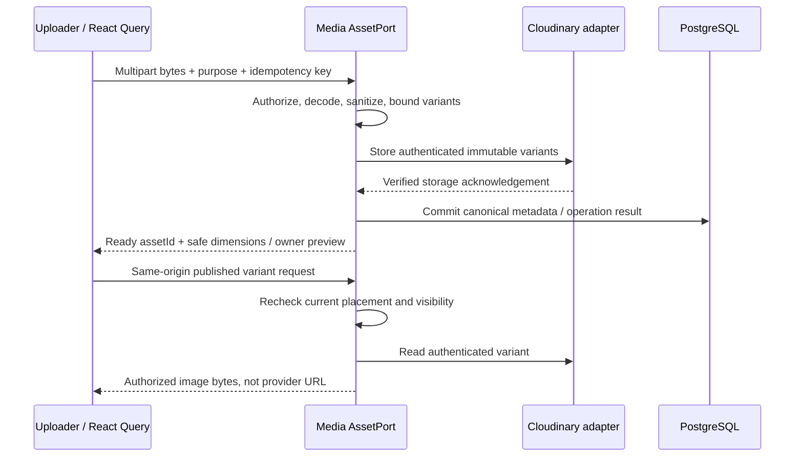

# Media and maps integration contract

**Decision: 2026-11-12, confirmed by the user.** Cloudinary for public-purpose
images; YouTube/Instagram link embeds for videos; Leaflet with OpenStreetMap
for maps. Direct video uploads are disabled. These are implementation
requirements, not a claim that adapters, credentials or runtime UI exist.

## Contents

- [Choices and boundaries](#choices-and-boundaries)
- [Cloudinary public images](#cloudinary-public-images)
- [YouTube and Instagram embeds](#youtube-and-instagram-embeds)
- [Leaflet and OpenStreetMap](#leaflet-and-openstreetmap)
- [Configuration and readiness](#configuration-and-readiness)
- [Manual acceptance](#manual-acceptance)
- [Provider references](#provider-references)

## Choices and boundaries

| Area | Selected approach and reason | Alternative / when to switch |
|---|---|---|
| Public-purpose images | Cloudinary behind `StoragePort`; reuse Media's existing sanitizer, asset identity and publication gateway | S3-compatible image storage only after an approved provider change justified by cost, residency or capability |
| Private documents | Existing private-storage boundary for KYC, dispute evidence and account exports; never send these to Cloudinary | Production private-storage vendor/residency/retention remain separate decisions |
| Videos / Reels | YouTube watch/Shorts and Instagram Reels/public posts; no hosted video files or transcoding pipeline | Direct hosting requires a new user-approved scope, limits, processing states, cost and retention decision |
| Interactive maps | `leaflet` (BSD-2-Clause), shared React client-only wrapper; small raster maps suit discovery and zone editing | MapLibre GL JS only if measured vector/large-dataset requirements justify it |
| Polygon editing | `@geoman-io/leaflet-geoman-free` (MIT), free drawing/editing features only | No Pro features or paid dependency without approval |
| Map tiles | OpenStreetMap standard tiles for policy-compliant interactive use | An approved tile provider or self-hosting when capacity, availability or offline requirements demand it; hosting is not guaranteed free |

Use the existing [Media BE/FE](../media-videos/be/media-videos.md) and
[Geo BE/FE](../geo/be/geo.md) contracts and their F/S/BR IDs. Consumers are
Businesses, Products, Services, Catalog, Offers, Reviews, Search, Delivery
and Admin; no new domain module or duplicate asset/map implementation.
The [React Query contract](./frontend-shared.md#api-integration-with-react-query)
and [verification policy](../../AGENTS.md#4-hard-limits-non-negotiable)
remain mandatory.

## Cloudinary public images

### Ownership and upload

1. Media's `AssetPort` is the only asset entry point. Cloudinary implements
   the image capability of `StoragePort` under the API integrations layer;
   no controller, feature service, React component or consumer imports its SDK.
2. Allowed Cloudinary purposes are `product`, `service`, `gallery`,
   `business_profile`, `offer_banner`, `catalog_taxonomy`, `video_thumbnail`
   and `review_photo`. The server chooses the adapter from the purpose.
   `kyc_document`, `case_evidence` and Users' export archives stay private
   and separate, regardless of their file extension.
3. Keep the existing authenticated/CSRF-protected multipart upload and
   purpose/owner/business/scope checks. Upload file bytes through ApnaTown,
   not a Cloudinary Upload Widget, unsigned preset, browser upload signature,
   arbitrary remote URL, client `public_id` or client transformation string.
4. Apply the exact [public image policy](../media-videos/be/media-videos.md#public-image-policy):
   content sniff and complete decode, input/pixel/concurrency limits,
   orientation normalization, EXIF/GPS removal, static WebP variants and byte
   ceilings. Only sanitized variants leave the server; never upload or serve
   the original. Cloudinary does not replace these checks.
5. Upload each finished variant with authenticated server credentials,
   `resource_type=image`, delivery `type=authenticated`, server-generated
   immutable IDs and `overwrite=false`. Persist Cloudinary asset ID, public
   ID, version and delivery type only as private provider metadata beneath
   the canonical `assetId`/variant descriptor. Do not enable remote fetching
   or arbitrary on-demand transformations.
6. External calls run outside DB locks. Return `ready` only after every
   variant is acknowledged and metadata commits. Reauthorize idempotent
   retries; reconcile uncertain provider outcomes using the same server-owned
   operation/asset identity rather than uploading duplicate variants.
   Failed replacements retain the prior attachment. Targeted, durable orphan
   cleanup deletes only that operation's uncommitted objects.

### Delivery, preview and revocation

- "Public-purpose" is an application classification, not Cloudinary public
  delivery. Use **authenticated**, not `upload` or `private` delivery:
  Cloudinary's `private` type can leave derivatives public, and an exposed
  signed delivery URL is shareable rather than a live authorization check.
- Browsers receive only `MediaPublicAssetDTO`/`PublicImageVariantDTO.path`.
  The same-origin Media gateway authorizes the current exact placement,
  owner status, moderation and surface consent before fetching authenticated
  bytes from Cloudinary. Never redirect a public image or owner preview to
  Cloudinary, return its URL/signature, or use a Cloudinary Next.js loader.
- Cloudinary image previews use a same-origin owner-authorized, no-store
  view; this is separate from the existing short-lived private-document
  capability. Preserve current authorization for GET, HEAD, conditional and
  range requests; no browser/CDN/Next image cache may bypass revocation.
- Retain intrinsic dimensions and approved responsive variants. Static
  design assets are unaffected. Account erasure and moderation use existing
  owner events/retention checks; don't delete historical referenced assets
  or private documents because an image attachment was replaced.
- Bound SDK requests and retries; redact credentials, provider URLs,
  signatures and file content from logs. Missing configuration uses
  `MEDIA_UPLOAD_POLICY_REQUIRED`; transient storage failure uses
  `MEDIA_STORAGE_UNAVAILABLE` (503, `errors.media.storageUnavailable`).
  Never return a success-shaped placeholder or silently switch providers.

## YouTube and Instagram embeds

### Source validation and response contract

- Launch `VideoSource` is `{kind:'youtube'|'instagram',url:string}` only.
  Reject file/video upload fields and `video_file` purposes server-side;
  the prototype's video-file control stays disabled with an explanation.
  Image thumbnails still use Cloudinary. No Cloudinary video upload,
  downloaded provider video, scraping or unofficial media extraction.
- Parse URLs, not substring matches. Require HTTPS, no credentials or
  nonstandard port, exact allow-listed hosts and one valid provider ID.
  YouTube: `youtube.com`, `www.youtube.com`, `m.youtube.com`, `youtu.be`;
  accept `/watch?v=`, `/shorts/{id}` and the short-share path with an
  11-character `[A-Za-z0-9_-]` ID. Instagram: `instagram.com` or
  `www.instagram.com`, `/reel/{shortcode}/` or `/p/{shortcode}/`, bounded
  `[A-Za-z0-9_-]` shortcode. Profiles, stories, playlists, legacy `/tv/`,
  malformed IDs and lookalike/suffix hosts are not launch video inputs.
- Store provider/kind/ID, not raw HTML or the submitted URL. Discard tracking
  query/fragment data. Rebuild all playback and Open links server-side;
  invalid input returns the existing Media validation error, never a raw-link
  fallback. A fallback is only for a valid provider source that cannot embed.
- `VideoPlaybackDTO` is a shared discriminated union:
  `{provider:'youtube',render:'iframe',embedUrl,openUrl}` |
  `{provider:'instagram',render:'instagram',permalink,openUrl}` |
  `{provider:'youtube'|'instagram',render:'fallback',openUrl,reason:'disabled'|'unavailable'}`.
  Every URL comes from the approved builder. FE cannot substitute raw input.

### Provider rendering and configuration

- YouTube uses `https://www.youtube-nocookie.com/embed/{id}` and canonical
  `https://www.youtube.com/watch?v={id}` Open links. Basic embeds need no
  YouTube Data API key. If playback controls use the official IFrame API,
  enable it with the configured exact app origin; validate message origin
  and source, keep provider controls/branding, and respect player dimensions.
- Instagram uses the canonical `/reel/{id}/` or `/p/{id}/` permalink,
  application-created `instagram-media` markup and the single trusted
  `https://www.instagram.com/embed.js` loader. Never inject submitted or
  oEmbed-returned HTML. Standard embeds need no Meta token; Graph/oEmbed
  access is **not selected** and must not become an undocumented dependency.
- Private/deleted/restricted content, embeds disabled by the publisher,
  provider outage, blocked script, load timeout or disabled integration show
  the safe Open link/unavailable state. A valid URL does not prove a video
  exists, is embeddable or has been moderated.
- Share one lazy `EmbedCard`/`ReelsPlayer` provider renderer. Only the active
  item may load/play; unmount off-screen Instagram frames and clean up SDK
  listeners. Preserve frozen ranking, deep-link anchoring, pending approval
  and per-surface owner consent. Viewer third-party consent remains
  Users-owned and is not implied by the vendor's Gallery/Reels toggle.
- Autoplay/mute/seek controls are capability-dependent: use supported
  YouTube controls; Instagram retains native interaction, with no promise
  of programmatic autoplay/mute/progress or playback telemetry. Save-Data,
  denied required consent and browser autoplay restrictions retain tap-to-play
  or fallback. Do not equate first-party view signals with provider analytics.
- Apply narrowly scoped CSP: known YouTube/Instagram frame origins and,
  only where their SDK is used, their exact script origins. No wildcards,
  `unsafe-eval`, raw embed HTML or global CSP relaxation. Minimize iframe
  permissions per provider; preserve origin referrers needed by embeds using
  `strict-origin-when-cross-origin`, without leaking paths or location.

## Leaflet and OpenStreetMap

Explore now uses `packages/ui/src/geo/MapView.tsx` with locally bundled
Leaflet 1.9.4 and typed props; the wrapper supplies pins, radius, Directions
and list fallback. This read-only integration does not install Geoman or
claim zone editing/live delivery implementation.

- Implement one client-only `MapView` and reuse it for Explore, address/
  business pins, city zones and live-delivery maps. Lazy-import Leaflet
  inside a client boundary; no `window` access during SSR. Clean up the
  map/listeners on unmount and handle container resizing.
- Use direct Leaflet bindings in the shared React component. `react-leaflet`
  is not assumed to be MIT/BSD: its current Hippocratic license requires
  separate acceptance before adoption. Pin a compatible stable Leaflet/
  Geoman pair at implementation; bundle assets locally, not `latest` CDN scripts.
- Geoman Free powers polygon draw/edit. Keep undo/cancel/save, editable
  coordinates and keyboard/list alternatives; never require a paid Pro
  feature. Enable editing only for authorized zone operations. GeoJSON is
  `[longitude,latitude]`; convert explicitly from Leaflet coordinates.
  PostGIS validates SRID 4326, bounds, closure, validity and overlaps.
- Tiles render the basemap only. City/area/PIN lookup, serviceability,
  distances and fees remain ApnaTown/PostGIS-owned. Leaflet/OSM is not a
  geocoding, routing or traffic service. No public Nominatim autocomplete
  or new routing API is selected; keep manual entry and device-map Directions.
- Standard tile URL: `https://tile.openstreetmap.org/{z}/{x}/{y}.png`.
  Keep visible linked `OpenStreetMap contributors` attribution. Use HTTPS,
  the browser's real User-Agent and an origin-only Referer; never strip it
  with `no-referrer`. Honor tile HTTP cache headers; do not apply private
  API `no-store` rules to public tiles.
- No bulk/offline tile downloads, viewport-ahead prefetch, service-worker
  tile caching or attempts to evade limits. Browser HTTP caching remains
  allowed. Standard OSM tiles have no SLA/unlimited-free promise; change
  the approved deploy-time tile configuration before traffic/availability
  requirements exceed the policy. Self-hosting also has operating costs.
- API results/mutations remain React Query-owned; maps consume typed props,
  not their own API fetch/store. Location is optional and precise coordinates
  stay out of public URLs/logs/analytics. Explain third-party map loading;
  a tile failure must preserve list/manual entry and show retry, never
  fabricate zero results or zero delivery availability.
- CSP permits the exact configured tile origin under `img-src`. Escape
  marker/popup text and attribution; no client-supplied tile URL, HTML or
  arbitrary server-side tile proxy. Retain normal app CSP everywhere else.

## Configuration and readiness

Map keys below are implemented in Web's typed config, launcher allow-lists
and `.env.example`. The exact validated tile origin is added to CSP and only
public map configuration reaches the client. Operators must verify the chosen
tile provider's policy, attribution, supported zoom and traffic capacity
before deployment; standard OSM has no SLA. No account provisioning or live
provider readiness checks were performed during implementation.

| Key / setting | Owner and rule |
|---|---|
| `CLOUDINARY_CLOUD_NAME`, `CLOUDINARY_API_KEY`, `CLOUDINARY_API_SECRET` | API/worker adapter only; require the full tuple for Cloudinary readiness; never `NEXT_PUBLIC_*`, logs, DB settings or API responses |
| `YOUTUBE_EMBEDS_ENABLED`, `INSTAGRAM_EMBEDS_ENABLED` | Typed API configuration, default enabled for validated links; Media builds the enabled renderer or canonical fallback. Flags grant no publication permission |
| `MAP_TILE_URL_TEMPLATE` | Web server config, default standard OSM URL; HTTPS allow-listed deployment host, only `{z}/{x}/{y}` substitutions; project the validated public template to MapView |
| `MAP_TILE_ATTRIBUTION_TEXT`, `MAP_TILE_ATTRIBUTION_URL` | Web server config; defaults `OpenStreetMap contributors` and `https://www.openstreetmap.org/copyright`; escaped text and validated HTTPS link, not raw HTML |
| `MAP_TILE_MAX_ZOOM` | Web server config; standard OSM default 19; validate against the chosen provider's supported range |
| Existing `PRIVATE_STORAGE_ADAPTER` and private-storage credentials | Unchanged; never repurpose these as Cloudinary credentials or migrate private archives/documents to public-image storage |

Malformed configured values fail explicitly. Missing Cloudinary setup disables
image upload with the existing readiness/error UI, not login, browse or embeds.
Settings' image readiness includes Cloudinary capability/configuration; the
admin receives readiness/missing-field names only, never credential values.
Cloudinary plan quotas, residency and deletion guarantees require operator
verification; do not promise unlimited free image storage or make live calls
from default local verification. No video-hosting readiness toggle is exposed.

## Manual acceptance

Follow the existing non-test verification policy; **no unit, integration, DB
or Playwright test files**. Record actual results, not inferred readiness.

| Given / when | Required outcome |
|---|---|
| Valid image, exact size/pixel boundaries, spoofed MIME, animation or EXIF | Existing Media policy accepts only sanitized in-policy variants; no original reaches Cloudinary |
| Missing credentials, timeout, quota failure or repeated upload | Explicit unavailable/error; no false ready/duplicate attachment, previous image survives, orphan reconciliation is bounded |
| KYC/evidence/export or a foreign asset/purpose is submitted | No Cloudinary request; owning private/authorization rules still apply |
| Publication/consent is revoked; old image path, HEAD, range or conditional request is replayed | Current gateway denial; no public provider URL or cache bypass |
| Valid YouTube watch/Shorts or Instagram Reel/post is submitted | Pending review; only current approved/consented placements receive typed safe playback |
| Spoofed host, `javascript:`, raw HTML, story, profile or direct video file is submitted | Typed rejection, no arbitrary fetch/iframe/fallback or video upload |
| Embed fails, Save-Data is set, or Instagram lacks a custom player capability | Usable poster/Open/native controls; no unsupported autoplay claim or fabricated metrics |
| SSR, keyboard use, Hindi/dark layouts, GPS denial and failed tiles | No browser-global SSR error; list/manual entry stays usable; attribution remains visible |
| Polygon coordinates are reversed, invalid or overlapping; zone save is forged | Server rejection with edits preserved; Leaflet never authorizes or computes the fee |
| Rider PWA/offline mode or many map views | No bulk/service-worker tile caching; policy-compliant HTTP caching and explicit failure/retry |

## Provider references

- [Cloudinary upload](https://cloudinary.com/documentation/upload_images) and
  [access methods](https://cloudinary.com/documentation/control_access_to_media).
- [YouTube player parameters](https://developers.google.com/youtube/player_parameters)
  and [IFrame API](https://developers.google.com/youtube/iframe_api_reference).
- [Instagram embeds and limitations](https://developers.facebook.com/docs/instagram-platform/oembed).
- [Leaflet](https://leafletjs.com/) and [BSD license](https://github.com/Leaflet/Leaflet/blob/main/LICENSE).
- [Geoman Free](https://geoman.io/docs/leaflet/getting-started/free-version)
  and [MIT license](https://github.com/geoman-io/leaflet-geoman/blob/develop/LICENSE).
- [React Leaflet license](https://github.com/PaulLeCam/react-leaflet/blob/master/LICENSE.md).
- [OSM tile usage policy](https://operations.osmfoundation.org/policies/tiles/).
